# Les algorithmes d'Obscyro

Chaque algorithme du produit a ici sa section : à quoi il sert, son schéma, ses règles, où il vit dans le code et quels tests le tiennent.

**Ce fichier se met à jour avec le code.** Ajouter, modifier ou supprimer un algorithme, c'est aussi ajouter, modifier ou supprimer sa section et son schéma, dans le même commit (voir [CLAUDE.md](../CLAUDE.md)). Un schéma se dessine d'après le code qu'on vient de lire.

## Table

| Réf. | Algorithme | Fichier principal |
|---|---|---|
| **A** | **Aide à la décision, page Scenarios** | |
| [A1](#a1-boucle-de-lanalyste) | Boucle de l'analyste | `backend/src/services/analyst.ts` |
| [A2](#a2-vérificateur-de-chiffres) | Vérificateur de chiffres | `backend/src/services/analyst-verify.ts` |
| [A3](#a3-calculatrice) | Calculatrice | `backend/src/services/analyst-calc.ts` |
| [A4](#a4-run-dun-scénario) | Run d'un scénario, en deux passes, sur la page et sur le serveur | `frontend/app/studio/simulation/hex/engine.ts`, `backend/src/services/scenario-run.ts` |
| [A5](#a5-où-ça-casse) | Où ça casse : lecture des files | `frontend/app/studio/simulation/hex/results.ts` |
| [A6](#a6-comparaison-à-la-réalité) | Comparaison à la réalité | `backend/src/services/observed-series.ts` |
| [A7](#a7-grille-dhexagones-et-couches) | Grille d'hexagones et couches | `frontend/app/studio/simulation/hex/hex-grid.ts` |
| [A8](#a8-options-testées-par-le-moteur) | Options testées par le moteur | `backend/src/services/analyst-options.ts` |
| [A9](#a9-décision-enregistrée-et-suivi) | Décision enregistrée et suivi | `backend/src/services/decisions.ts` |
| [A10](#a10-recherche-en-ligne-et-calendrier-dévénements) | Recherche en ligne validée et calendrier d'événements | `backend/src/services/analyst-events.ts` |
| **B** | **Jumeau et moteur de simulation** | |
| [B1](#b1-export-du-jumeau) | Export du jumeau vers le moteur | `backend/src/services/twin-export.ts` |
| [B2](#b2-un-pas-du-moteur-dévénements) | Un pas du moteur d'événements | `simulation-service/app/events/dynamics.py` |
| [B3](#b3-propagation) | Propagation entre états déclarés | `simulation-service/app/events/spread.py` |
| [B4](#b4-politiques-score-et-comparaison) | Politiques, score et comparaison | `simulation-service/app/events/policy.py` |
| [B5](#b5-scénario-en-surcouche) | Scénario en surcouche du jumeau | `backend/src/services/scenario-overrides.ts` |
| [B6](#b6-événement-tiré-dune-série-observée) | Événement tiré d'une série observée | `backend/src/services/sim-event-from-rows.ts` |
| **C** | **Prévision et laboratoire** | |
| [C1](#c1-boucle-de-prévision-quotidienne) | Boucle de prévision quotidienne | `backend/src/services/forecast-loops.ts` |
| [C2](#c2-prévision-dune-série-et-apprentissage-sur-table) | Prévision d'une série, apprentissage sur table | `simulation-service/app/lab/timeseries.py` |
| [C3](#c3-signaux-précurseurs) | Signaux précurseurs : décalage et réplication | `backend/src/services/lag-scan.ts` |
| [C4](#c4-laboratoire-causal) | Laboratoire causal | `backend/src/services/causal-lab.ts` |
| [C5](#c5-simulation-hybride) | Simulation hybride, graphe de modèles | `simulation-service/app/runner.py` |
| **D** | **Données** | |
| [D1](#d1-extraction-clinique) | Extraction clinique d'un texte | `nlp-service/app/main.py` |
| [D2](#d2-pipelines-de-données) | Pipelines de données | `backend/src/services/pipeline.ts` |
| [D3](#d3-identité-des-objets) | Identité des objets | `backend/src/services/identity.ts` |
| [D4](#d4-qualité-des-données) | Qualité des données, six couches | `backend/src/services/data-quality.ts` |
| [D5](#d5-alertes-du-jumeau-et-signaux) | Alertes du jumeau et signaux | `backend/src/services/twin-alert-scheduler.ts` |
| [D6](#d6-métriques-du-jumeau) | Métriques du jumeau | `backend/src/services/twin-metrics.ts` |
| [D7](#d7-fraîcheur-dune-valeur) | Fraîcheur d'une valeur | `backend/src/services/observed-at.ts` |
| [D8](#d8-correspondance-de-zones) | Correspondance de zones | `backend/src/services/zone-correspondence.ts` |

---

# A. Aide à la décision, page Scenarios

## A1. Boucle de l'analyste

**But.** Répondre à une question sur le jumeau, le scénario ouvert ou le run à l'écran, en ne s'appuyant que sur ce que des outils ont renvoyé. Le modèle de langage choisit quoi lire et rédige ; il ne détient aucun fait, ne calcule pas et ne décide pas. Détail : [analyst.md](analyst.md).

La même boucle sert trois sortes d'échanges. Ce qui les distingue est leur **clôture** : les consignes données au modèle, l'outil par lequel il livre, et la façon dont cette livraison est contrôlée. Une question se clôt par `give_answer` ; un objectif se clôt par `give_options`, après des tests (A8) ; une recherche d'événements se clôt par `give_events`, après des recherches en ligne (A10).

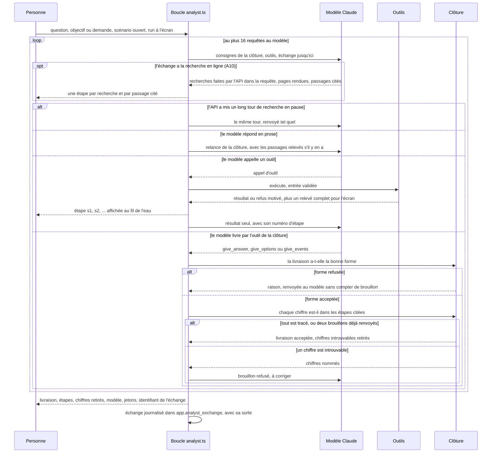

**Règles.**
- Modèle `claude-opus-5-5`, effort `medium`, choix d'outil libre. Une demande refusée par un garde-fou est rejouée sur le modèle de repli prévu par l'API (`fallbacks: "default"`).
- Au plus 16 requêtes au modèle par échange, et 2 brouillons renvoyés pour chiffres introuvables.
- La livraison passe par l'outil de la clôture, seul dans son tour. Une réponse en prose est redemandée une fois, puis abandonnée. Deux fois quand l'échange cherche en ligne : la prose y est une étape, c'est d'elle que viennent les passages cités (A10).
- La recherche en ligne n'est pas exécutée par la boucle mais par l'API, à l'intérieur d'une requête. La boucle lit dans chaque réponse ce que l'API a cherché, les pages rendues et les passages cités, et en fait des étapes numérotées comme les autres. Une page rendue ne porte aucun chiffre citable ; seul un passage en porte.
- Un tour que l'API met en pause (`pause_turn`) lui est renvoyé tel quel, sans un mot de notre part : un message ajouté fermerait le tour. Une livraison demandée en même temps qu'une recherche est refusée une fois, le temps que la recherche tourne.
- Un refus d'outil (nom inconnu, pas de run à l'écran) est une étape que le modèle lit ; il ne porte aucun chiffre citable. Une panne de notre côté n'est jamais déguisée en refus.
- Un outil peut garder, à côté de son résultat, un relevé complet (`Recorded`) : il est affiché et journalisé, jamais envoyé au modèle. Aucune phrase ne peut donc s'appuyer dessus.
- Un refus du modèle ne produit aucune réponse inventée.
- Si la personne part, plus rien n'est demandé au modèle.
- L'identifiant de l'échange est choisi avant de commencer et part avec la dernière ligne du flux : c'est lui qu'une décision nommera (A9).

**Code.** `backend/src/services/analyst.ts` (`converse`, `Closing`, `askClosing`), `analyst-web.ts` (`WebReader`), `backend/src/routes/analyst.ts`, `backend/src/lib/ndjson.ts`, `frontend/app/studio/simulation/hex/AnalystPanel.tsx`.
**Tests.** `analyst.unit.test.ts`, `analyst-options.unit.test.ts`, `analyst-events.unit.test.ts`, `analyst-web.unit.test.ts`, `routes/analyst.unit.test.ts`, `lib/ndjson.unit.test.ts`, `AnalystPanel.test.tsx`.

## A2. Vérificateur de chiffres

**But.** Empêcher qu'un chiffre arrive à l'écran sans qu'un outil l'ait renvoyé, ou à côté du mauvais nom. Chaque paragraphe est contrôlé contre les étapes qu'il cite lui-même, pas contre tout ce qui a été lu : c'est ce qui donne un sens à une puce de source.

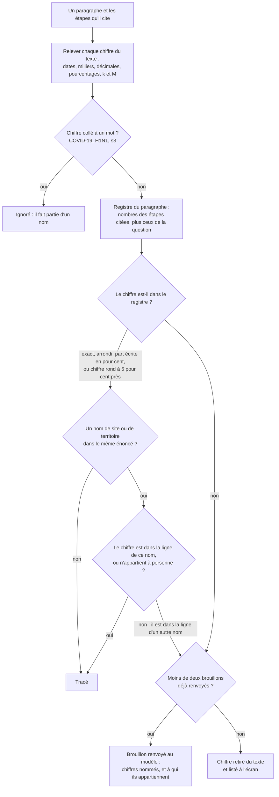

**Règles.**
- Le registre d'une étape contient : chaque nombre du résultat, chaque nombre écrit dans une chaîne, chaque date et ses parties (année, mois, jour), et la longueur de chaque liste.
- Arrondi admis : « 94 » pour 93,6 ; « 94 % » pour une part de 0,941 ; « 6 000 » pour 5 999. Un chiffre rond ne peut pas s'écarter de plus de 5 % : « 100 » ne vaut pas pour 60.
- Les hypothèses et les limites ne citent pas d'étape : elles sont contrôlées contre tout ce qui a été lu.
- **À qui est le chiffre.** Un résultat d'outil est fait de lignes qui portent un nom (un site, un territoire). Le texte est coupé en énoncés, aux fins de phrase, aux virgules et aux mots qui joignent deux énoncés. Un chiffre écrit dans le même énoncé qu'un nom est fautif quand trois choses sont vraies : aucune ligne de ce nom ne le contient, il n'est pas un chiffre qui n'appartient à personne (un total, la question, un calcul), et la ligne d'un autre nom le contient. Le contrôle attrape donc une interversion, et se tait quand il ne peut pas trancher.
- Un nom se reconnaît à ses mots distinctifs (« lakeshore », « santa cabrini »), sans casse ni accents. Un nom fait seulement de mots communs à tous (« Hôpital général de Montréal ») n'attribue rien.
- **Ce que le contrôle prouve :** le chiffre existe dans un résultat d'outil cité, et pas dans la ligne d'un autre nom que celui à côté duquel il est écrit. **Ce qu'il ne prouve pas :** que la phrase autour est juste. C'est pourquoi chaque étape reste consultable sous la réponse.
- Origine de la règle d'attribution : la première réponse donnée en production, tous chiffres « trouvés », donnait à Lachine le jour de LaSalle.
- **Ce qui vient du web.** Le registre d'un passage cité contient les chiffres du passage et du titre de sa page, et les dates qu'ils écrivent en toutes lettres (« 31 décembre 2021 » vaut 2021-12-31) ; jamais les chiffres de l'adresse de la page. Un chiffre venu du web doit donc se trouver dans le passage cité. Les règles propres aux candidats (citation mot pour mot, date énoncée) sont en A10.

**Code.** `backend/src/services/analyst-verify.ts`. **Tests.** `analyst-verify.unit.test.ts`.

## A3. Calculatrice

**But.** Faire les calculs à la place du modèle, et refuser de calculer sur un nombre qui ne vient de nulle part.

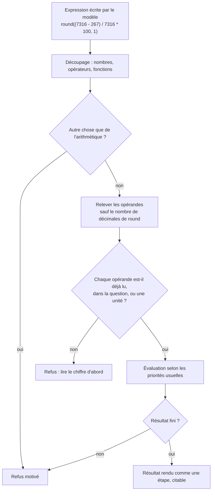

**Règles.** Opérateurs `+ - * / ^` et parenthèses. Fonctions `round, abs, sqrt, floor, ceil, min, max, sum, mean`. Aucune variable, aucun accès à quoi que ce soit, rien n'est exécuté comme du code. Unités admises sans source : 0, 1, 2, 7, 10, 24, 100, 1000.

**Code.** `backend/src/services/analyst-calc.ts`, outil `calculate` dans `analyst-tools.ts`. **Tests.** `analyst-calc.unit.test.ts`, `analyst-tools.unit.test.ts`.

## A4. Run d'un scénario

**But.** Dire ce que les choix du planificateur changent. Le scénario passe deux fois dans le moteur : une fois avec ce qui arrive à la ville, une fois avec les choix en plus. La différence entre les deux est l'effet des choix, construit plutôt que déduit.

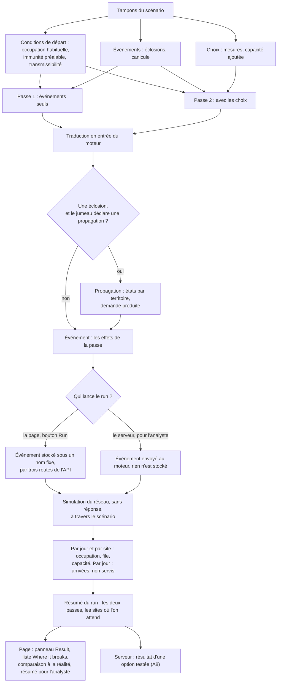

**Règles.**
- Les conditions sont dans les deux passes : elles disent d'où l'on part, pas ce qu'on choisit.
- Le moteur n'ensemence qu'une fois : toutes les éclosions partent du jour de la première, et l'écran le dit.
- Deux conditions du même genre : la plus haute l'emporte, et l'écran le dit.
- Sur la page, les deux événements stockés sont réécrits à chaque run sous un nom fixe. Sur le serveur, rien n'est stocké : une option testée n'est pas un événement de la bibliothèque, et l'analyste n'écrit rien.
- L'occupation de l'île est pondérée par la capacité de chaque site, capacité ajoutée comprise à partir du jour où elle ouvre.
- Les deux côtés lisent le jumeau de la même façon : le contexte (sites, territoires, modèle déclaré) vient du jumeau tel qu'il est, et le moteur reçoit le jumeau lu à travers le scénario.

**Le même scénario donne les mêmes chiffres sur la page et sur le serveur.** La traduction des tampons et la lecture des tables existent en deux exemplaires, un par côté. Ce qui les tient ensemble est un enregistrement du vrai moteur, `backend/src/services/scenario-run-parity.fixture.json` : un petit jumeau, un scénario, une option, ce que chaque run demande au moteur, ce que le moteur répond, et le résumé qui en sort. Le test du serveur et celui de la page le rejouent tous les deux, chacun avec son propre code. Chacun doit envoyer au moteur les demandes enregistrées et retrouver les chiffres enregistrés : changer un côté seul fait échouer l'autre.

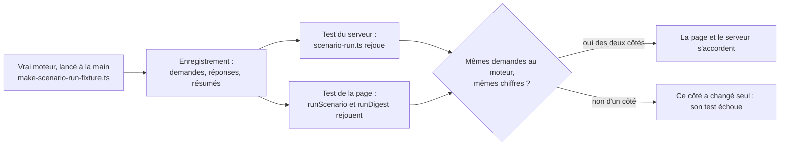

L'enregistrement contient deux runs : le scénario tel quel, et le scénario avec les tampons de l'option. Le second est ce qui garantit qu'ajouter une option testée au scénario puis lancer Run redonne les chiffres du test. Il se régénère à la main quand le moteur ou la traduction change (`cd backend && npx tsx scripts/make-scenario-run-fixture.ts`, avec Python et les dépendances du service de simulation), puis on relance les deux suites.

Sur le serveur, le run existe en deux formes. `ScenarioRunner.digest` fait les deux passes, comme la page : c'est lui que le test de parité rejoue. `ScenarioRunner.full` ne fait que la passe « avec les choix » : c'est ce que lit une option testée (A8), parce que le tableau des options compare le scénario avec ses choix au scénario avec l'option en plus, et que la passe « événements seuls » n'y montre rien. Les deux formes passent par le même résumé d'une passe (`passFigures`), donc une colonne du tableau ne peut pas différer de ce que Run affiche pour la même passe ; un test le vérifie sur l'enregistrement.

Tester plusieurs options ne refait pas tout : une propagation est gardée d'après ce qu'on lui a demandé, donc une option qui n'ajoute que des lits ne réintègre pas l'épidémie. Chaque appel au moteur est chronométré (`timings`), pour que la durée d'un test soit une mesure et pas une impression.

**Code.** Page : `frontend/app/studio/simulation/hex/engine.ts` (`runScenario`), `stamps.ts` (`engineInput`), `run-digest.ts`. Serveur : `backend/src/services/scenario-run.ts` (`ScenarioRunner`), `scenario-stamps.ts` (`engineInput`, `twinContext`), `scenario-run-recording.ts`. Enregistrement : `backend/scripts/make-scenario-run-fixture.ts`, `simulation-service/scripts/engine_once.py`.
**Tests.** `hex.test.ts`, `HexTwinView.test.tsx`, `run-parity.test.ts` (page) ; `scenario-run.unit.test.ts` (serveur).

## A5. Où ça casse

**But.** Un pic à 96 % sur l'ensemble des sites dit que le réseau a tenu. Il ne dit pas que quatre hôpitaux ont été pleins trois semaines. L'occupation plafonne à 100 % et se tait sur ceux qu'on a refusés : c'est la file, site par site, qui le dit.

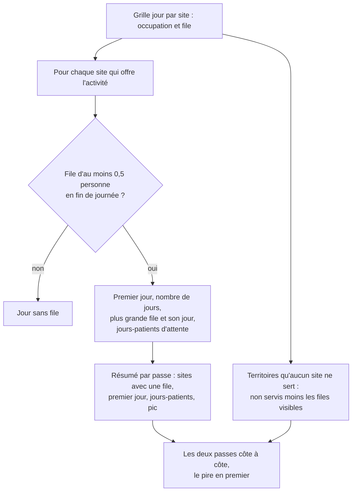

**Règles.** Une file sous 0,5 est de l'arithmétique, pas une personne. Un jour-patient d'attente compte une personne qui attend un jour : une personne trois jours compte trois. Un territoire sans site pour l'activité n'apparaît dans aucune ligne du moteur : il est nommé à part, pour qu'un dixième de l'île n'attende pas sous un panneau qui dit que personne n'attend.

**Code.** `frontend/app/studio/simulation/hex/results.ts`, `BreakList.tsx`. **Tests.** `results.test.ts`.

## A6. Comparaison à la réalité

**But.** Poser une série observée sur l'axe du run et dire à quel point les deux s'écartent, en commençant par ce qui trompe le moins.

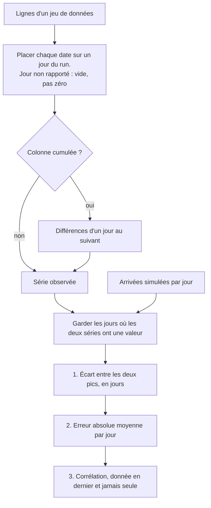

**Règles.** Une date répétée : la dernière ligne l'emporte, on ne somme pas. Deux courbes qui montent puis descendent se corrèlent fortement que le modèle soit juste ou non : la corrélation ne vient qu'en dernier. Un calage après coup n'est pas une prévision, et l'écran le dit.

**Code.** `backend/src/services/observed-series.ts`, route `POST /v1/ontology/:env/observed-series`, `frontend/app/studio/simulation/hex/RealityCheck.tsx`. **Tests.** `observed-series.unit.test.ts`.

## A7. Grille d'hexagones et couches

**But.** Une seule grille pour tout ce qui se montre sur la carte : une lecture de civières, la population d'un territoire et une mesure dessinée tombent sur les mêmes cellules, donc se superposent sans jointure.

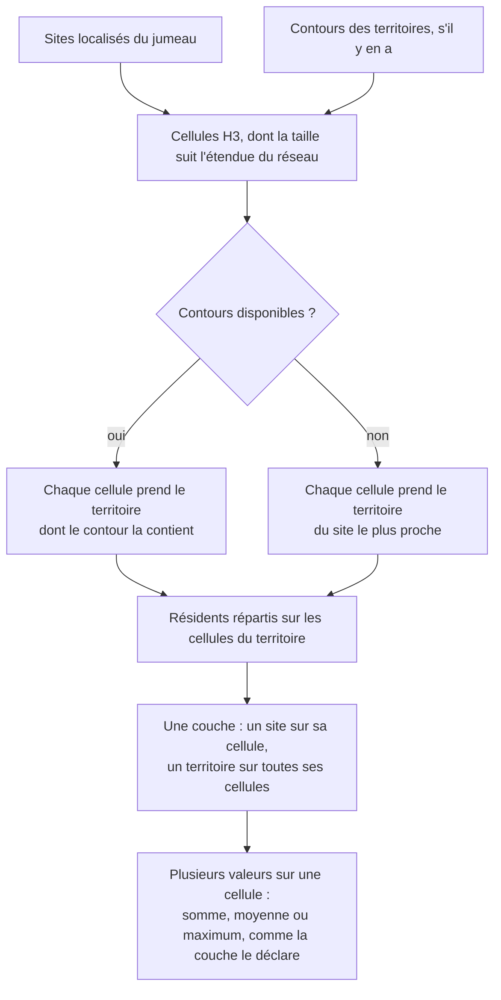

**Règles.** La grille est construite depuis le jumeau, jamais livrée avec le client. La façon de combiner est déclarée par la couche : des lits s'additionnent, une température non.

**Code.** `frontend/app/studio/simulation/hex/hex-grid.ts`, `layers.ts`, `backend/src/services/twin-layers.ts`. **Tests.** `hex.test.ts`, `twin-layers.unit.test.ts`.

## A8. Options testées par le moteur

**But.** Une recommandation qui ne repose sur aucun run est une opinion. La personne dit son objectif ; l'analyste propose jusqu'à trois options, et chacune passe dans le moteur avant d'être montrée, à côté du scénario tel quel. Le modèle écrit des phrases ; les chiffres du tableau, les tampons et les niveaux de preuve viennent du programme.

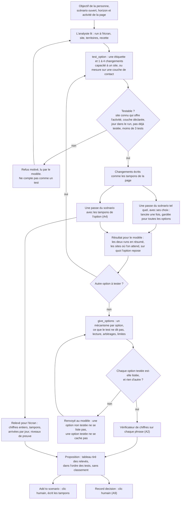

**Règles.**
- Trois options au plus par objectif, quatre changements au plus par option. Chaque test coûte au moteur une passe du réseau, plus une propagation si l'option change un contact ; le scénario tel quel coûte une passe, une seule fois. Trois options font donc quatre passes. La passe « événements seuls » que fait Run sur la page n'est pas lancée : rien dans le tableau ne la lit.
- Les passes se suivent, elles ne tournent pas en même temps. Le service de simulation est un seul processus : mesuré en local, lancer deux passes ensemble ne gagne que 18 % sur les lancer l'une après l'autre, pour deux fois la mémoire.
- Chaque test garde dans son relevé de quoi sa durée était faite : la lecture du jumeau (au premier test seulement), puis chaque appel au moteur. Ce relevé va au journal, pas au modèle.
- Une capacité se teste à un site qui offre déjà l'activité ; négative, elle ferme des unités, jamais plus que le site n'en a. Une mesure se teste sur une couche de contact que le jumeau déclare.
- Un refus du moteur (un scénario sans événement, par exemple) est lu par le modèle. Un moteur injoignable est une panne : l'échange s'arrête et le dit, sans option inventée.
- Le niveau de preuve de chaque élément est attribué par le programme, d'après d'où il vient : **mesuré** pour ce que le jumeau contient (unités d'un site, résidents d'un territoire), **publié** pour le taux d'une canicule, **hypothèse** pour les conditions du scénario, les choix, l'option elle-même et la règle de routage du moteur. Le modèle n'en choisit aucun.
- Le mécanisme d'une option est contrôlé contre le résultat de son propre test ; la lecture, contre les étapes qu'elle cite ; le reste, contre tout ce qui a été lu. Un chiffre de l'objectif appartient à la personne et peut être repris.
- Le mécanisme et la lecture reçoivent les deux contrôles du vérificateur (A2), comme les paragraphes d'une réponse : un chiffre que personne n'a renvoyé, et un chiffre qui existe mais qui est écrit à côté du mauvais site ou du mauvais territoire.
- Le tableau suit l'ordre des tests. Rien ne classe les options : dire lesquelles atteignent l'objectif d'après les runs est une lecture, choisir entre elles revient à la personne. Les arbitrages de valeur sont présentés à part, comme tels.
- L'analyste n'écrit rien. Une option entre dans le scénario au clic « Add to scenario », écrite comme un tampon posé sur la carte ; Run redonne alors les chiffres du test (A4). Si le scénario n'est plus celui qui a été testé, l'écran dit lequel des trois cas c'est : une option ajoutée depuis l'onglet (Run doit redonner sa colonne, les autres colonnes ne décrivent plus ce scénario), plusieurs options ajoutées ensemble (aucun test ne les a couvertes ensemble), ou une modification faite ailleurs (toutes les colonnes sont dépassées).
- Un run n'est pas une prévision : le tableau le porte dans son titre.

**Code.** `backend/src/services/analyst-options.ts` (`testOption`, `benchFor`, `optionsClosing`), `scenario-stamps.ts` (`basisOfStamp`), route `POST /v1/ontology/:env/analyst/options` dans `backend/src/routes/analyst.ts` ; `frontend/app/studio/simulation/hex/OptionsTab.tsx`, `analyst-parts.tsx`, `addOption` dans `HexTwinView.tsx`.
**Tests.** `analyst-options.unit.test.ts`, `routes/analyst.unit.test.ts`, `OptionsTab.test.tsx`, `HexTwinView.test.tsx`.

## A9. Décision enregistrée et suivi

**But.** Garder ce qu'une personne a retenu avec le résultat qu'elle en attendait, pour pouvoir le confronter plus tard à ce qui est arrivé. Sans cela on ne compare qu'un souvenir à un résultat.

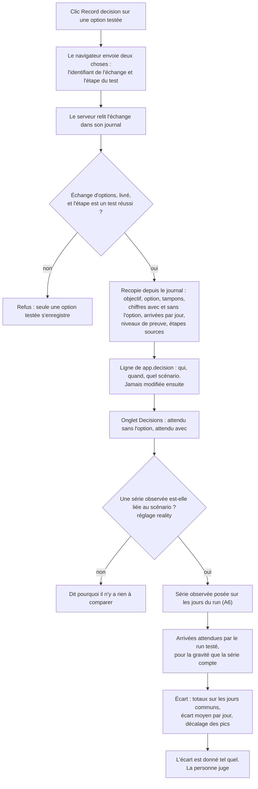

**Règles.**
- Aucun chiffre d'une décision ne vient du navigateur. Le serveur les recopie de l'échange journalisé (`app.analyst_exchange`, sorte `options`) : un chiffre envoyé avec la demande est ignoré, et une étape qui n'est pas un test réussi est refusée.
- Une décision se suffit à elle-même : elle garde le nom du scénario et une copie des étapes sources, pour rester lisible si le scénario ou l'échange disparaît.
- Une décision ne se modifie pas. La revoir, c'est en enregistrer une autre.
- Le suivi compare des arrivées, rien d'autre : c'est la seule chose que le run testé attendait et que le réseau compte aussi jour par jour. Le jumeau ne garde aucun historique des files ni de l'occupation, donc la file attendue n'a rien d'observé à côté d'elle, et l'écran le dit.
- Un jour que la série ne rapporte pas n'est pas comparé. Une série qui ne rapporte rien ne donne pas un écart nul, elle ne donne pas d'écart.
- Le suivi ne conclut pas. Il donne l'écart ; dire si la décision a tenu revient à la personne.

**Code.** `backend/src/services/decisions.ts` (`decisionFromExchange`, `followUp`, `realityOf`), `backend/src/routes/decisions.ts`, migrations `060_analyst_exchange_kind.sql` et `061_decision.sql` ; `frontend/app/studio/simulation/hex/DecisionsTab.tsx`.
**Tests.** `decisions.unit.test.ts`, `analyst-options.unit.test.ts` (d'une option testée à une décision), `routes/decisions.unit.test.ts`, `DecisionsTab.test.tsx`.

## A10. Recherche en ligne et calendrier d'événements

**But.** Dire ce qui se passait autour du réseau à une date donnée : un couvre-feu, une fermeture d'écoles, une canicule. L'analyste ne connaît que le jumeau ; ici il peut chercher en ligne, dans les seules sources que le projet autorise. Chaque trouvaille est un **candidat**, et un candidat n'est rien tant qu'une personne ne l'a pas accepté. C'est l'étape « Précédents » de la [boucle](decision-loop.md).

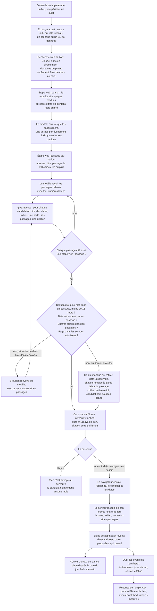

**Règles.**
- **Rien du jumeau ne part dans une recherche.** L'échange n'a aucun outil de lecture et son contexte ne nomme ni le projet ni le scénario : le modèle n'a sous la main que la demande de la personne, la liste des sources et la date du jour. Une requête ne peut donc contenir qu'un lieu, une période et un sujet. Chaque requête est une étape, affichée et journalisée.
- **Sources.** La liste de domaines est réglable par projet (`app.project_web_source`). Sans réglage, la liste de départ s'applique : inspq.qc.ca, quebec.ca, msss.gouv.qc.ca, donneesquebec.ca, canada.ca, who.int. Un domaine couvre ses sous-domaines ; ASCII seulement, vingt entrées au plus. L'API restreint la recherche à cette liste (`allowed_domains`), et le serveur vérifie à son tour que la page d'un candidat y est.
- **Plafond.** Huit recherches par demande (`max_uses`). Elles sont appelées directement (`allowed_callers: ["direct"]`) et non depuis le bac à code de l'API : ainsi chaque recherche est une étape visible, et le plafond vaut pour tout l'échange, ce qu'il ne fait pas pour une recherche lancée depuis le bac à code.
- **Le passage est l'unité de preuve.** L'API ne rend en clair que l'adresse et le titre des pages, et, sous chaque phrase que le modèle écrit d'après une page, le passage qui l'appuie (150 caractères au plus). C'est le seul texte d'une page web que le serveur détient. Une page seulement rendue par une recherche n'appuie rien.
- **Citation.** Moins de quinze mots, recopiés mot pour mot d'un passage que le candidat cite (aux espaces et aux guillemets typographiques près). Une citation introuvable est remplacée, au dernier brouillon, par les premiers mots du passage, et l'écran le dit.
- **Dates.** Une date tient quand un passage (ou le titre de sa page) énonce le jour et le mois, en français ou en anglais ; l'année doit y être écrite, ou être une année que les passages ou la demande nomment. « En janvier 2022 » n'énonce aucun jour. Une date introuvable est retirée et laissée vide : la personne lit la source et la saisit.
- **Portes.** Chaque candidat dit par quelle porte il touche un réseau de santé : demande, capacité, accès, soins. C'est le modèle qui la choisit ; la personne la voit avant d'accepter.
- **Niveau de preuve.** « Published », attribué par le programme. Un événement validé n'est jamais présenté comme mesuré par le jumeau ni comme le résultat d'un run.
- **Validation.** Accepter envoie l'identifiant de l'échange, celui du candidat et les dates validées, rien d'autre : le serveur recopie le reste de l'échange journalisé (`app.analyst_exchange`, sorte `events`), comme pour une décision (A9). Un candidat que la recherche n'a pas livré ne s'accepte pas ; le même candidat ne s'accepte pas deux fois. Les dates proposées par l'analyste sont gardées à côté des dates validées.
- **Refus.** Il n'existe aucune route pour refuser : un candidat refusé n'entre dans aucune table d'événements, et ni `list_events` ni la frise ne le voient. Il reste, comme tout ce que l'analyste a écrit, dans le journal de l'échange où il a été proposé, qu'aucun outil ne relit.
- **Retrait.** Un événement accepté se retire du calendrier sur un clic confirmé, gardé au journal d'audit.
- **Sur la frise.** Le couloir « Context » place chaque événement d'après la date que le scénario donne à son jour 0 (réglage « reality »). Sans cette date, rien n'est dessiné et le couloir dit pourquoi. Les événements y sont en contour, pas en aplat : ce ne sont pas des tampons, le moteur ne les reçoit jamais.
- **Pour l'analyste.** `list_events` rend les événements validés, avec leurs jours sur l'axe du run quand le jour 0 a une date : c'est le programme qui compte les jours, pas le modèle. Le lien de chaque événement reste dans le relevé de l'étape, pour l'écran.

**Code.** `backend/src/services/analyst-events.ts` (`eventsClosing`, `EVENTS_PROMPT`), `analyst-web.ts` (`webSearchTool`, `WebReader`, `statedDates`, `dateStated`, `quotedFrom`), `web-sources.ts`, `health-events.ts` (`eventFromExchange`), outil `listEvents` dans `analyst-tools.ts`, route `POST /v1/ontology/:env/analyst/events` dans `backend/src/routes/analyst.ts`, `backend/src/routes/health-events.ts`, migration `062_health_event.sql` ; `frontend/app/studio/simulation/hex/EventFinderTab.tsx`, `ContextLane.tsx`, `context-lane.ts`, `WebChip` dans `analyst-parts.tsx`.
**Tests.** `analyst-events.unit.test.ts`, `analyst-web.unit.test.ts`, `web-sources.unit.test.ts`, `health-events.unit.test.ts`, `analyst-tools.unit.test.ts` (`list_events`), `routes/health-events.unit.test.ts`, `routes/analyst.unit.test.ts` ; `EventFinderTab.test.tsx`, `ContextLane.test.tsx`, `context-lane.test.ts`, `AnalystPanel.test.tsx`, `HexTwinView.test.tsx`.

---

# B. Jumeau et moteur de simulation

## B1. Export du jumeau

**But.** Mettre le jumeau dans la forme que lit le moteur. Le moteur est en Python et l'ontologie en Postgres : ce qui traverse est une charge utile, pas une connexion. Rien ici ne reconnaît un nom de type ou de lien : tout est déclaré (rôle du type, comportement du lien, mécanique de la propriété).

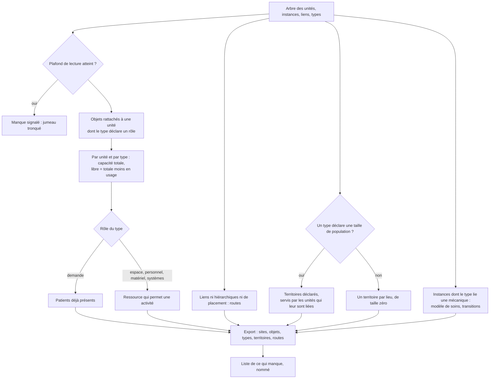

**Règles.** Un lit déjà occupé n'est pas de la capacité libre. Un territoire sans chiffre de population apparaît quand même, à zéro, dans la liste des manques. Une route n'a pas de débit dans l'ontologie : elle sort à zéro, et c'est signalé. Le plafond de lecture est `ROLLUP_INSTANCE_CAP` ; l'atteindre se dit, parce que tout le reste serait une sous-estimation silencieuse.

**Code.** `backend/src/services/twin-export.ts`, `property-schema.ts`. **Tests.** `twin-export.unit.test.ts`, `scenario-lens-links.unit.test.ts`.

## B2. Un pas du moteur d'événements

**But.** Faire avancer le réseau d'un pas : appliquer l'événement, décider la réponse, soigner ou non, propager les pannes, tout écrire. L'ordre dans un pas est une décision de modélisation, écrite une seule fois.

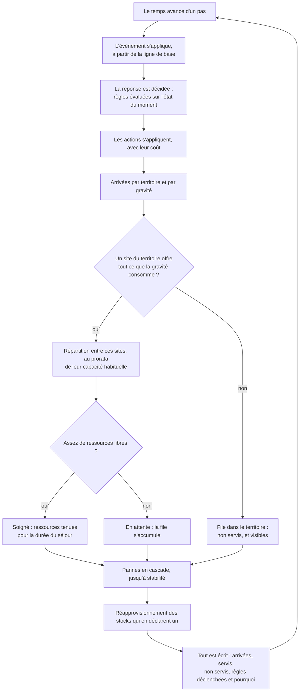

**Règles.**
- La réponse est décidée avant les soins : une politique réagit dans le pas où l'événement arrive.
- Une capacité se reconstruit depuis une ligne de base à chaque pas ; une file s'accumule. La façon de composer appartient à la quantité, pas à l'auteur de l'événement (voir `simulation-service/app/events/README.md`).
- Un site plein reste le bon endroit où attendre ; un site qui n'offre pas l'activité ne le devient jamais.
- Le poids d'un site est sa capacité habituelle pour la ressource la plus rare que la gravité consomme, pas ce qu'il lui reste de libre ce jour-là. Pondérer par le libre donnerait au réseau un équilibrage parfait et gratuit, c'est-à-dire exactement ce qu'une politique de transfert est censée acheter.
- L'occupation habituelle d'un scénario est tenue à chaque site pour tout le run.
- Un changement de capacité est un changement de ce qui est libre, du même montant, et rien d'autre. Des lits ouverts arrivent vides. Des lits fermés partent d'abord de ce qui est libre ; le reste, ce sont des lits encore occupés, portés en dépassement jusqu'à ce qu'assez de patients soient sortis : une fermeture n'admet ni ne renvoie personne. Quand elle se termine, les lits reviennent de la même façon.
- Même système, même événement, même politique, même graine : même trajectoire.

**Code.** `simulation-service/app/events/dynamics.py` (`Engine.run`, `_apply_perturbations`, `_deliver_care`), `domain.py`, `objects.py`, `ontology.py`, `mechanics.py`. **Tests.** `simulation-service/tests/`, dont `test_events_occupancy.py` pour l'occupation habituelle et les changements de capacité.

## B3. Propagation

**But.** Faire circuler une condition dans la population sans que le moteur connaisse le mot « infectieux ». Le jumeau déclare des états et des transitions ; le moteur ne connaît que trois formes de transition.

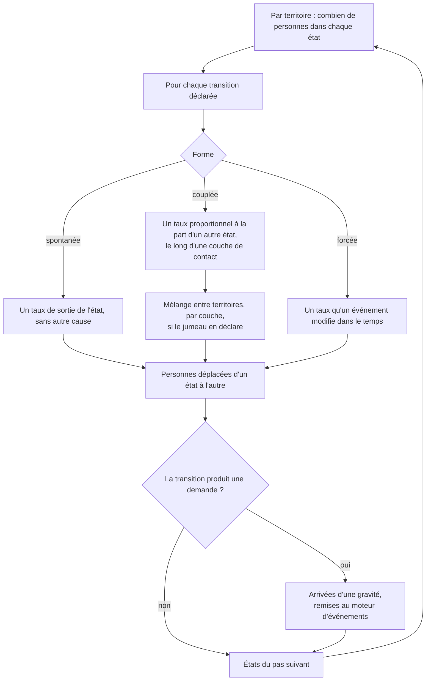

**Règles.** Une mesure ou un variant multiplie une couche de contact, entre deux pas, pour certains territoires ou pour tous. Deux transitions qui décrivent le même passage avec deux taux sont refusées, pas arbitrées. Sans mélange déclaré, une éclosion ne sort pas de son territoire. Approximation assumée : un visiteur rencontre les résidents du lieu visité, à leur prévalence.

**Code.** `simulation-service/app/events/spread.py`, `backend/src/services/spread-payload.ts`. **Tests.** `simulation-service/tests/`, `spread-payload.unit.test.ts`.

## B4. Politiques, score et comparaison

**But.** Comparer des réponses sur un même événement, avec un score qu'on peut discuter.

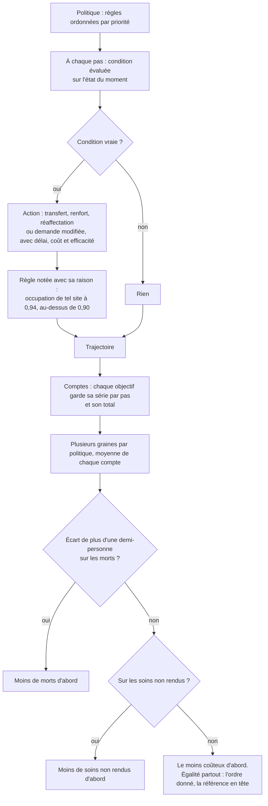

**Règles.**
- Une condition est un arbre typé, pas une chaîne évaluée : on peut la montrer et la faire varier par programme.
- Le classement se fait sur des comptes, dans l'ordre : morts, soins non rendus, coût. Un compte ne départage que les réponses à égalité sur les précédents, et un écart de moins d'une demi-personne est une égalité.
- C'est un ordre de priorités, pas un prix : une somme pondérée demanderait un taux de change entre une vie, un soin non rendu et un dollar, et il n'y en a pas d'honnête. L'ordre reste un jugement, et l'écran le dit.
- L'écran nomme le compte qui a décidé de la première place. Quand rien ne sépare les deux premières réponses, aucune n'est marquée meilleure.
- Comparer sur une seule graine reviendrait à optimiser la graine.

**Code.** `simulation-service/app/events/policy.py`, `scoring.py`, `harness.py` (`rank`, `decided_by`), `api.py` (`RANK_BY`), `frontend/app/studio/events/ranking.ts`, `backend/src/services/sim-policies.ts`. **Tests.** `tests/test_events_ranking.py`, `ranking.test.ts`.

## B5. Scénario en surcouche

**But.** Un scénario n'est pas une copie du jumeau : c'est une liste ordonnée de modifications lues par-dessus. Lire le jumeau « à travers » un scénario donne le monde tel qu'il serait.

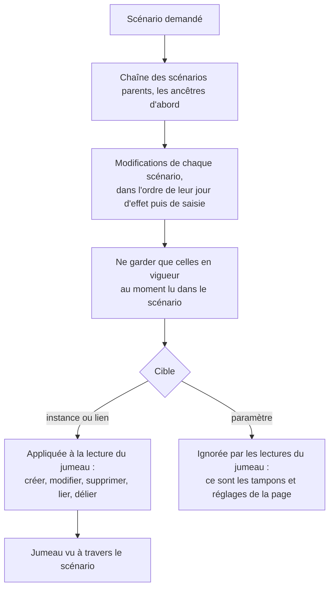

**Règles.** Une lecture qui reçoit une lentille qu'elle ne sait pas honorer échoue bruyamment : comparer la réalité à elle-même en silence serait le pire résultat. Ce qu'un scénario invente reçoit un identifiant stable, dérivé, pour ne pas apparaître et disparaître d'une lecture à l'autre. La lecture « à une date passée » est déclarée mais pas faite : les propriétés sont écrasées en place.

**Code.** `backend/src/services/scenario-overrides.ts`, `scenario-apply.ts`, `ontology-lens.ts`. **Tests.** `scenario-overrides.unit.test.ts`, `scenario-apply.unit.test.ts`, `ontology-lens.unit.test.ts`.

## B6. Événement tiré d'une série observée

**But.** Le chemin le plus court entre un fichier publié et un run : ce qui a été admis chaque jour devient les arrivées de l'événement, sans script à la main.

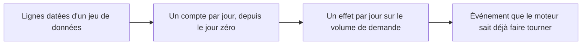

**Règles.** La cible est un volume, pas une incidence : une incidence est par mille personnes et demanderait une taille de population que le fichier ne porte pas.

**Code.** `backend/src/services/sim-event-from-rows.ts`. **Tests.** `sim-event-from-rows.unit.test.ts`.

---

# C. Prévision et laboratoire

## C1. Boucle de prévision quotidienne

**But.** Savoir ce que vaut une prévision faite chaque matin avec ce qu'on savait ce matin-là. Chaque prévision est figée le jour où elle est faite ; personne ne peut la retoucher après coup.

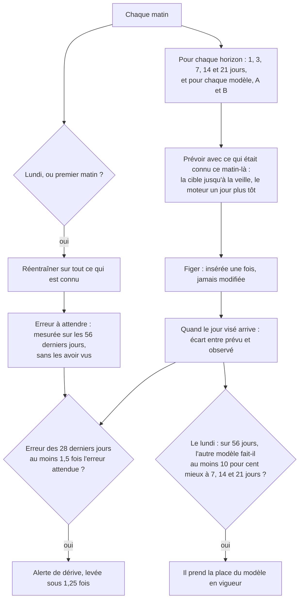

**Règles.**
- Modèle A : régression ridge sur 14 jours de la cible et le calendrier. Modèle B : gradient boosting, avec le moteur s'il y en a un.
- Il faut au moins 90 jours d'historique avant le premier matin, et 60 lignes pour un réentraînement.
- La dérive demande au moins 14 prévisions notées dans la fenêtre ; le remplacement, au moins 28 par horizon.
- Le modèle en vigueur, les alertes et les remplacements ne sont pas stockés : ce sont des règles fixées d'avance, appliquées à des prévisions figées. Elles donnent la même réponse à chaque lecture.
- Le rejeu se fait par blocs de 28 matins, dans n'importe quel ordre.

**Code.** `backend/src/services/forecast-loops.ts`, `simulation-service/app/lab/loop.py`, `frontend/app/studio/lab/loop-rules.ts`, migration `058_forecast_loops.sql`. **Tests.** `forecast-loops.unit.test.ts`, `tests/test_lab_loop.py`, `loop-rules.test.ts`.

## C2. Prévision d'une série et apprentissage sur table

**But.** Une prévision est une régression dont les variables sont le passé. Ce qui change n'est pas le modèle, c'est la façon de le noter.

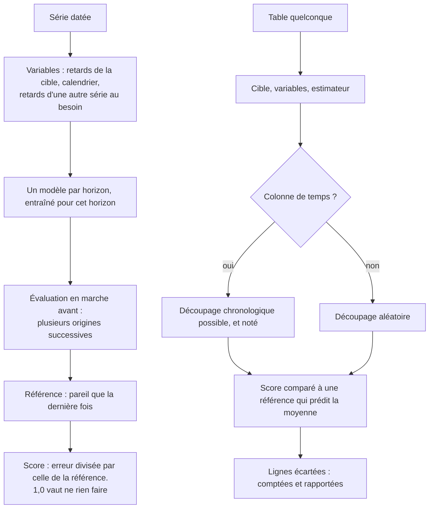

**Règles.** Un modèle qui ne bat pas la référence ne se déploie pas. Un découpage aléatoire sur une table ordonnée dans le temps s'entraîne sur la semaine prochaine : quand une colonne de temps existe, le découpage honnête est offert. Le contexte d'entraînement est gardé avec le score.

**Code.** `simulation-service/app/lab/timeseries.py`, `tabular.py`, `sandbox.py` (code de l'utilisateur, isolé), `backend/src/services/lab-models.ts`. **Tests.** `simulation-service/tests/`.

## C3. Signaux précurseurs

**But.** Dire quel signal en précède un autre et de combien, avec les raisons d'en douter calculées dans la même passe.

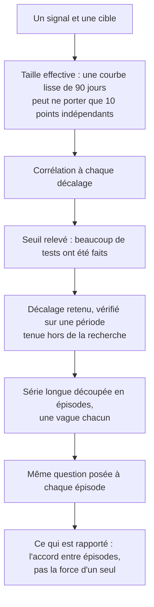

**Règles.** Choisir le décalage qui maximise la corrélation puis rapporter cette corrélation est circulaire : d'où la période tenue à part. Une série longue n'est pas beaucoup d'observations : c'est la réplication d'une vague à l'autre qui tranche.

**Code.** `backend/src/services/lag-scan.ts` (`effectiveSize`, `crossCorrelate`, `findLead`), `episodes.ts` (`findEpisodes`, `replicationAcross`). **Tests.** `lag-scan.unit.test.ts`, `episodes.unit.test.ts`.

## C4. Laboratoire causal

**But.** Explorer, sur les données vivantes d'un environnement, quels signaux en précèdent d'autres, et ce que deviendrait une série si l'on en perturbait une autre.

```mermaid
flowchart TD
    A["Signaux horaires : créations par type,<br/>moyenne d'une propriété, activité d'un canal"] --> B["Pour chaque paire : corrélation au meilleur décalage"]
    B --> C["Arêtes : qui précède qui"]
    A --> D["Modèle à un pas, régression ridge sur le passé"]
    D --> E["Prévision : le modèle itéré vers l'avant"]
    E --> F["Événement injecté : une variable future est perturbée"]
    F --> G["Trajectoire simulée"]
```

**Règles.** Le décalage va de 1 au maximum demandé, pour que la direction suive le temps. Une arête est une précédence, pas une cause prouvée : voir C3 pour les raisons d'en douter.

**Code.** `backend/src/services/causal-lab.ts`. **Tests.** aucun test unitaire dédié à ce jour.

## C5. Simulation hybride

**But.** Faire tourner un graphe de modèles sur une branche de scénario : un modèle mécaniste comme base, des modèles appris par-dessus quand ils existent.

```mermaid
flowchart TD
    A["Charge utile : branche du jumeau, paramètres"] --> B["Graphe de contacts :<br/>appartenance par les liens de lieu, voisinage par les liens de contact"]
    B --> C["Graphe de modèles, exécuté dans l'ordre de ses dépendances"]
    C --> D["Nœud mécaniste : SEIR à graine fixe"]
    D --> E["Nœuds appris : résidu, réseau sur graphe,<br/>substitut, prévision"]
    E --> F["Bandes de quantiles, écart à la base,<br/>importance des variables"]
    C --> G{"Service de simulation absent,<br/>ou modèle lourd non installé ?"}
    G -->|"oui"| H["Retour au SEIR mécaniste, dans l'API"]
```

**Règles.** Le SEIR Python reproduit celui de l'API à graine égale. Le service est sans état : il ne touche jamais la base. Sans le service, la route de simulation retombe sur le SEIR de l'API.

**Code.** `simulation-service/app/runner.py`, `graph.py`, `contacts.py`, `mechanistic.py`, `uncertainty.py`, `training.py`, `models/` ; `backend/src/services/simulation.ts`, `ml-simulation.ts`. **Tests.** `simulation-service/tests/`, `simulation.unit.test.ts`, `ml-simulation.unit.test.ts`.

---

# D. Données

## D1. Extraction clinique

**But.** Tirer d'un texte clinique des concepts codés et leur contexte, sans modèle génératif.

```mermaid
flowchart TD
    A["Texte clinique"] --> B["Repérage des mentions"]
    B --> C["Plongement de chaque mention"]
    C --> D["Recherche des descriptions SNOMED les plus proches,<br/>dans Postgres"]
    D --> E{"Proximité et marge sur le suivant"}
    E -->|"nettes"| F["Résolu"]
    E -->|"douteuses"| G["Signalé"]
    E -->|"insuffisantes"| H["Non résolu"]
    A --> I["Contexte par règles, en français et en anglais :<br/>affirmé ou nié, sujet, temporalité"]
    F --> J["Décision : accepter, signaler, faire remonter"]
    G --> J
    I --> J
    J --> K{"Persistance demandée ?"}
    K -->|"oui"| L["Constat clinique écrit dans l'ontologie,<br/>avec sa provenance"]
```

**Règles.** La correspondance SNOMED n'utilise que la base Postgres d'Obscyro. Un patient n'est rattaché que par un identifiant explicite, jamais deviné depuis un nom ou le texte.

**Code.** `nlp-service/app/main.py`, `ner.py`, `context.py`, `embeddings.py`, `pg_index.py` ; `backend/src/services/persist-extract.ts`. **Tests.** `nlp-service/tests/`, `persist-extract.integration.test.ts`.

## D2. Pipelines de données

**But.** Transformer des jeux de données en objets de l'ontologie ou en d'autres jeux, par un graphe de nœuds.

```mermaid
flowchart LR
    A["Entrée : dataset_input"] --> B["Table : filter, select, derive, cast,<br/>expand, join, latest"]
    B --> C["Texte clinique : text_field,<br/>extract_snomed, validate_confidence"]
    B --> D["Sorties : object_output, dataset_output"]
    C --> D
```

**Règles.** La liste des sortes de nœuds existe en un seul endroit (`NODE_KINDS`) : le schéma de la route est construit à partir d'elle, pour qu'un nœud accepté soit toujours un nœud exécutable. Les objets écrits passent par l'identité (D3). Les canaux d'ingestion (`channel-runner.ts`) font le même travail pour une charge utile reçue par webhook ou par appel REST.

**Code.** `backend/src/services/pipeline.ts`, `channel-runner.ts`, `rest-connector.ts`, `connectivity.ts`. **Tests.** `pipeline*.unit.test.ts`, `channel-*.unit.test.ts`, `rest-connector*.unit.test.ts`.

## D3. Identité des objets

**But.** Dire quelles propriétés font qu'un objet est « la même chose réelle », pour que deux pipelines ne créent pas deux fois le même lit.

```mermaid
flowchart TD
    A["Objet à écrire"] --> B["Clés d'identité déclarées sur son type"]
    B --> C{"Un objet porte déjà ces valeurs ?"}
    C -->|"oui"| D["Mise à jour de cet objet"]
    C -->|"non"| E["Création"]
    D --> F["Contrainte tenue par la base elle-même"]
    E --> F
```

**Règles.** L'identité est déclarée sur le type, pas fournie par le pipeline qui passe. La contrainte vit dans la base (migration 043).

**Code.** `backend/src/services/identity.ts`, `ontology.ts` (`upsertInstanceByIdentity`). **Tests.** `identity.unit.test.ts`.

## D4. Qualité des données

**But.** Contrôler chaque objet de l'ontologie par couches, de la plus simple à la plus statistique.

```mermaid
flowchart TD
    A["Un objet"] --> L1["L1 Forme : type de chaque propriété,<br/>code SNOMED existant"]
    L1 --> L2["L2 Valeur : bornes déclarées,<br/>pas de négatif, date valide"]
    L2 --> L3["L3 Cohérence : ordre des dates,<br/>objet sans aucun lien"]
    L3 --> L4["L4 Population : valeur aberrante<br/>parmi les objets du même type"]
    L4 --> L5["L5 Source : source muette depuis 7 jours,<br/>valeurs identiques répétées"]
    L5 --> L6["L6 Anomalie : écart interquartile<br/>ou écart robuste à la médiane"]
    L6 --> F["Constats, chacun avec sa couche et son code"]
```

**Règles.** En L6, l'un ou l'autre des deux tests suffit à signaler. Il faut au moins 12 valeurs du même type ; les seuils sont réglables (`DQ_IQR_K`, `DQ_ZSCORE_THRESHOLD`, `DQ_ANOMALY_MIN_SAMPLE`). Les couches L4 à L6 lisent toute la population, pour rester stables.

**Code.** `backend/src/services/data-quality.ts`. **Tests.** `data-quality.unit.test.ts`, `data-quality.integration.test.ts`.

## D5. Alertes du jumeau et signaux

**But.** Qu'un seuil franchi atteigne une personne en quelques secondes, où qu'elle soit dans le studio, avec de quoi juger : quelle unité, depuis quand, de quand date la valeur, et un clic vers l'unité et vers le signal. Une règle se déclenche à l'heure où le seuil est franchi, pas à l'heure où quelqu'un ouvre la page.

```mermaid
flowchart TD
    A["Évaluateur : une évaluation finie,<br/>attendre 5 s, ou deux fois sa durée si elle a été lente"] --> B["Projets qui ont au moins une règle"]
    B --> C["Métriques de chaque unité, sans lentille :<br/>la réalité, jamais un scénario"]
    C --> D["Chaque règle évaluée"]
    D --> E{"La condition"}
    E -->|"tient maintenant, pas avant"| F["Alerte ouverte, avec deux heures :<br/>de quand date la valeur, quand la donnée a été écrite ici"]
    E -->|"tient encore"| F2["Valeur et âge de la valeur rafraîchis ;<br/>l'heure d'écriture qui a ouvert l'alerte ne bouge pas"]
    E -->|"tenait, et ne tient plus de façon démontrée"| G["Alerte résolue"]
    F --> H["Pont lancé tout de suite, une passe à la fois"]
    G --> H
    H --> I["Signal créé, titré une fois"]
    I --> J["Workflow : étapes, approbation au besoin"]
    F --> K["Fil d'alertes : GET /alerts/feed<br/>alertes ouvertes, unité nommée, âges, signal, dernière évaluation"]
    I --> K
    K --> L["Cadre du studio : lu toutes les 3 s,<br/>une seule lecture pour toutes les pages"]
    L --> M["Pastille : combien sont ouvertes, et si la liste est à jour"]
    L --> N{"Alerte absente de la lecture précédente ?"}
    N -->|"oui"| O["Bandeau sur toutes les pages, deux minutes :<br/>Open unit, Signal"]
    N -->|"non, ou première lecture"| M
    L --> P["Pages du jumeau : mêmes alertes sur la carte, l'arbre, la fiche d'unité"]
    L --> Q["Response : le tableau se relit quand les signaux changent"]
```

**Règles.**
- **Cadence.** L'évaluateur se règle seul : une évaluation ne commence jamais avant la fin de la précédente, et l'attente vaut cinq secondes, ou deux fois la durée de la dernière évaluation si elle a été lente, sans dépasser trente secondes. Il ne peut donc pas prendre plus d'un tiers de l'attention de la base, quelle que soit la taille du jumeau. Une évaluation lente est écrite au journal du service.
- **Seule la réalité lève des alertes.** Une lecture faite à travers un scénario, ou à une autre date, n'évalue rien : une urgence qui déborde dans un « et si » ne doit pas arriver sur tous les écrans comme si elle arrivait.
- **La résolution ne se fait jamais dans une lecture** : sous une lentille qui cache des unités, leur absence ressemblerait à un service vidé. L'échec d'un projet ne coûte pas leur évaluation aux autres.
- **Deux heures de plus que l'ouverture.** `observed_at` : quand la valeur était vraie, d'après l'horodatage que la source publie (D7) ; vide quand la source ne le dit pas. `written_at` : quand la donnée qui a fait franchir le seuil a été écrite ici ; fixée à l'ouverture. `created_at - written_at` est le temps que nous avons mis à voir le dépassement, mesuré sur chaque alerte. Une alerte ouverte trois secondes après son écriture peut porter sur une valeur vieille de cinquante minutes : l'écran dit les deux.
- **Le pont suit l'évaluateur.** Une évaluation qui ouvre ou ferme une alerte lance le pont aussitôt ; l'horloge propre du pont (quinze secondes) reste comme filet. Les passes du pont se suivent, jamais deux à la fois : « un signal par alerte » repose sur un `NOT EXISTS` que deux passes simultanées franchiraient toutes les deux.
- **Une seule lecture pour tout le studio.** Le cadre lit le fil d'alertes toutes les trois secondes et le donne à toutes les pages. Avant, chaque page avait son horloge : dix secondes sur la fiche d'unité, trente sur le globe, une requête par unité sur l'arbre, un bouton sur Response.
- **Ce qui est une nouvelle.** Une alerte est annoncée quand elle est dans une lecture et n'était pas dans la précédente. La première lecture n'annonce rien : ces alertes étaient ouvertes avant qu'on regarde, et un écran qui crie quarante vieilles alertes à l'arrivée apprend à ne plus le lire. L'annonce dure deux minutes, ou jusqu'à ce qu'on la ferme ; la fermer ne touche pas à l'alerte.
- **Le silence n'est pas le calme.** Sans lecture réussie depuis quinze secondes, la pastille dit que la liste n'est plus à jour et depuis combien de temps ; la dernière liste lue reste affichée, marquée comme ancienne. La liste dit aussi quand les seuils ont été vérifiés pour la dernière fois.
- **Les âges se comptent sur l'horloge du serveur**, pas sur celle du poste : un ordinateur réglé cinq minutes de travers ne vieillit pas une alerte de cinq minutes.
- **Un clic.** Depuis une alerte : son unité (`/studio/live?unit=…`, la fiche s'ouvre seule) et son signal (`/studio/response?signal=…`). Depuis un signal : son unité. Le lien porte le projet.
- Une alerte est une unité et une valeur agrégée, jamais une personne.

**Délai.** Du moment où une donnée est écrite ici au moment où l'alerte est à l'écran : au plus cinq secondes d'attente de l'évaluateur, la durée d'une évaluation, puis au plus trois secondes de lecture. Les mesures faites en production sont dans [decision-loop.md](decision-loop.md), ligne « Signal ».

**Code.** `backend/src/services/twin-alert-scheduler.ts` (`nextEvaluationDelay`, `evaluationPulse`), `alert-bridge.ts`, `alert-feed.ts`, `signals.ts`, `twin.ts` (`evaluateAlerts`, `readsReality`), route `GET /v1/ontology/:env/alerts/feed` dans `backend/src/routes/twin.ts`, migration `063_twin_alert_times.sql` ; `frontend/app/studio/AlertFeed.tsx`, `alert-feed-state.ts`, `AlertBanner.tsx`, `StudioShell.tsx`, `response/ResponseView.tsx`, `live/LiveTwinView.tsx`.
**Tests.** `twin-alert-scheduler.unit.test.ts`, `alert-bridge.unit.test.ts`, `alert-feed.unit.test.ts`, `signals.unit.test.ts` ; `alert-feed-state.test.ts`, `AlertBanner.test.tsx`, `response/ResponseView.test.tsx`, `platform-nav.test.ts`.

## D6. Métriques du jumeau

**But.** Laisser chaque établissement définir ses mesures, sans que le moteur sache ce qu'est un lit.

```mermaid
flowchart LR
    A["Définition : un agrégat,<br/>divisé au besoin par un second"] --> B["Objets du sous-arbre d'une unité"]
    B --> C["Compte, somme, moyenne, minimum ou maximum,<br/>sur les objets retenus"]
    C --> D["Valeur de la métrique pour l'unité"]
```

**Règles.** Rien ne repose sur un nom de type ou une valeur de statut écrits en dur : « lits occupés sur lits » est une définition, pas un cas particulier.

**Code.** `backend/src/services/twin-metrics.ts`, `twin.ts`. **Tests.** `twin-metrics.unit.test.ts`, `twin-self-rollup.unit.test.ts`.

## D7. Fraîcheur d'une valeur

**But.** Mesurer l'âge d'une valeur depuis le moment où elle était vraie, pas depuis notre dernier téléchargement.

```mermaid
flowchart TD
    A["Une lecture"] --> B{"Le type déclare une propriété<br/>qui porte le moment de la mesure ?"}
    B -->|"oui"| C["Âge compté depuis ce moment,<br/>dans le fuseau déclaré"]
    B -->|"non"| D["Âge inconnu, et dit comme tel"]
```

**Règles.** Le moment est déclaré, jamais deviné : une colonne qui ressemble à une date n'est pas forcément l'heure de la mesure. Un horodatage sans fuseau et sans fuseau déclaré est rapporté illisible plutôt qu'interprété.

**Code.** `backend/src/services/observed-at.ts`. **Tests.** `observed-at.unit.test.ts`.

## D8. Correspondance de zones

**But.** Lire un signal mesuré sur une géographie (un bassin d'égout, une station) sur les territoires du réseau.

```mermaid
flowchart TD
    A["Signal par zone source"] --> B["Recouvrements : part de chaque zone<br/>qui revient à chaque territoire"]
    B --> C{"Base du poids"}
    C -->|"population"| D["Préférée dès qu'elle existe"]
    C -->|"surface ou déclarée"| E["Admise, et étiquetée comme telle"]
    D --> F{"Nature de la quantité"}
    E --> F
    F -->|"un compte"| G["Les parts s'additionnent"]
    F -->|"une concentration, un taux"| H["Moyenne pondérée"]
```

**Règles.** Pondérer par la surface trompe : un bassin qui couvre 30 % des hectares peut porter 70 % des gens. Deux usines à 500 copies par litre ne font pas 1 000.

**Code.** `backend/src/services/zone-correspondence.ts`. **Tests.** `zone-correspondence.unit.test.ts`.
