# Les algorithmes d'Obscyro

Chaque algorithme du produit a ici sa section : à quoi il sert, son schéma, ses règles, où il vit dans le code et quels tests le tiennent.

**Ce fichier se met à jour avec le code.** Ajouter, modifier ou supprimer un algorithme, c'est aussi ajouter, modifier ou supprimer sa section et son schéma, dans le même commit (voir [CLAUDE.md](../CLAUDE.md)). Un schéma se dessine d'après le code qu'on vient de lire.

## Table

| Réf. | Algorithme | Fichier principal |
|---|---|---|
| **A** | **Aide à la décision, page Scenarios** | |
| [A1](#a1-boucle-de-lanalyste) | Boucle de l'analyste | `backend/src/services/analyst.ts` |
| [A2](#a2-vérificateur-de-chiffres) | Vérificateur de chiffres | `backend/src/services/analyst-verify.ts` |
| [A3](#a3-calculatrice) | Calculatrice | `backend/src/services/analyst-calc.ts` |
| [A4](#a4-run-dun-scénario) | Run d'un scénario, en deux passes, sur la page et sur le serveur | `frontend/app/studio/simulation/hex/engine.ts`, `backend/src/services/scenario-run.ts` |
| [A5](#a5-où-ça-casse) | Où ça casse : lecture des files | `frontend/app/studio/simulation/hex/results.ts` |
| [A6](#a6-comparaison-à-la-réalité) | Comparaison à la réalité | `backend/src/services/observed-series.ts` |
| [A7](#a7-grille-dhexagones-et-couches) | Grille d'hexagones et couches | `frontend/app/studio/simulation/hex/hex-grid.ts` |
| [A8](#a8-options-testées-par-le-moteur) | Options testées par le moteur | `backend/src/services/analyst-options.ts` |
| [A9](#a9-décision-enregistrée-et-suivi) | Décision enregistrée et suivi | `backend/src/services/decisions.ts` |
| [A10](#a10-recherche-en-ligne-et-calendrier-dévénements) | Recherche en ligne validée et calendrier d'événements | `backend/src/services/analyst-events.ts` |
| [A11](#a11-retest-dune-réponse-préparée) | Retest d'une réponse préparée, à l'ouverture d'un signal | `backend/src/services/response-retest.ts` |
| [A12](#a12-prix-registre-des-coûts-et-délai-dune-option) | Prix, registre des coûts et délai d'une option | `backend/src/services/price-catalogue.ts`, `cost-ledger.ts` |
| **B** | **Jumeau et moteur de simulation** | |
| [B1](#b1-export-du-jumeau) | Export du jumeau vers le moteur | `backend/src/services/twin-export.ts` |
| [B2](#b2-un-pas-du-moteur-dévénements) | Un pas du moteur d'événements | `simulation-service/app/events/dynamics.py` |
| [B3](#b3-propagation) | Propagation entre états déclarés | `simulation-service/app/events/spread.py` |
| [B4](#b4-politiques-score-et-comparaison) | Politiques, score et comparaison | `simulation-service/app/events/policy.py` |
| [B5](#b5-scénario-en-surcouche) | Scénario en surcouche du jumeau | `backend/src/services/scenario-overrides.ts` |
| [B6](#b6-événement-tiré-dune-série-observée) | Événement tiré d'une série observée | `backend/src/services/sim-event-from-rows.ts` |
| **C** | **Prévision et laboratoire** | |
| [C1](#c1-boucle-de-prévision-quotidienne) | Boucle de prévision quotidienne | `backend/src/services/forecast-loops.ts` |
| [C2](#c2-prévision-dune-série-et-apprentissage-sur-table) | Prévision d'une série, apprentissage sur table | `simulation-service/app/lab/timeseries.py` |
| [C3](#c3-signaux-précurseurs) | Signaux précurseurs : décalage et réplication | `backend/src/services/lag-scan.ts` |
| [C4](#c4-laboratoire-causal) | Laboratoire causal | `backend/src/services/causal-lab.ts` |
| [C5](#c5-simulation-hybride) | Simulation hybride, graphe de modèles | `simulation-service/app/runner.py` |
| **D** | **Données** | |
| [D1](#d1-extraction-clinique) | Extraction clinique d'un texte | `nlp-service/app/main.py` |
| [D2](#d2-pipelines-de-données) | Pipelines de données | `backend/src/services/pipeline.ts` |
| [D3](#d3-identité-des-objets) | Identité des objets | `backend/src/services/identity.ts` |
| [D4](#d4-qualité-des-données) | Qualité des données, six couches | `backend/src/services/data-quality.ts` |
| [D5](#d5-alertes-du-jumeau-et-signaux) | Alertes du jumeau et signaux | `backend/src/services/twin-alert-scheduler.ts` |
| [D6](#d6-métriques-du-jumeau) | Métriques du jumeau | `backend/src/services/twin-metrics.ts` |
| [D7](#d7-fraîcheur-dune-valeur) | Fraîcheur d'une valeur : l'âge d'une unité, et celui de chaque mesure | `backend/src/services/observed-at.ts` |
| [D8](#d8-correspondance-de-zones) | Correspondance de zones | `backend/src/services/zone-correspondence.ts` |
| [D9](#d9-lecture-du-direct-et-fiche-de-situation) | Lecture du direct et fiche de situation | `backend/src/services/live-reading.ts`, `situation.ts` |
| [D10](#d10-sites-et-unités-sur-la-carte-du-réseau) | Sites et unités sur la carte du réseau | `frontend/app/studio/command/units-tree.ts` |
| [D11](#d11-historique-des-mesures-du-jumeau) | Historique des mesures du jumeau | `backend/src/services/twin-history.ts` |

---

# A. Aide à la décision, page Scenarios

## A1. Boucle de l'analyste

**But.** Répondre à une question sur le jumeau, le scénario ouvert ou le run à l'écran, en ne s'appuyant que sur ce que des outils ont renvoyé. Le modèle de langage choisit quoi lire et rédige ; il ne détient aucun fait, ne calcule pas et ne décide pas. Détail : [analyst.md](analyst.md).

La même boucle sert trois sortes d'échanges. Ce qui les distingue est leur **clôture** : les consignes données au modèle, l'outil par lequel il livre, et la façon dont cette livraison est contrôlée. Une question se clôt par `give_answer` ; un objectif se clôt par `give_options`, après des tests (A8) ; une recherche d'événements se clôt par `give_events`, après des recherches en ligne (A10).

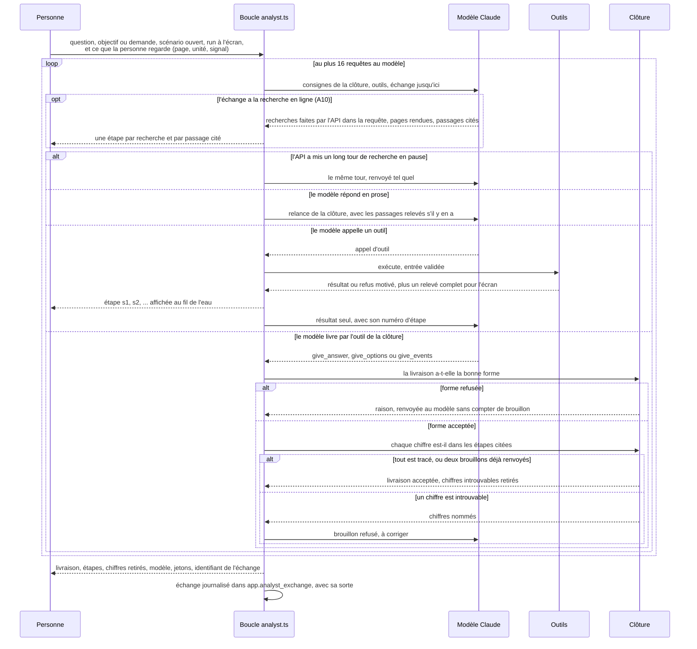

**Règles.**
- Modèle : celui que nomme la variable `ANALYST_MODEL` du service, parmi `claude-opus-5-5` (pris quand elle est vide), `claude-sonnet-5-5` et `claude-haiku-5-5`. Une valeur hors de cette liste éteint l'analyste, qui le dit, au lieu de le faire retomber sur un autre modèle. Effort `medium`, choix d'outil libre. Une demande refusée par un garde-fou est rejouée sur le modèle de repli prévu par l'API (`fallbacks: "default"`).
- Au plus 16 requêtes au modèle par échange, et 2 brouillons renvoyés pour chiffres introuvables.
- La livraison passe par l'outil de la clôture, seul dans son tour. Une réponse en prose est redemandée une fois, puis abandonnée. Deux fois quand l'échange cherche en ligne : la prose y est une étape, c'est d'elle que viennent les passages cités (A10).
- La recherche en ligne n'est pas exécutée par la boucle mais par l'API, à l'intérieur d'une requête. La boucle lit dans chaque réponse ce que l'API a cherché, les pages rendues et les passages cités, et en fait des étapes numérotées comme les autres. Une page rendue ne porte aucun chiffre citable ; seul un passage en porte.
- Un tour que l'API met en pause (`pause_turn`) lui est renvoyé tel quel, sans un mot de notre part : un message ajouté fermerait le tour. Une livraison demandée en même temps qu'une recherche est refusée une fois, le temps que la recherche tourne.
- Un refus d'outil (nom inconnu, pas de run à l'écran) est une étape que le modèle lit ; il ne porte aucun chiffre citable. Une panne de notre côté n'est jamais déguisée en refus.
- Un outil peut garder, à côté de son résultat, un relevé complet (`Recorded`) : il est affiché et journalisé, jamais envoyé au modèle. Aucune phrase ne peut donc s'appuyer dessus.
- Ce que la personne regarde arrive par identifiants (`focus` : page, unité, signal). Le serveur retrouve les noms lui-même, dans ce projet seulement, et les écrit dans le contexte de la question : aucun texte tapé par l'appelant n'entre dans les consignes.
- Les outils lisent deux sources, et chacun dit laquelle : l'export du jumeau, qui est ce qu'un run utilise, et la lecture du direct (D9), qui est ce que les écrans montrent.
- Un refus du modèle ne produit aucune réponse inventée.
- Si la personne part, plus rien n'est demandé au modèle.
- L'identifiant de l'échange est choisi avant de commencer et part avec la dernière ligne du flux : c'est lui qu'une décision nommera (A9).

**Code.** `backend/src/services/analyst.ts` (`converse`, `Closing`, `askClosing`), `analyst-web.ts` (`WebReader`), `backend/src/routes/analyst.ts`, `backend/src/lib/ndjson.ts`, `frontend/app/studio/simulation/hex/AnalystPanel.tsx`, `frontend/app/studio/AnalystDock.tsx`.
**Tests.** `analyst.unit.test.ts`, `analyst-options.unit.test.ts`, `analyst-events.unit.test.ts`, `analyst-web.unit.test.ts`, `routes/analyst.unit.test.ts`, `lib/ndjson.unit.test.ts`, `AnalystPanel.test.tsx`.

## A2. Vérificateur de chiffres

**But.** Empêcher qu'un chiffre arrive à l'écran sans qu'un outil l'ait renvoyé, ou à côté du mauvais nom. Chaque paragraphe est contrôlé contre les étapes qu'il cite lui-même, pas contre tout ce qui a été lu : c'est ce qui donne un sens à une puce de source.

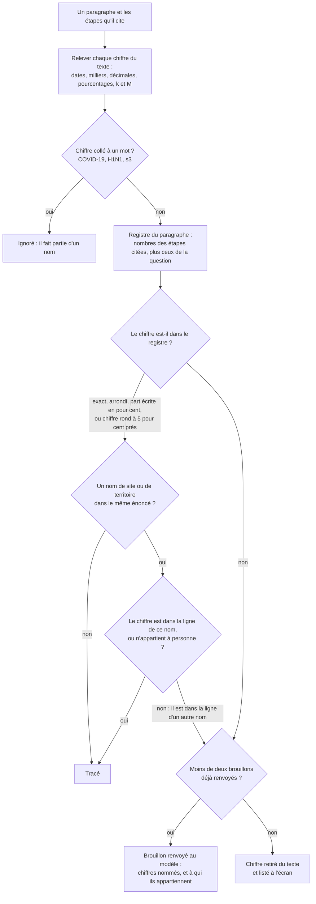

**Règles.**
- Le registre d'une étape contient : chaque nombre du résultat, chaque nombre écrit dans une chaîne, chaque date et ses parties (année, mois, jour), et la longueur de chaque liste.
- Arrondi admis : « 94 » pour 93,6 ; « 94 % » pour une part de 0,941 ; « 6 000 » pour 5 999. Un chiffre rond ne peut pas s'écarter de plus de 5 % : « 100 » ne vaut pas pour 60.
- Les hypothèses et les limites ne citent pas d'étape : elles sont contrôlées contre tout ce qui a été lu.
- **À qui est le chiffre.** Un résultat d'outil est fait de lignes qui portent un nom (un site, un territoire). Le texte est coupé en énoncés, aux fins de phrase, aux virgules et aux mots qui joignent deux énoncés. Un chiffre écrit dans le même énoncé qu'un nom est fautif quand trois choses sont vraies : aucune ligne de ce nom ne le contient, il n'est pas un chiffre qui n'appartient à personne (un total, la question, un calcul), et la ligne d'un autre nom le contient. Le contrôle attrape donc une interversion, et se tait quand il ne peut pas trancher.
- Un nom se reconnaît à ses mots distinctifs (« lakeshore », « santa cabrini »), sans casse ni accents. Un nom fait seulement de mots communs à tous (« Hôpital général de Montréal ») n'attribue rien.
- **Ce que le contrôle prouve :** le chiffre existe dans un résultat d'outil cité, et pas dans la ligne d'un autre nom que celui à côté duquel il est écrit. **Ce qu'il ne prouve pas :** que la phrase autour est juste. C'est pourquoi chaque étape reste consultable sous la réponse.
- Origine de la règle d'attribution : la première réponse donnée en production, tous chiffres « trouvés », donnait à Lachine le jour de LaSalle.
- **Ce qui vient du web.** Le registre d'un passage cité contient les chiffres du passage et du titre de sa page, et les dates qu'ils écrivent en toutes lettres (« 31 décembre 2021 » vaut 2021-12-31) ; jamais les chiffres de l'adresse de la page. Un chiffre venu du web doit donc se trouver dans le passage cité. Les règles propres aux candidats (citation mot pour mot, date énoncée) sont en A10.

**Code.** `backend/src/services/analyst-verify.ts`. **Tests.** `analyst-verify.unit.test.ts`.

## A3. Calculatrice

**But.** Faire les calculs à la place du modèle, et refuser de calculer sur un nombre qui ne vient de nulle part.

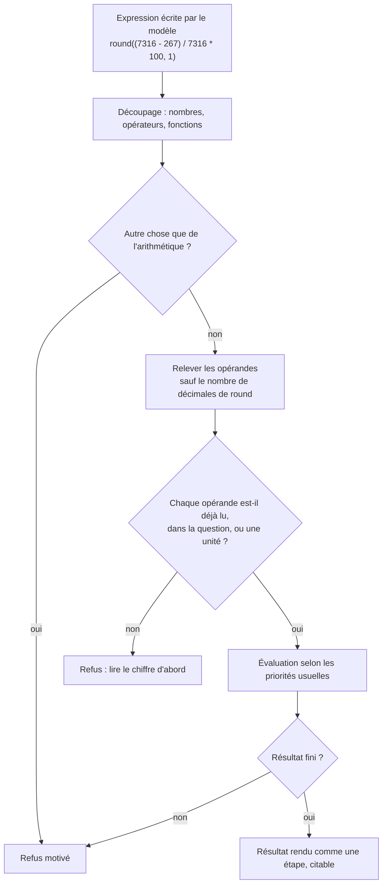

**Règles.** Opérateurs `+ - * / ^` et parenthèses. Fonctions `round, abs, sqrt, floor, ceil, min, max, sum, mean`. Rien n'est exécuté comme du code. Unités admises sans source : 0, 1, 2, 7, 10, 24, 100, 1000. L'outil `calculate` de l'analyste ne connaît aucune variable et n'a accès à rien.

**La même évaluation sert aux formules de coût** (A12), avec des valeurs nommées en plus. Le contrôle des opérandes, lui, appartient à l'outil `calculate` : une formule de coût est déclarée dans le jumeau, ses nombres sont ceux de sa ligne de prix.

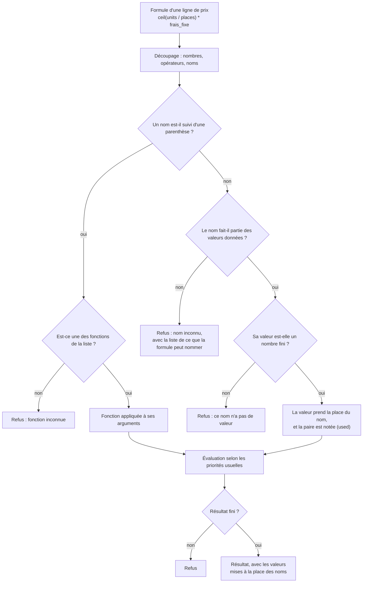

Une valeur nommée n'est cherchée que parmi celles que l'appelant donne, et une fonction que parmi celles de la liste : un mot de la formule n'est jamais pris pour autre chose. Une formule qui a un trou ne donne aucun résultat, jamais un résultat avec un zéro dans le trou.

**Code.** `backend/src/services/analyst-calc.ts` (`evaluate`, `FUNCTION_NAMES`), outil `calculate` dans `analyst-tools.ts`. **Tests.** `analyst-calc.unit.test.ts`, `analyst-tools.unit.test.ts`, `cost-ledger.unit.test.ts`.

## A4. Run d'un scénario

**But.** Dire ce que les choix du planificateur changent. Le scénario passe deux fois dans le moteur : une fois avec ce qui arrive à la ville, une fois avec les choix en plus. La différence entre les deux est l'effet des choix, construit plutôt que déduit.

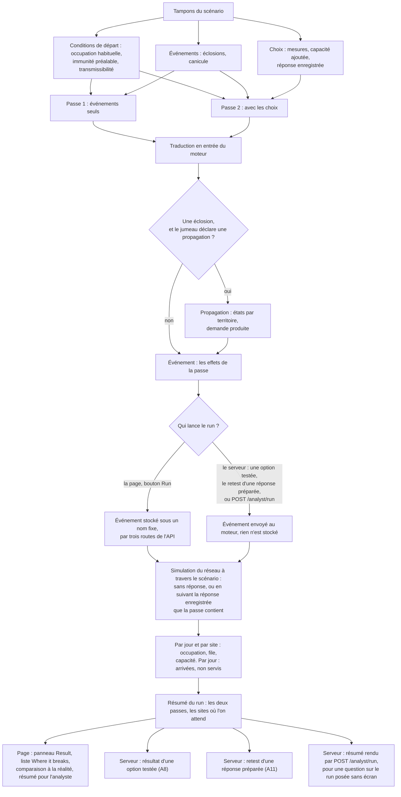

**Règles.**
- Les conditions sont dans les deux passes : elles disent d'où l'on part, pas ce qu'on choisit.
- Le moteur n'ensemence qu'une fois : toutes les éclosions partent du jour de la première, et l'écran le dit.
- Deux conditions du même genre : la plus haute l'emporte, et l'écran le dit.
- Sur la page, les deux événements stockés sont réécrits à chaque run sous un nom fixe. Sur le serveur, rien n'est stocké : une option testée n'est pas un événement de la bibliothèque, et l'analyste n'écrit rien.
- L'occupation de l'île est pondérée par la capacité de chaque site, capacité ajoutée comprise à partir du jour où elle ouvre.
- Les deux côtés lisent le jumeau de la même façon : le contexte (sites, territoires, modèle déclaré) vient du jumeau tel qu'il est, et le moteur reçoit le jumeau lu à travers le scénario.
- **Une réponse enregistrée est un tampon comme les autres** (`response`). Tout autre tampon est quelque chose qui arrive un jour donné ; celui-ci porte des règles que le moteur évalue à chaque pas (B4). C'est un choix : seule la passe « avec les choix » la suit, à la place de la réponse « ne rien faire » ; la passe « événements seuls » ne répond jamais. Trois provenances : la bibliothèque de l'organisation (page Events), dont les règles voyagent dans le tampon telles qu'elles étaient quand on l'a posé ; une réponse que le moteur écrit lui-même d'après le réseau, qui part sous son nom ; et un transfert écrit par le test d'une option de l'analyste (A8).
- **Le jour d'une réponse.** Les règles d'une réponse posée au jour 12 ne s'appliquent pas avant le jour 12 : chaque règle est décalée, et une règle que son auteur faisait déjà commencer plus tard garde son propre jour (`rulesFromStep`, la fonction avec laquelle le rejeu de la page des unités bifurque). Une réponse que le moteur écrit lui-même vaut pour tout le run : le moteur écrit ses règles, on ne peut pas les décaler.
- **Une réponse par run.** Le moteur en suit une à la fois. Si la recette en contient deux, la première par le jour est suivie, et le panneau Result nomme celle qui ne l'est pas.
- **Ce qu'une réponse a coûté.** Le serveur lit dans la table des pas ce que le moteur a compté : le coût que chaque règle déclare pour son action, chaque fois que l'action s'est déclenchée (`PassDigest.cost`). Zéro quand la passe ne suit aucune réponse, ou une réponse dont aucune règle ne déclare de coût ; ce que ce zéro veut dire se décide en A8.
- **Une limite dite.** Une réponse qui ajoute ou déplace des unités pendant le run change la capacité des sites, et le moteur ne rend pas la capacité de chaque jour. L'occupation de l'île est alors pondérée par la capacité habituelle, et le run le dit dans ses notes.

**Le même scénario donne les mêmes chiffres sur la page et sur le serveur.** La traduction des tampons et la lecture des tables existent en deux exemplaires, un par côté. Ce qui les tient ensemble est un enregistrement du vrai moteur, `backend/src/services/scenario-run-parity.fixture.json` : un petit jumeau, un scénario, des options, ce que chaque run demande au moteur (les effets, et la réponse suivie quand il y en a une), ce que le moteur répond, et le résumé qui en sort. Le test du serveur et celui de la page le rejouent tous les deux, chacun avec son propre code. Chacun doit envoyer au moteur les demandes enregistrées et retrouver les chiffres enregistrés : changer un côté seul fait échouer l'autre.

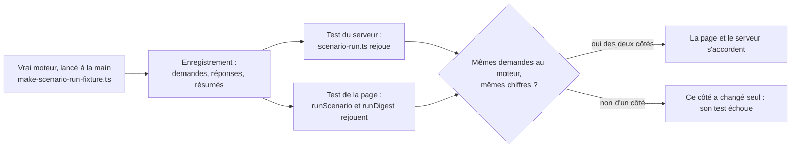

L'enregistrement contient six runs : le scénario tel quel ; le scénario avec les tampons d'une option ; le scénario où une option a remplacé un choix (l'ancien tampon retiré, le nouveau écrit) ; et trois runs avec une réponse enregistrée : une réponse de la bibliothèque (un transfert de patients, posé un jour donné, à un coût déclaré), une réponse que le moteur écrit lui-même, et le transfert tel que le test de l'analyste l'écrit. Tous sauf le premier sont ce qui garantit qu'appliquer une option testée au scénario puis lancer Run redonne les chiffres du test, réponse enregistrée comprise. Il se régénère à la main quand le moteur ou la traduction change (`cd backend && npx tsx scripts/make-scenario-run-fixture.ts`, avec Python et les dépendances du service de simulation), puis on relance les deux suites.

Sur le serveur, le run existe en deux formes. `ScenarioRunner.digest` fait les deux passes, comme la page : c'est lui que le test de parité rejoue, et c'est lui que `serverRun` appelle pour la route `POST /v1/ontology/:env/analyst/run`. Cette route rend le résumé qu'une personne aurait à l'écran après Run, pour qu'une question sur le run puisse être posée par un script, sans navigateur ([analyst.md](analyst.md), les questions de référence). Elle n'appelle aucun modèle, n'écrit rien, et refuse une activité qu'aucun site n'offre avant de solliciter le moteur. `ScenarioRunner.full` ne fait que la passe « avec les choix » : c'est ce que lit une option testée (A8), parce que le tableau des options compare le scénario avec ses choix au scénario avec l'option en plus, et que la passe « événements seuls » n'y montre rien. Le retest d'une réponse préparée (A11) lit la même passe, pour la même raison. Les deux formes passent par le même résumé d'une passe (`passFigures`), donc une colonne du tableau ne peut pas différer de ce que Run affiche pour la même passe ; un test le vérifie sur l'enregistrement.

Tester plusieurs options ne refait pas tout : une propagation est gardée d'après ce qu'on lui a demandé, donc une option qui n'ajoute que des lits ne réintègre pas l'épidémie. Chaque appel au moteur est chronométré (`timings`), pour que la durée d'un test soit une mesure et pas une impression.

**Code.** Page : `frontend/app/studio/simulation/hex/engine.ts` (`runScenario`), `stamps.ts` (`engineInput`), `run-digest.ts`, `frontend/app/studio/command/branch.ts` (`rulesFromStep`). Serveur : `backend/src/services/scenario-run.ts` (`ScenarioRunner`, `serverRun`, `costByStep`), `scenario-stamps.ts` (`engineInput`, `rulesFromStep`, `twinContext`), `scenario-run-recording.ts`, route `POST /v1/ontology/:env/analyst/run` dans `backend/src/routes/analyst.ts`. Enregistrement : `backend/scripts/make-scenario-run-fixture.ts`, `simulation-service/scripts/engine_once.py`.
**Tests.** `hex.test.ts`, `HexTwinView.test.tsx`, `run-parity.test.ts` (page) ; `scenario-run.unit.test.ts` (serveur).

## A5. Où ça casse

**But.** Un pic à 96 % sur l'ensemble des sites dit que le réseau a tenu. Il ne dit pas que quatre hôpitaux ont été pleins trois semaines. L'occupation plafonne à 100 % et se tait sur ceux qu'on a refusés : c'est la file, site par site, qui le dit.

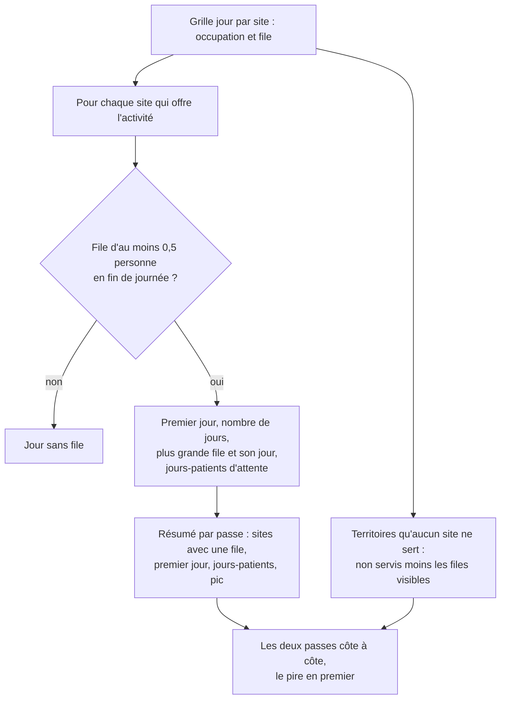

**Règles.** Une file sous 0,5 est de l'arithmétique, pas une personne. Un jour-patient d'attente compte une personne qui attend un jour : une personne trois jours compte trois. Un territoire sans site pour l'activité n'apparaît dans aucune ligne du moteur : il est nommé à part, pour qu'un dixième de l'île n'attende pas sous un panneau qui dit que personne n'attend.

**Code.** `frontend/app/studio/simulation/hex/results.ts`, `BreakList.tsx`. **Tests.** `results.test.ts`.

## A6. Comparaison à la réalité

**But.** Poser une série observée sur l'axe du run et dire à quel point les deux s'écartent, en commençant par ce qui trompe le moins.

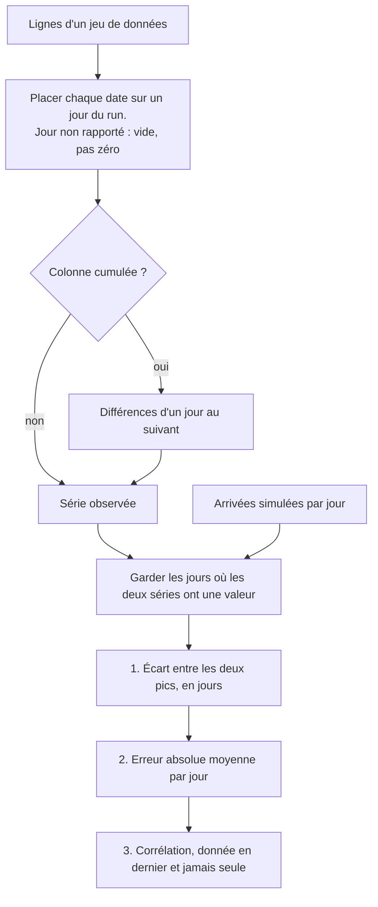

**Règles.** Une date répétée : la dernière ligne l'emporte, on ne somme pas. Deux courbes qui montent puis descendent se corrèlent fortement que le modèle soit juste ou non : la corrélation ne vient qu'en dernier. Un calage après coup n'est pas une prévision, et l'écran le dit.

**Code.** `backend/src/services/observed-series.ts`, route `POST /v1/ontology/:env/observed-series`, `frontend/app/studio/simulation/hex/RealityCheck.tsx`. **Tests.** `observed-series.unit.test.ts`.

## A7. Grille d'hexagones et couches

**But.** Une seule grille pour tout ce qui se montre sur la carte : une lecture de civières, la population d'un territoire et une mesure dessinée tombent sur les mêmes cellules, donc se superposent sans jointure.

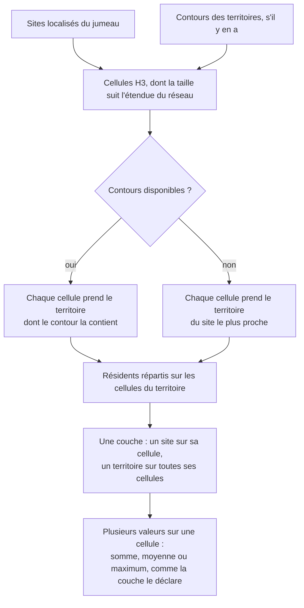

**Règles.** La grille est construite depuis le jumeau, jamais livrée avec le client. La façon de combiner est déclarée par la couche : des lits s'additionnent, une température non.

**Code.** `frontend/app/studio/simulation/hex/hex-grid.ts`, `layers.ts`, `backend/src/services/twin-layers.ts`. **Tests.** `hex.test.ts`, `twin-layers.unit.test.ts`.

## A8. Options testées par le moteur

**But.** Une recommandation qui ne repose sur aucun run est une opinion. La personne dit son objectif ; l'analyste propose jusqu'à trois options, et chacune passe dans le moteur avant d'être montrée, à côté du scénario tel quel. Le modèle écrit des phrases ; les chiffres du tableau, les tampons et les niveaux de preuve viennent du programme.

```mermaid
flowchart TD
    A["Objectif de la personne,<br/>scénario ouvert, horizon et activité de la page"] --> B["L'analyste lit : run à l'écran, site, territoires, recette"]
    B --> B2["scenario_recipe : chaque choix du scénario<br/>porte un nom (choice-a, choice-b…)"]
    B --> B3["list_responses : les réponses enregistrées<br/>(bibliothèque, moteur), chacune sous un nom,<br/>et où les patients d'un site peuvent être envoyés"]
    B2 --> C["test_option : une étiquette et 1 à 4 changements.<br/>Ajouter une capacité, une mesure, un transfert<br/>ou une réponse enregistrée ;<br/>remplacer un choix nommé, ou le retirer"]
    B3 --> C
    C --> D{"Testable ?<br/>site connu qui offre l'activité, couche déclarée,<br/>route de transfert dans le jumeau, une seule réponse,<br/>jour dans le run, pas déjà testée, moins de 3 tests"}
    D -->|"non"| E["Refus motivé, lu par le modèle.<br/>Ne compte pas comme un test"]
    E --> B
    D -->|"oui"| D2{"Le changement nomme-t-il<br/>un choix du scénario ?"}
    D2 -->|"non : il ajoute"| F["Changements écrits comme les tampons de la page"]
    D2 -->|"oui"| D3{"Est-ce bien un choix (mesure, capacité),<br/>du même genre, nommé une seule fois,<br/>et remplacé par autre chose que lui-même ?"}
    D3 -->|"non"| E
    D3 -->|"oui"| D4["L'ancien tampon sort de la liste.<br/>Remplacement : ce que le changement ne dit pas<br/>est gardé de l'ancien"]
    D4 --> F
    F --> F2{"Pour chaque capacité que la liste de prix tarife :<br/>le mode existe-t-il, et son délai<br/>permet-il le jour demandé ? (A12)"}
    F2 -->|"non"| E
    F2 -->|"oui, ou rien à tarifer"| G["Une passe du scénario tel quel, avec ses choix :<br/>lancée une fois, gardée pour toutes les options"]
    F2 -->|"oui, ou rien à tarifer"| H["Une passe du scénario, les tampons retirés en moins,<br/>ceux de l'option en plus (A4)"]
    G --> I["Résultat pour le modèle : les deux runs en résumé,<br/>les sites où l'on attend, sur quoi l'option repose"]
    H --> I
    H --> J["Relevé pour l'écran : chiffres entiers, tampons écrits,<br/>choix retirés, ce qui est ajouté, remplacé, retiré,<br/>arrivées par jour, niveaux de preuve,<br/>coût compté par le moteur,<br/>et registre de la liste de prix quand le jumeau en déclare une (A12)"]
    I --> K{"Autre option à tester ?"}
    K -->|"oui"| C
    K -->|"non"| L["give_options : un mécanisme par option,<br/>ce que le test ne dit pas, lecture, arbitrages, limites"]
    L --> M{"Chaque option testée est-elle listée,<br/>et rien d'autre ?"}
    M -->|"non"| N["Renvoyé au modèle : une option non testée ne se liste pas,<br/>une option testée ne se cache pas"]
    N --> L
    M -->|"oui"| O["Vérificateur de chiffres sur chaque phrase (A2)"]
    O --> P["Proposition : tableau tiré des relevés,<br/>dans l'ordre des tests, sans classement"]
    J --> P
    P --> P2{"Deux options dont le coût est entier,<br/>et l'une coûte autant ou plus<br/>pour autant ou plus d'attente ?"}
    P2 -->|"oui"| P3["Celle-là est marquée Dominated,<br/>avec le nom de l'option qui la domine"]
    P2 -->|"non"| P4["Pas de Dominated.<br/>Avec une liste de prix à l'écran :<br/>Not beaten sur les options pesées qu'aucune ne bat (A12)"]
    P --> Q{"Add to scenario / Apply to scenario :<br/>clic humain. L'option retire-t-elle un choix ?"}
    Q -->|"non"| Q1["Les tampons sont écrits"]
    Q -->|"oui"| Q2["La recette est relue"]
    Q2 --> Q3{"Chaque tampon à retirer<br/>y est-il encore ?"}
    Q3 -->|"non"| Q4["Rien n'est écrit, et l'écran dit lequel manque"]
    Q3 -->|"oui"| Q5["Pour chaque tampon : le nouveau écrit, puis l'ancien retiré.<br/>Enfin les choix retirés sans remplaçant"]
    P --> R["Record decision : clic humain (A9)"]
```

**Règles.**
- Trois options au plus par objectif, quatre changements au plus par option. Chaque test coûte au moteur une passe du réseau, plus une propagation si l'option change un contact ; le scénario tel quel coûte une passe, une seule fois. Trois options font donc quatre passes. La passe « événements seuls » que fait Run sur la page n'est pas lancée : rien dans le tableau ne la lit.
- Les passes se suivent, elles ne tournent pas en même temps. Le service de simulation est un seul processus : mesuré en local, lancer deux passes ensemble ne gagne que 18 % sur les lancer l'une après l'autre, pour deux fois la mémoire.
- Chaque test garde dans son relevé de quoi sa durée était faite : la lecture du jumeau (au premier test seulement), puis chaque appel au moteur. Ce relevé va au journal, pas au modèle.
- Une capacité se teste à un site qui offre déjà l'activité ; négative, elle ferme des unités, jamais plus que le site n'en a. Une mesure se teste sur une couche de contact que le jumeau déclare.
- **Une réponse enregistrée dans une option.** Le changement `response` nomme une réponse par le nom que `list_responses` lui donne : `response-a`, `response-b`… pour celles de la bibliothèque de l'organisation, rangées par nom ; `transfer-when-full` et `surge-then-transfer` pour les deux que le moteur écrit lui-même. Comme pour un choix, jamais un UUID. Une réponse de la bibliothèque peut commencer un jour donné ; une réponse du moteur vaut pour tout le run, et lui donner un jour est refusé. Elle devient un tampon `response` de l'option, testé par le même run que les autres tampons (A4).
- **Un transfert de patients.** Le changement `transfer` nomme deux sites, un nombre de patients par jour et un jour. Le programme en écrit la règle (`transferRule`) : quand quelqu'un attend au premier site pour l'activité que le run lit, et que le second en a une unité libre, jusqu'à ce nombre de patients y sont envoyés. La condition sur le site d'arrivée n'est pas une précaution de plus : sans elle on envoie des patients attendre derrière ceux d'un hôpital plein. Plusieurs transferts d'une option font une seule réponse, une règle chacun. Sont refusés, avec ce qui peut être demandé à la place : deux sites entre lesquels le jumeau ne contient aucune route de transfert (le refus liste où les patients du premier peuvent aller), un site d'arrivée qui n'offre pas l'activité, plus de patients par jour qu'une route n'en porte.
- **Ce qu'une route porte.** Le jumeau ne contient le débit d'aucune route. Le run donne donc à chacune le même : vingt patients par jour (`ROUTE_CAPACITY`), sur la page comme sur le serveur. C'est une hypothèse du moteur, et elle figure comme telle parmi ce sur quoi l'option repose ; que la route existe est, elle, une mesure du jumeau.
- **Une réponse par run, donc par option.** Une option contient soit un changement `response`, soit des changements `transfer`. Si le scénario suit déjà une réponse, le test est refusé tant que l'option ne la retire pas (`remove`, par son nom de choix) : la tester à sa place est alors un seul test.
- **Le coût vient de deux endroits, et de nulle part ailleurs.** Le moteur compte une chose (`costOf`) : le coût que la règle d'une réponse déclare pour son action, chaque fois qu'elle se déclenche. La liste de prix du jumeau, quand il en déclare une, donne le coût de la capacité que l'option ouvre (A12, `withPriceList`). Les deux s'additionnent quand les deux existent ; aucun ne remplace l'autre. Sans liste de prix, rien ne change : une capacité et une mesure n'ont alors aucun prix, et la carte l'écrit à la place d'un chiffre. Une réponse dont aucune règle ne déclare de coût est sans prix, pas gratuite. Le transfert écrit par le programme ne déclare aucun coût : personne n'en a donné, et en inventer un mettrait à l'écran un chiffre qu'aucun outil n'a rendu.
- **Un coût est dit entier quand tout ce que l'option change a un prix** : une réponse à coût déclaré, de la capacité que la liste tarife, ou les deux. Une mesure, une capacité que la liste ne contient pas, des unités fermées, un choix retiré du scénario n'ont pas de prix : le compte est alors montré et dit incomplet.
- **Un mode se choisit, et son délai se respecte.** Quand la liste tarife une activité en plusieurs modes, `test_option` demande lequel chaque capacité utilise, et refuse un jour que le délai du mode ne permet pas, en disant le premier jour possible et les modes assez rapides (A12). C'est ce qui permet de tester la même capacité plus tôt à un prix plus élevé, ou plus tard à un prix plus bas.
- **Un prix de démo se voit.** Une ligne de prix sans source est un prix de démo, et tout total qui en contient un porte la marque « demo price ». Les montants que déclarent les règles d'une réponse enregistrée n'ont pas de source non plus : ce que le moteur compte pour elle porte la même marque (`OptionCost.demo`), et le résultat de l'outil le dit au modèle.
- **Une option dominée est marquée, d'après les runs.** Entre deux options au coût entier, celle qui coûte autant ou plus et laisse autant ou plus d'attente (strictement pire sur l'un des deux) porte « Dominated » et le nom de l'autre. C'est la seule comparaison de coût et d'effet qui ne demande aucun taux de change entre un dollar et un jour-patient : quelle que soit la valeur qu'on leur donne, cette option n'est pas celle à préférer sur ces deux comptes. L'attente comptée comprend celle des territoires qu'aucun site ne sert, pour qu'une file déplacée hors de vue ne passe pas pour une file évitée. Le marquage est fait par la fonction du rejeu de la page des unités (`dominatedBy`, `frontend/app/studio/command/options.ts`) : les deux écrans le font de la même façon. Une option dont le coût n'est pas entier n'est ni dominée ni dominante : il faudrait un prix que personne n'a donné. Quand une liste de prix est à l'écran, les options pesées qu'aucune autre ne bat portent « Not beaten » (A12).
- **Remplacer ou retirer un choix.** Un changement peut prendre la place d'un choix que le scénario contient déjà (`replaces`), ou le retirer (`remove`). « 40 lits au lieu de 60 » est alors un seul tampon à +40, et non un −20 empilé sur un +60 : le test tourne sur le scénario sans l'ancien tampon et avec le nouveau, et c'est ce que la recette contiendra. Un remplacement ne dit que ce qui diffère (les unités, le jour, la durée) ; le reste est gardé du choix remplacé.
- **Un choix se désigne par un nom, pas par son identifiant.** `scenario_recipe` donne à chaque choix un nom fait de lettres (`choice-a`, `choice-b`…), valable le temps de l'échange. L'identifiant d'un tampon est un UUID : trente-six caractères à recopier sans faute, et pleins de chiffres que le vérificateur trouverait ensuite « dans une étape ». Le relevé du test, lui, garde l'identifiant du tampon : c'est ce que la page retire.
- **Seul un choix se remplace.** Une condition de départ dit où le run commence, un événement dit ce qui arrive : une option qui en retirerait un testerait un autre scénario en l'appelant une réponse. Ni l'un ni l'autre n'a de nom, et les désigner est refusé, avec la liste de ce qui peut l'être. Sont refusés aussi : remplacer une capacité par une mesure (on retire l'une et on ajoute l'autre, dans la même option), nommer deux fois le même choix, remplacer un choix par lui-même.
- **Ce qui est retiré se dit.** Le relevé liste ce que l'option ajoute, remplace et retire, en phrases écrites par le programme à partir des tampons ; la carte de l'option les montre telles quelles, et « Takes out of the scenario : … » figure parmi ce sur quoi l'option repose, au niveau **hypothèse**. Une décision enregistrée les garde.
- Un refus du moteur (un scénario sans événement, par exemple) est lu par le modèle. Un moteur injoignable est une panne : l'échange s'arrête et le dit, sans option inventée.
- Le niveau de preuve de chaque élément est attribué par le programme, d'après d'où il vient : **mesuré** pour ce que le jumeau contient (unités d'un site, résidents d'un territoire), **publié** pour le taux d'une canicule, **hypothèse** pour les conditions du scénario, les choix, l'option elle-même (les règles d'une réponse comprises : quand elles se déclenchent, leur délai, leur efficacité, leur coût sont ce que leur auteur a écrit), la règle de routage du moteur et le débit d'une route. Le modèle n'en choisit aucun.
- Le mécanisme d'une option est contrôlé contre le résultat de son propre test ; la lecture, contre les étapes qu'elle cite ; le reste, contre tout ce qui a été lu. Un chiffre de l'objectif appartient à la personne et peut être repris.
- Le mécanisme et la lecture reçoivent les deux contrôles du vérificateur (A2), comme les paragraphes d'une réponse : un chiffre que personne n'a renvoyé, et un chiffre qui existe mais qui est écrit à côté du mauvais site ou du mauvais territoire.
- Le tableau suit l'ordre des tests, quel que soit l'ordre dans lequel le modèle liste les options : un ordre choisi par lui serait un classement. Rien ne classe les options : dire lesquelles atteignent l'objectif d'après les runs est une lecture, choisir entre elles revient à la personne. Les arbitrages de valeur sont présentés à part, comme tels. « Dominated » n'est pas un classement : la marque ne dit rien de deux options dont aucune ne domine l'autre, et choisir entre celles-là reste à la personne.
- L'analyste n'écrit rien. Une option entre dans le scénario au clic « Add to scenario », écrite comme un tampon posé sur la carte ; Run redonne alors les chiffres du test (A4). Quand l'option retire un choix, le bouton dit « Apply to scenario » : la recette est relue, et si un tampon à retirer n'y est plus (quelqu'un l'a modifié depuis le test), rien n'est écrit et l'écran le dit. Sinon le nouveau tampon est écrit puis l'ancien retiré, comme le fait la recette quand on modifie un tampon à la main : un arrêt à mi-chemin laisse un tampon de trop, qui se voit, plutôt qu'un de moins. Le jeu d'essai de parité couvre un remplacement : les chiffres du test et ceux de Run après le clic sont les mêmes. Si le scénario n'est plus celui qui a été testé, l'écran dit lequel des trois cas c'est : une option ajoutée depuis l'onglet (Run doit redonner sa colonne, les autres colonnes ne décrivent plus ce scénario), plusieurs options ajoutées ensemble (aucun test ne les a couvertes ensemble), ou une modification faite ailleurs (toutes les colonnes sont dépassées).
- Un run n'est pas une prévision : le tableau le porte dans son titre.

**Code.** `backend/src/services/analyst-options.ts` (`testOption`, `choiceNamed`, `stampOf`, `responseStamp`, `transfersStamp`, `costOf`, `withPriceList`, `settleMode`, `priceBasis`, `benchFor`, `optionsClosing`), `price-catalogue.ts` et `cost-ledger.ts` (A12), `analyst-responses.ts` (`listResponses`, `listedResponses`, `transferRule`, `transferRoutes`, `whatRulesDo`, `declaresCost`), `scenario-stamps.ts` (`basisOfStamp`, `choiceRefs`, `choiceLine`), `scenario-run.ts` (`ScenarioRunner.withOption`, `ROUTE_CAPACITY`), `analyst-tools.ts` (`scenario_recipe`), route `POST /v1/ontology/:env/analyst/options` dans `backend/src/routes/analyst.ts` ; `frontend/app/studio/simulation/hex/OptionsTab.tsx`, `option-cards.tsx` (`weighOptions`, `CostLine`, `DelayLine`, `DemoPrice`), `analyst-parts.tsx` (`OptionChanges`), `option-write.ts` (`writeOption`), `addOption` dans `HexTwinView.tsx`, `frontend/app/studio/command/options.ts` (`dominatedBy`).
**Tests.** `analyst-options.unit.test.ts`, `scenario-run.unit.test.ts` (parité, dont le remplacement et les réponses enregistrées), `option-cards.test.tsx`, `command/options.test.ts`, `analyst-tools.unit.test.ts`, `routes/analyst.unit.test.ts`, `OptionsTab.test.tsx`, `option-write.test.ts`, `run-parity.test.ts`, `DecisionsTab.test.tsx`, `HexTwinView.test.tsx`. Le jeu d'essai `scenario-run-parity.fixture.json` est écrit par `backend/scripts/make-scenario-run-fixture.ts`.

## A9. Décision enregistrée et suivi

**But.** Garder ce qu'une personne a retenu avec le résultat qu'elle en attendait, pour pouvoir le confronter plus tard à ce qui est arrivé. Sans cela on ne compare qu'un souvenir à un résultat.

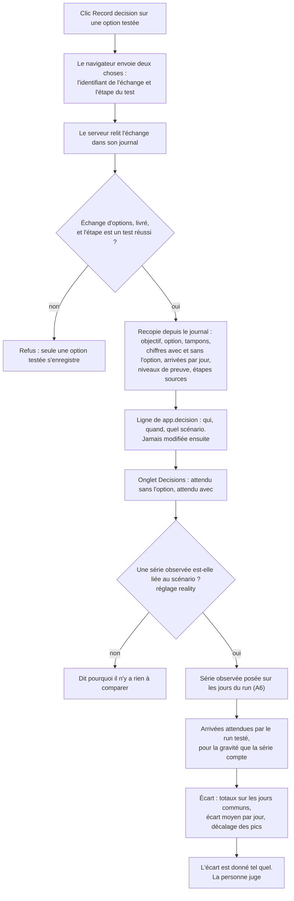

**Règles.**
- Aucun chiffre d'une décision ne vient du navigateur. Le serveur les recopie de l'échange journalisé (`app.analyst_exchange`, sorte `options`) : un chiffre envoyé avec la demande est ignoré, et une étape qui n'est pas un test réussi est refusée.
- Une décision se suffit à elle-même : elle garde le nom du scénario et une copie des étapes sources, pour rester lisible si le scénario ou l'échange disparaît.
- Une décision ne se modifie pas. La revoir, c'est en enregistrer une autre.
- **Une décision garde le coût attendu, et les prix dont il a été compté.** Le coût de l'option est recopié du journal avec son registre entier (A12) : les lignes, le prix de chacune, sa source ou la mention de démo, le mode et le jour où les unités devaient être ouvertes. Un prix corrigé plus tard dans le jumeau ne change pas ce que la décision montre : l'onglet Decisions rouvre les lignes du jour du test.
- Le suivi compare des arrivées, rien d'autre : c'est la seule chose que le run testé attendait et que le réseau compte aussi jour par jour. Le jumeau garde les relevés de ses propres mesures (D11), mais ce ne sont pas la file ni l'occupation que le moteur compte, et rien ne les pose encore à côté d'un run. La file attendue n'a donc rien d'observé à côté d'elle, et l'écran le dit.
- Un jour que la série ne rapporte pas n'est pas comparé. Une série qui ne rapporte rien ne donne pas un écart nul, elle ne donne pas d'écart.
- Le suivi ne conclut pas. Il donne l'écart ; dire si la décision a tenu revient à la personne.

**Suivi sur le signal.** Une décision prise sur un signal se relit avec ce qui a été mesuré ensuite, au même endroit : la fiche de situation de ce signal.

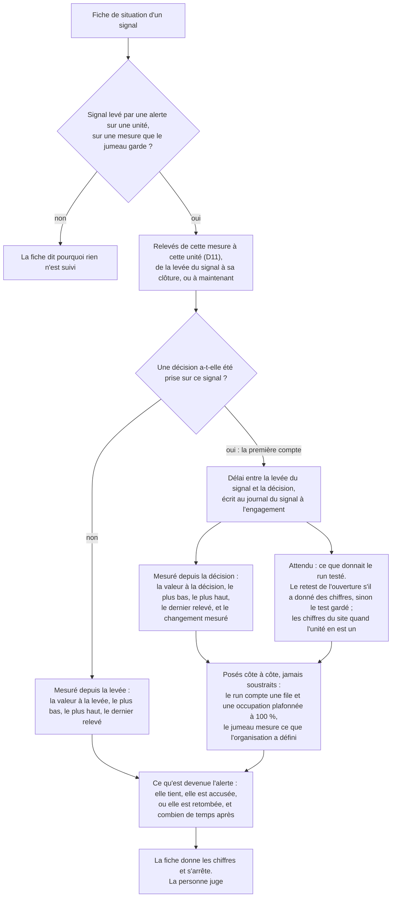

- **Mesuré, enregistré, attendu : trois choses, jamais mélangées.** Mesuré : la mesure qui a levé le signal, à son unité, telle que le jumeau l'a notée (D11). Enregistré : qui a décidé, quand, et combien de temps après la levée du signal. Attendu : ce que donnait le run qui a testé la réponse, dans les termes du moteur. L'écran les sépare sous trois titres.
- **Aucun chiffre ne pose le run contre le jumeau.** Le run compte des personnes en attente et une occupation qui s'arrête à 100 % de la capacité ; le jumeau mesure ce que l'organisation a défini, et peut lire 143 %. Soustraire l'un de l'autre donnerait un nombre qui ne veut rien dire. Chaque côté donne son propre changement, dans sa propre unité : des points de la mesure d'un côté, des jours-patients d'attente de l'autre. La fiche écrit pourquoi aucun écart n'est calculé entre les deux.
- **Le run dont on parle est nommé.** Quand le retest fait à l'ouverture du signal avait donné des chiffres, ce sont eux qui sont montrés, avec leur date. Sinon c'est le test gardé à froid, et la fiche le dit. Les chiffres par site viennent toujours du test gardé : un retest ne garde que ceux du réseau. Si l'unité du signal n'est pas un site de ce run, le run ne donne aucun chiffre pour elle, et la fiche l'écrit.
- **Le délai est écrit deux fois.** Il se calcule à partir de deux heures enregistrées, celle du signal et celle de la décision, et il est aussi écrit au journal du signal quand la réponse est engagée (`secondsSinceRaised`), journal que rien ne modifie ensuite.
- **Ce que le jumeau montrait.** La valeur « à la décision » est le dernier relevé noté à ce moment-là : ce que la personne avait sous les yeux, pas ce que la source a publié plus tard pour la même heure.
- **Aucun nouveau relevé n'est pas aucun changement.** Quand rien n'a été noté depuis la décision, la fiche l'écrit, et ne donne pas de changement. Une mesure qui a perdu sa valeur le dit au lieu d'afficher un chiffre.
- **Un changement après une décision n'est pas son effet.** D'autres choses ont changé en même temps, et ce suivi ne les distingue pas. La fiche le dit, et ne conclut pas.
- **Un signal clos** est suivi jusqu'à sa clôture, et la fiche garde la façon dont il a été clos.
- **Ce qui ne se suit pas.** Un signal qu'aucune alerte n'a levé n'a pas de mesure. Un signal levé sur un compte intégré non plus : le jumeau ne garde que les mesures que l'organisation a définies. Un signal plus ancien que l'historique n'a pas de relevés avant le jour où il a commencé. Chaque cas est écrit sur la fiche.

**Réponse préparée et engagement.** Une décision peut aussi être prise sur un signal, en engageant une réponse préparée à froid.

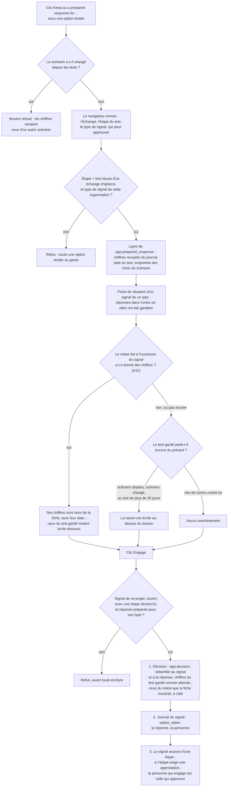

- **Seule une option testée se garde.** Comme une décision, une réponse préparée est recopiée par le serveur depuis l'échange journalisé. Aucun chiffre ne vient du navigateur : une réponse non testée ne peut pas passer pour testée.
- **Un test porte sa date et son état.** `tested_at` est la date de l'échange. `scenario_mark` est une empreinte des choix du scénario quand la réponse est gardée : elle ne dépend ni de l'ordre des choix ni des lignes qui les portent, et change dès qu'un choix est ajouté, retiré ou modifié.
- **Ce que le test vaut se dit avant le clic.** Trois choses se savent sans rien relancer : le scénario n'existe plus, ses choix ont changé, le test a plus de trente jours (`OLD_AFTER_DAYS`). Chacune s'écrit en une phrase. Aucune ne dit que la réponse est mauvaise. Ces trois phrases parlent du test gardé : quand le retest fait à l'ouverture du signal a donné des chiffres (A11), ce sont eux que la fiche montre, et c'est leur date qui est dite.
- **La décision garde les deux tests.** `expected` reste celui du test gardé, avec ses sites et ses arrivées. Quand la fiche montrait un retest, `expected.retested` porte ses deux runs et leur date, et l'onglet Decisions l'écrit sous les chiffres attendus.
- **Rien n'est classé.** Les réponses sont listées dans l'ordre où elles ont été gardées.
- **Tout refus précède la première écriture.** Le journal d'un signal ne se réécrit pas : un engagement qui ne peut pas aboutir est refusé avant d'y laisser une ligne (`stageAhead`).
- **Retirer n'est pas effacer.** Une réponse retirée n'est plus proposée ; les décisions qui l'ont engagée restent lisibles.
- **Rien n'est déclenché ailleurs.** Engager enregistre et suit. L'écran le dit.

**Code.** `backend/src/services/decisions.ts` (`decisionFromExchange`, `followUp`, `realityOf`, `listDecisionsForSignalType`, `listDecisionsForSignal`), `signal-follow-up.ts` (`signalFacts`, `signalFollowUp`), `twin-history.ts` (`readReadingsBetween`), `prepared-responses.ts` (`scenarioMark`, `standingOf`, `onCard`), `response-retest.ts` (`expectedOnEngage`), `signals.ts` (`stageAhead`, `recordOptionTaken`, `moveSignal`), `backend/src/routes/decisions.ts`, `routes/prepared-responses.ts`, migrations `060_analyst_exchange_kind.sql`, `061_decision.sql` et `065_prepared_response.sql` ; `frontend/app/studio/simulation/hex/DecisionsTab.tsx`, `KeepPrepared.tsx`, `frontend/app/studio/situation/PreparedResponses.tsx`, `SituationView.tsx`.
**Tests.** `decisions.unit.test.ts`, `signal-follow-up.unit.test.ts`, `prepared-responses.unit.test.ts`, `analyst-options.unit.test.ts` (d'une option testée à une décision), `routes/decisions.unit.test.ts`, `DecisionsTab.test.tsx`, `KeepPrepared.test.tsx`, `PreparedResponses.test.tsx`.

## A10. Recherche en ligne et calendrier d'événements

**But.** Dire ce qui se passait autour du réseau à une date donnée : un couvre-feu, une fermeture d'écoles, une canicule. L'analyste ne connaît que le jumeau ; ici il peut chercher en ligne, dans les seules sources que le projet autorise. Chaque trouvaille est un **candidat**, et un candidat n'est rien tant qu'une personne ne l'a pas accepté. C'est l'étape « Précédents » de la [boucle](decision-loop.md).

```mermaid
flowchart TD
    A["Demande de la personne :<br/>un lieu, une période, un sujet"] --> B["Échange à part : aucun outil qui lit le jumeau,<br/>un scénario ou un jeu de données"]
    B --> C["Recherche web de l'API Claude, appelée directement :<br/>domaines du projet seulement, 8 recherches au plus,<br/>prévues d'avance et lancées ensemble"]
    C --> D["Étape web_search : la requête et les pages rendues<br/>adresse et titre ; le contenu reste chiffré"]
    D --> E["Le modèle écrit ce que les pages disent,<br/>une phrase par événement : l'API y attache ses citations"]
    E --> F["Étape web_passage par citation :<br/>adresse, titre, passage de 150 caractères au plus"]
    F --> F2{"Au moins un passage relevé ?"}
    F2 -->|"non"| F3["La conversation continue telle quelle :<br/>le modèle doit encore écrire d'après les pages"]
    F3 --> E
    F2 -->|"oui"| G["Conversation neuve : la demande, les recherches faites,<br/>les passages relevés avec leur numéro d'étape.<br/>Les pages ne sont pas renvoyées, la recherche n'est plus offerte"]
    G --> H["give_events : pour chaque candidat un titre, des dates,<br/>un lieu, une porte, ses passages, une citation"]
    H --> I{"Chaque passage cité est-il<br/>une étape web_passage ?"}
    I -->|"non"| H
    I -->|"oui"| J{"Citation mot pour mot dans un passage, moins de 15 mots ?<br/>Dates énoncées par un passage ?<br/>Chiffres du titre dans les passages ?<br/>Page dans les sources autorisées ?"}
    J -->|"non, et moins de deux brouillons renvoyés"| K["Brouillon renvoyé au modèle,<br/>avec ce qui manque et les passages"]
    K --> H
    J -->|"non, au dernier brouillon"| L["Ce qui manque est retiré : date laissée vide,<br/>citation remplacée par le début du passage,<br/>chiffre du titre retiré, candidat hors sources écarté"]
    J -->|"oui"| M["Candidats à l'écran : niveau Published,<br/>puce WEB avec le lien, citation entre guillemets"]
    L --> M
    M --> N{"La personne"}
    N -->|"Reject"| O["Rien n'est envoyé au serveur :<br/>le candidat n'entre dans aucune table"]
    N -->|"Accept, dates corrigées au besoin"| P["Le navigateur envoie l'échange, le candidat et les dates"]
    P --> Q["Le serveur recopie de son journal le titre, le lieu,<br/>la porte, le lien, la citation et les passages"]
    Q --> R["Ligne de app.health_event :<br/>dates validées, dates proposées, qui, quand"]
    R --> S["Couloir Context de la frise :<br/>placé d'après la date du jour 0 du scénario"]
    R --> T["Outil list_events de l'analyste :<br/>événements, jours du run, source, citation"]
    T --> U["Réponse de l'onglet Ask : puce WEB avec le lien,<br/>niveau Published, jamais « mesuré »"]
```

**Règles.**
- **Rien du jumeau ne part dans une recherche.** L'échange n'a aucun outil de lecture et son contexte ne nomme ni le projet ni le scénario : le modèle n'a sous la main que la demande de la personne, la liste des sources et la date du jour. Une requête ne peut donc contenir qu'un lieu, une période et un sujet. Chaque requête est une étape, affichée et journalisée.
- **Sources.** La liste de domaines est réglable par projet (`app.project_web_source`). Sans réglage, la liste de départ s'applique : inspq.qc.ca, quebec.ca, msss.gouv.qc.ca, donneesquebec.ca, canada.ca, who.int. Un domaine couvre ses sous-domaines ; ASCII seulement, vingt entrées au plus. L'API restreint la recherche à cette liste (`allowed_domains`), et le serveur vérifie à son tour que la page d'un candidat y est.
- **Plafond.** Huit recherches par demande (`max_uses`). Elles sont appelées directement (`allowed_callers: ["direct"]`) et non depuis le bac à code de l'API : ainsi chaque recherche est une étape visible, et le plafond vaut pour tout l'échange, ce qu'il ne fait pas pour une recherche lancée depuis le bac à code.
- **Les recherches partent ensemble.** Les consignes demandent de prévoir les recherches avant la première et de les lancer dans la même étape. Une recherche lancée seule fait relire au modèle tout ce que les précédentes ont renvoyé. Une recherche de plus reste possible ensuite, pour ce que les premiers résultats n'ont pas rendu. C'est une consigne : rien ne force le modèle à la suivre.
- **Les pages ne sont lues qu'une fois.** Ce qu'une recherche renvoie est de loin le plus gros de ce que l'échange lit : environ 14 000 jetons par recherche, dix pages chacune. Or rien d'une page ne peut atteindre un candidat autrement que par un passage cité. Dès que des passages sont relevés, la livraison est donc demandée dans une conversation neuve qui ne contient que la demande, la liste des recherches faites et les passages. Avant, les pages repartaient avec la livraison, puis une troisième fois quand un brouillon était renvoyé : plus de la moitié des jetons d'une demande. Une fois ce passage de relais fait, l'outil de recherche n'est plus offert : le plafond tient pour tout l'échange parce que l'outil n'est plus là, et non parce que l'API compterait d'une conversation à l'autre. Ce qui a été lu reste entier dans les étapes et dans le journal. Ce qu'une recherche coûte est dans [analyst.md](analyst.md), « Ce que coûte une recherche ».
- **Le passage est l'unité de preuve.** L'API ne rend en clair que l'adresse et le titre des pages, et, sous chaque phrase que le modèle écrit d'après une page, le passage qui l'appuie (150 caractères au plus). C'est le seul texte d'une page web que le serveur détient. Une page seulement rendue par une recherche n'appuie rien.
- **Citation.** Moins de quinze mots, recopiés mot pour mot d'un passage que le candidat cite (aux espaces et aux guillemets typographiques près). Une citation introuvable est remplacée, au dernier brouillon, par les premiers mots du passage, et l'écran le dit.
- **Dates.** Une date tient quand un passage (ou le titre de sa page) énonce le jour et le mois, en français ou en anglais ; l'année doit y être écrite, ou être une année que les passages ou la demande nomment. « En janvier 2022 » n'énonce aucun jour. Une date introuvable est retirée et laissée vide : la personne lit la source et la saisit.
- **Portes.** Chaque candidat dit par quelle porte il touche un réseau de santé : demande, capacité, accès, soins. C'est le modèle qui la choisit ; la personne la voit avant d'accepter.
- **Niveau de preuve.** « Published », attribué par le programme. Un événement validé n'est jamais présenté comme mesuré par le jumeau ni comme le résultat d'un run.
- **Validation.** Accepter envoie l'identifiant de l'échange, celui du candidat et les dates validées, rien d'autre : le serveur recopie le reste de l'échange journalisé (`app.analyst_exchange`, sorte `events`), comme pour une décision (A9). Un candidat que la recherche n'a pas livré ne s'accepte pas ; le même candidat ne s'accepte pas deux fois. Les dates proposées par l'analyste sont gardées à côté des dates validées.
- **Refus.** Il n'existe aucune route pour refuser : un candidat refusé n'entre dans aucune table d'événements, et ni `list_events` ni la frise ne le voient. Il reste, comme tout ce que l'analyste a écrit, dans le journal de l'échange où il a été proposé, qu'aucun outil ne relit.
- **Retrait.** Un événement accepté se retire du calendrier sur un clic confirmé, gardé au journal d'audit.
- **Sur la frise.** Le couloir « Context » place chaque événement d'après la date que le scénario donne à son jour 0 (réglage « reality »). Sans cette date, rien n'est dessiné et le couloir dit pourquoi. Les événements y sont en contour, pas en aplat : ce ne sont pas des tampons, le moteur ne les reçoit jamais.
- **Pour l'analyste.** `list_events` rend les événements validés, avec leurs jours sur l'axe du run quand le jour 0 a une date : c'est le programme qui compte les jours, pas le modèle. Le lien de chaque événement reste dans le relevé de l'étape, pour l'écran.

**Code.** `backend/src/services/analyst-events.ts` (`eventsClosing`, `handoff`, `EVENTS_PROMPT`), la boucle `converse` de `analyst.ts` (`Closing.handoff`, `usage.byRequest`), `analyst-web.ts` (`webSearchTool`, `WebReader`, `statedDates`, `dateStated`, `quotedFrom`), `web-sources.ts`, `health-events.ts` (`eventFromExchange`), outil `listEvents` dans `analyst-tools.ts`, route `POST /v1/ontology/:env/analyst/events` dans `backend/src/routes/analyst.ts`, `backend/src/routes/health-events.ts`, migration `062_health_event.sql` ; `frontend/app/studio/simulation/hex/EventFinderTab.tsx`, `ContextLane.tsx`, `context-lane.ts`, `WebChip` dans `analyst-parts.tsx`.
**Tests.** `analyst-events.unit.test.ts`, `analyst-web.unit.test.ts`, `web-sources.unit.test.ts`, `health-events.unit.test.ts`, `analyst-tools.unit.test.ts` (`list_events`), `routes/health-events.unit.test.ts`, `routes/analyst.unit.test.ts` ; `EventFinderTab.test.tsx`, `ContextLane.test.tsx`, `context-lane.test.ts`, `AnalystPanel.test.tsx`, `HexTwinView.test.tsx`.

---

# B. Jumeau et moteur de simulation

## A11. Retest d'une réponse préparée

**But.** Dire ce qu'une réponse préparée donnerait sur le réseau tel qu'il est maintenant, sans que personne le demande. Le test gardé à froid dit ce qu'elle donnait le jour où on l'a gardée. Quand un signal s'ouvre, le serveur repasse donc dans le moteur chaque réponse préparée pour son type, pendant que la personne lit la fiche. Aucun modèle de langage n'intervient.

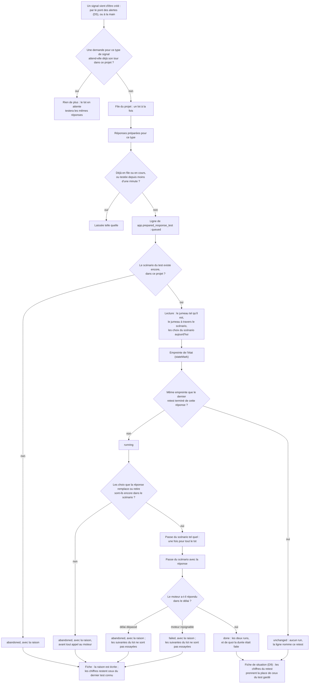

**Règles.**
- **Le déclencheur est l'ouverture d'un signal**, par le pont des alertes ou à la main. La demande part après la création du signal et personne ne l'attend : lever un signal, lire sa fiche et engager une réponse ne dépendent pas du moteur. Un moteur injoignable laisse la fiche entière et « Engage » utilisable.
- **Aucun modèle de langage.** Un retest est fait de passes du moteur et de rien d'autre.
- **Le scénario tel qu'il est maintenant.** Le retest tourne sur les choix que le scénario contient aujourd'hui et sur le jumeau lu à l'instant, avec l'horizon et l'activité du test d'origine. Les choix que la réponse remplace ou retire se retrouvent par leur contenu, pas par la ligne qui les portait : un choix supprimé puis réécrit est le même choix. S'il n'est plus dans le scénario, le retest est abandonné et le dit, plutôt que de tourner sur autre chose.
- **Les mêmes chiffres que Run.** Les passes sont celles d'une option testée (`ScenarioRunner.full`, A4). Un test rejoue l'enregistrement de parité et retrouve les chiffres de la page.
- **Un run à la fois par projet.** Les lots d'un projet se suivent. Des signaux d'un même type qui s'ouvrent ensemble ne demandent qu'un lot.
- **Pas de run quand rien n'a changé.** L'empreinte de l'état (`stateMark`) couvre ce que le moteur reçoit : les sites et ce qu'ils portent, les territoires, les routes, le modèle déclaré, les choix du scénario, l'horizon et l'activité. L'heure de la lecture n'en fait pas partie. Avec la même empreinte que le dernier retest terminé, la ligne est `unchanged`, nomme ce retest, et le moteur n'est pas sollicité.
- **Une réponse testée depuis moins d'une minute est laissée telle quelle** (`MIN_GAP_MS`), comme une réponse déjà en file ou en cours.
- **Le scénario tel quel ne passe qu'une fois par lot.** Trois réponses font quatre passes, pas six.
- **Un délai.** Passé trois minutes (`RETEST_TIMEOUT_MS`), le retest est abandonné et le dit. Quand le moteur ne répond pas, les réponses suivantes du lot ne sont pas essayées : chacune n'attendrait que le même silence.
- **Jamais un run inachevé comme résultat.** En file, en cours, abandonné ou raté : la fiche dit où il en est et pourquoi, et ses chiffres restent ceux du dernier test connu. La file vit dans la mémoire du serveur : au démarrage, une ligne restée en file ou en cours est close comme abandonnée.
- **« L'état du moment » a une durée.** Un retest est dit « on the current state » pendant quinze minutes (`CURRENT_FOR_MS`) après son run, ou après la dernière fois où l'état a été retrouvé identique. Ensuite la fiche écrit de quand il date (« Tested on the network as it was 3 h ago ») et le signale avant le clic.
- **La fiche énonce les conditions du run.** Sous les chiffres d'un retest, elle écrit que l'état de départ est le jumeau lu au moment du test, donc mesuré, et que la réponse, les événements et les choix du scénario sont des hypothèses. Un run reste le résultat d'un modèle sous ces conditions, pas une prévision.
- **La décision garde ce que la fiche montrait** : les chiffres du test gardé comme attendu, et ceux du retest à côté, avec leur date (A9).
- **Durée.** Sur le jumeau de Montréal, la première réponse d'un lot est retestée en une minute : deux secondes pour lire le jumeau, puis deux passes du moteur de vingt-neuf secondes chacune, le scénario tel quel puis le scénario avec la réponse ; la propagation compte pour moins d'une seconde. Chaque réponse suivante du lot ajoute une passe. Chaque retest garde de quoi sa durée était faite (`timing`) : c'est une mesure, pas un résultat.
- **Ce que le retest ne fait pas.** Il part à l'ouverture d'un signal, pas tant que la fiche reste ouverte : la fiche d'un signal ouvert depuis des heures montre un retest d'il y a des heures, et le dit ([issue 26](https://github.com/V1ktor7/obscyro/issues/26)). Et il ne retient que les chiffres des deux runs : les sites et les arrivées jour par jour d'une décision restent ceux du test gardé.
- Des unités et des valeurs agrégées, jamais une personne.

**Code.** `backend/src/services/response-retest.ts` (`stateMark`, `retiredNow`, `retestOne`, `Retests`, `sqlStore`, `liveTest`, `expectedOnEngage`, `startRetests`, `requestRetests`), `alert-bridge.ts` et `backend/src/routes/signals.ts` (la demande), `backend/src/index.ts` (le démarrage), `prepared-responses.ts` (`onCard`), `backend/src/routes/situation.ts`, migration `066_prepared_response_test.sql` ; `frontend/app/studio/situation/PreparedResponses.tsx`, `SituationView.tsx`, `prepared-api.ts`.
**Tests.** `response-retest.unit.test.ts`, `alert-bridge.unit.test.ts` ; `PreparedResponses.test.tsx`, `SituationView.test.tsx`, `DecisionsTab.test.tsx`.

## A12. Prix, registre des coûts et délai d'une option

**But.** Mettre à côté de chaque option ce qu'elle coûte et le jour où elle peut être prête, pour qu'une personne compare trois choses : ce que ça change, en combien de temps, à quel prix. Aucun prix n'est écrit dans le code. Un prix est un objet du jumeau, déclaré par l'établissement ; le registre en fait des lignes qu'on peut refaire à la main. Ce n'est pas une trésorerie : ni budget, ni financement, ni encaisse.

**La liste de prix, et le registre d'une option.**

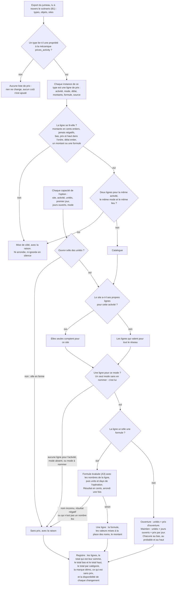

**Le délai d'un mode**, contrôlé avant tout run.

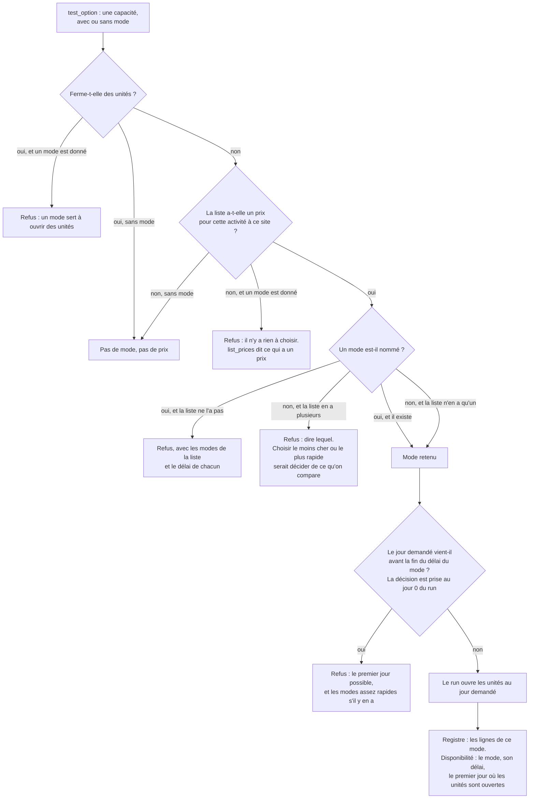

**La marque des options qu'aucune autre ne bat.**

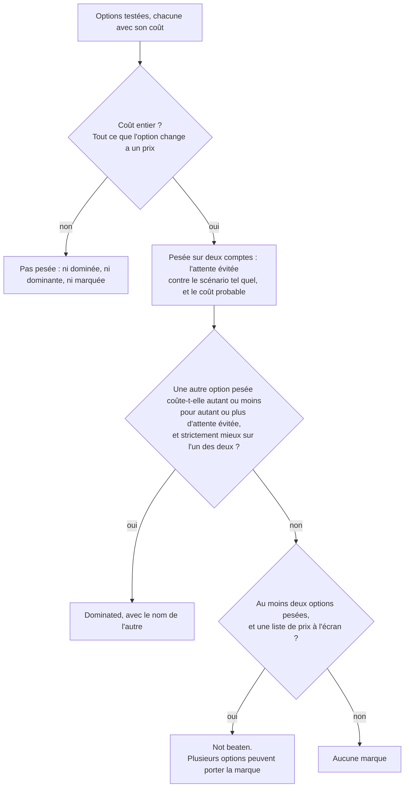

**Règles.**
- **L'argent est une donnée du jumeau, pas du code.** Une liste de prix est un type d'objet que l'établissement nomme comme il veut, dont les propriétés sont liées à onze mécaniques (`PRICE_MECHANICS`) : ce que la ligne tarife (`prices_activity`), le prix d'une unité ouverte un jour et celui de son ouverture, chacun avec un bas et un haut, une formule (`price_formula`), le mode (`price_mode`), son délai en jours (`price_lead_days`) et la source (`price_source`). Chaque instance est une ligne. Aucun montant n'est écrit dans l'API ni dans le moteur, et aucun type n'est reconnu à son nom. Un jumeau qui ne déclare aucun prix n'a aucun prix.
- **Un prix vise une sorte de ressource, pas chaque unité.** La ligne nomme une activité, c'est-à-dire le nom du type dont les unités sont la capacité : soixante lits qu'on ajoute n'existent pas encore et ont quand même un prix, et corriger un prix ne touche qu'une ligne. Le nom se compare sans majuscules, sans accents, et sans distinguer une espace d'un soulignement : « Soins intensifs » et `soins_intensifs` sont la même activité.
- **Le prix d'un site passe avant.** Une ligne rattachée à une unité, par un lien de placement, vaut pour ce site (`priced_at`, B1). Un site qui a ses propres lignes pour une activité n'est tarifé que par elles ; les autres sites le sont par les lignes sans rattachement, qui valent pour tout le réseau.
- **Des cents entiers, de la ligne au total.** Un montant se déclare en cents entiers : 125050 pour 1 250,50 $. Un montant qui n'en est pas un est refusé plutôt qu'arrondi, parce qu'arrondir un prix, c'est le changer. Chaque ligne du registre est en cents entiers, et un total est la somme de ses lignes : aucune somme n'est un nombre à virgule. Le résultat d'une formule est arrondi une fois, au cent.
- **Une fourchette se lit en trois passes.** Un montant peut porter un bas et un haut. Le registre donne alors trois totaux : bas, probable, haut. Rien n'est tiré au hasard. Ce que l'écran compare entre deux options est le coût probable ; la fourchette est écrite à côté.
- **Un mode est un prix et un délai.** Normal en quatorze jours, accéléré en trois à un autre prix : c'est ce qui fait exister « plus vite coûte plus cher ». La décision est prise au jour 0 du run ; une capacité ne peut donc pas être ouverte avant le délai de son mode, et `test_option` refuse le jour qui le demande, en disant le premier jour possible. Le moteur, lui, ne retarde rien : il ouvre les unités au jour demandé, une fois ce jour admis. Une ligne sans mode s'appelle `standard` ; une ligne sans délai en déclare zéro, et l'écran écrit qu'aucun délai n'est déclaré, pas que la chose est immédiate.
- **Une fonction de coût est une formule, pas du code.** Elle s'écrit dans la langue de la calculatrice (A3) et peut nommer deux sortes de valeurs : les nombres de sa propre ligne de prix, par le nom de la propriété en minuscules, et les quantités de l'opération. Pour une capacité ouverte, ces quantités sont `units` et `days`, et elles passent avant un nombre de la ligne qui porterait le même nom. La ligne du registre garde la formule, les valeurs mises à la place des noms et le résultat : « pourquoi ça coûte tant » a une réponse qu'on peut refaire.
- **Sans prix n'est pas gratuit.** Une activité que la liste ne contient pas, des unités fermées, un mode qu'il fallait nommer, une formule qui nomme une valeur absente ou dont le résultat n'est pas un prix : aucune ligne, et la raison est écrite parmi ce qui est sans prix. Jamais un zéro. Le coût de l'option n'est alors pas dit entier (A8).
- **Un prix de démo se voit, sur lui et sur ce qui en découle.** Une ligne sans source est un prix de démo : elle le porte, la ligne du registre aussi, et tout total qui la contient. Parmi ce sur quoi l'option repose, un prix qui nomme sa source est **publié** ; un prix de démo est une **hypothèse** (`priceBasis`).
- **Ce que le coût couvre.** Le coût des choix, et seulement lui : ouvrir des unités, puis les garder ouvertes pendant les jours du run. Pas ce que le réseau coûte à faire tourner, pas le personnel ni les stocks, que le jumeau ne contient pas, et pas ce qu'une fermeture ferait économiser. L'écran le dit.
- **La santé et l'argent restent séparés.** Rien ne convertit une attente en dollars, et aucun score ne mélange les deux. « Dominated » et « Not beaten » ne demandent aucun taux de change : ils disent seulement qu'une option fait au moins aussi bien qu'une autre sur les deux comptes à la fois, ou qu'aucune ne le fait contre elle. Plusieurs options peuvent être « Not beaten » ; choisir entre elles revient à la personne.
- **Sans liste de prix, rien ne change.** Les mêmes options, les mêmes chiffres, les mêmes cartes ; « Not beaten » n'apparaît qu'avec une liste de prix à l'écran.
- **Un scénario peut changer un prix.** Le catalogue se lit dans l'export du jumeau vu à travers le scénario, comme tout le reste : un scénario qui modifie une ligne de prix par `set_property` (B5) change le catalogue de ce scénario, sans rien construire de plus.
- **Où les prix se voient et se corrigent.** Une ligne de prix est une instance : elle se crée et se corrige dans la vue « Instances » de l'ontologie, ou arrive par un pipeline comme le reste du jumeau. La vue « Functions » montre la liste entière, les formules avec ce que chacune peut nommer, et les lignes mises de côté avec leur raison. Le panneau d'un type montre les lignes qui tarifent ses unités. L'analyste lit la même liste par `list_prices`.
- **Ce qui manque.** Seule la capacité qu'une option ouvre est tarifée. Un transfert de patients n'a pas de prix : sa formule (un forfait, tant par kilomètre) aura de quoi s'appliquer le jour où le registre tarifera un transfert, avec ses propres quantités. Une mesure n'a pas de prix. Les coûts des réponses enregistrées restent les montants de leurs règles, hors de la liste (B4).

**Code.** `backend/src/services/price-catalogue.ts` (`catalogueOf`, `modesFor`, `priceFor`, `priceListOf`, `fold`, `OPERATION_NAMES`), `cost-ledger.ts` (`ledgerOf`, `linesOf`, `formatCents`), `analyst-options.ts` (`settleMode`, `withPriceList`, `priceBasis`, `priceLines`), `analyst-tools.ts` (`list_prices`), `analyst-calc.ts` (`evaluate`), `property-schema.ts` (`PRICE_MECHANICS`), `twin-export.ts` (`priced_at`), `decisions.ts`, route `GET /v1/ontology/:env/twin/prices` dans `backend/src/routes/twin.ts` ; `simulation-service/app/events/mechanics.py` (`PRICE_MECHANICS`) ; `frontend/app/studio/simulation/hex/option-cards.tsx` (`CostLine`, `DelayLine`, `DemoPrice`, `weighOptions`), `OptionsTab.tsx`, `DecisionsTab.tsx`, `frontend/app/studio/manager/PriceList.tsx`, `price-list.ts`, `frontend/lib/money.ts`, `frontend/lib/property-schema.ts`.
**Tests.** `cost-ledger.unit.test.ts` (le calcul à la main, la formule, la valeur absente, le prix d'un site, la fourchette), `analyst-options.unit.test.ts` (le mode et son délai, sans liste de prix rien ne change, le montant inventé retiré, la décision garde le coût), `twin-figures.unit.test.ts`, `tests/test_events_mechanics.py` ; `option-cards.test.tsx`, `OptionsTab.test.tsx`, `DecisionsTab.test.tsx`, `manager/PriceList.test.tsx`, `PropertyRowsEditor.test.tsx`.

## B1. Export du jumeau

**But.** Mettre le jumeau dans la forme que lit le moteur. Le moteur est en Python et l'ontologie en Postgres : ce qui traverse est une charge utile, pas une connexion. Rien ici ne reconnaît un nom de type ou de lien : tout est déclaré (rôle du type, comportement du lien, mécanique de la propriété).

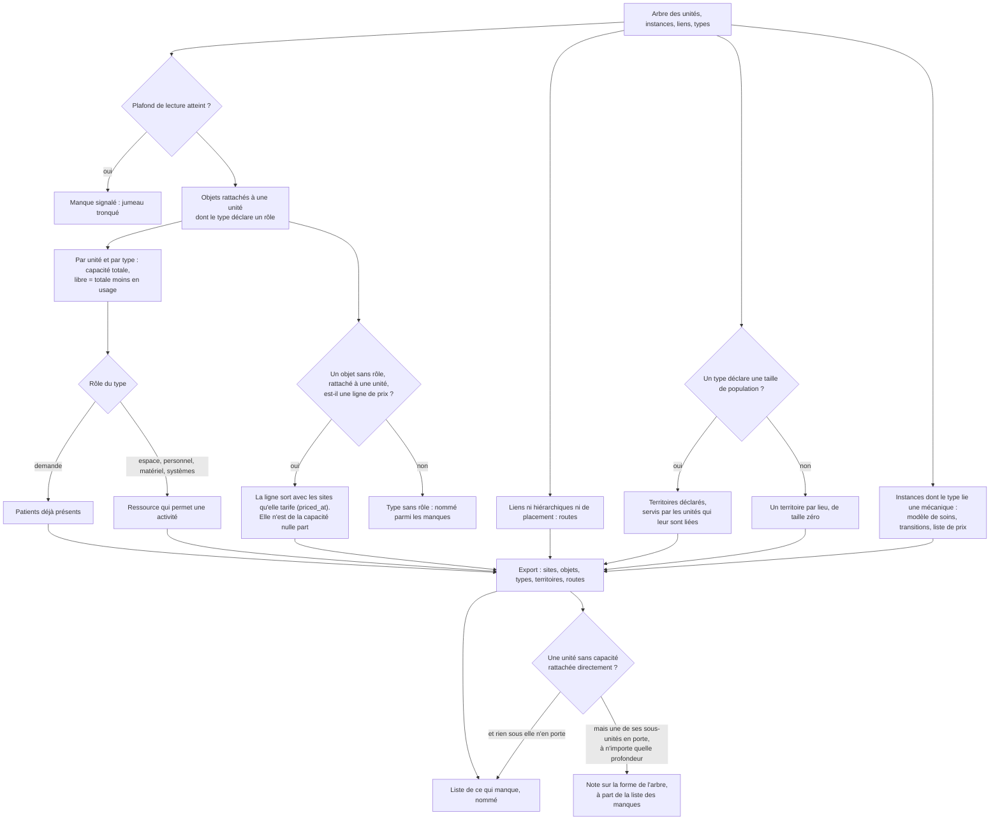

**Règles.** Seul ce qui est rattaché à une unité elle-même compte pour elle (`facilitiesFrom`) : les services d'un hôpital sont des sites à part entière, et leurs lits sont les leurs. C'est la différence avec la page des unités, qui additionne tout ce qui est sous une unité (D6, D9). Une unité peut donc sortir sans capacité pour deux raisons qui n'ont rien à voir, et l'export les sépare (`capacityFindings`). Si une de ses sous-unités porte de la capacité, c'est la forme de l'arbre : un établissement dont tous les lits sont dans ses installations. L'export le note à part (`structure`, code `CAPACITY_IN_SUBUNITS`), jamais parmi les manques, et la page de l'unité montre cette capacité. Si rien sous elle n'en porte, c'est un manque (`FACILITY_WITHOUT_RESOURCES`), et la page n'en montre aucune. « Sous » a ici le sens de la page des unités : les deux lectures parcourent l'arbre avec la même fonction (`buildDescendantMap`). Un lit déjà occupé n'est pas de la capacité libre. Un territoire sans chiffre de population apparaît quand même, à zéro, dans la liste des manques. Une route n'a pas de débit dans l'ontologie : elle sort à zéro, et c'est signalé. Le plafond de lecture est `ROLLUP_INSTANCE_CAP` ; l'atteindre se dit, parce que tout le reste serait une sous-estimation silencieuse. Une ligne de prix voyage comme les autres objets dont le type lie une mécanique : avec ses propriétés, et la liste des unités auxquelles elle est rattachée (`priced_at`), qui dit quels sites elle tarife. Elle n'est comptée comme capacité nulle part, et son type ne figure pas parmi les types sans rôle. Une liste de prix n'est pas un modèle de soins : un jumeau qui ne déclare que des prix garde, pour le moteur, le modèle par défaut (`bindsAnyMechanic` ignore les mécaniques de prix, comme `binds_care_model` du côté du moteur). Le moteur ne lit aucun prix.

**Code.** `backend/src/services/twin-export.ts` (`buildTwinExport`, `facilitiesFrom`, `capacityFindings`), `twin.ts` (`buildDescendantMap`), `property-schema.ts`. **Tests.** `twin-export.unit.test.ts`, `twin-figures.unit.test.ts`, `scenario-lens-links.unit.test.ts`.

## B2. Un pas du moteur d'événements

**But.** Faire avancer le réseau d'un pas : appliquer l'événement, décider la réponse, soigner ou non, propager les pannes, tout écrire. L'ordre dans un pas est une décision de modélisation, écrite une seule fois.

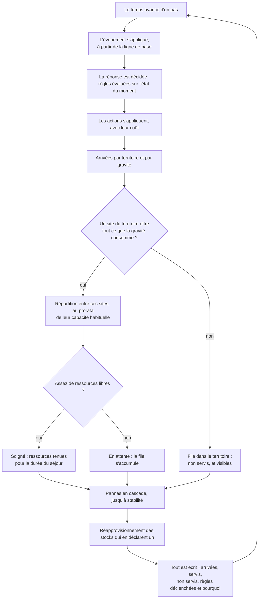

**Règles.**
- La réponse est décidée avant les soins : une politique réagit dans le pas où l'événement arrive.
- Une capacité se reconstruit depuis une ligne de base à chaque pas ; une file s'accumule. La façon de composer appartient à la quantité, pas à l'auteur de l'événement (voir `simulation-service/app/events/README.md`).
- Un site plein reste le bon endroit où attendre ; un site qui n'offre pas l'activité ne le devient jamais.
- Le poids d'un site est sa capacité habituelle pour la ressource la plus rare que la gravité consomme, pas ce qu'il lui reste de libre ce jour-là. Pondérer par le libre donnerait au réseau un équilibrage parfait et gratuit, c'est-à-dire exactement ce qu'une politique de transfert est censée acheter.
- L'occupation habituelle d'un scénario est tenue à chaque site pour tout le run.
- Un changement de capacité est un changement de ce qui est libre, du même montant, et rien d'autre. Des lits ouverts arrivent vides. Des lits fermés partent d'abord de ce qui est libre ; le reste, ce sont des lits encore occupés, portés en dépassement jusqu'à ce qu'assez de patients soient sortis : une fermeture n'admet ni ne renvoie personne. Quand elle se termine, les lits reviennent de la même façon.
- Même système, même événement, même politique, même graine : même trajectoire.

**Code.** `simulation-service/app/events/dynamics.py` (`Engine.run`, `_apply_perturbations`, `_deliver_care`), `domain.py`, `objects.py`, `ontology.py`, `mechanics.py`. **Tests.** `simulation-service/tests/`, dont `test_events_occupancy.py` pour l'occupation habituelle et les changements de capacité.

## B3. Propagation

**But.** Faire circuler une condition dans la population sans que le moteur connaisse le mot « infectieux ». Le jumeau déclare des états et des transitions ; le moteur ne connaît que trois formes de transition.

```mermaid
flowchart TD
    A["Par territoire : combien de personnes dans chaque état"] --> B["Pour chaque transition déclarée"]
    B --> C{"Forme"}
    C -->|"spontanée"| D["Un taux de sortie de l'état, sans autre cause"]
    C -->|"couplée"| E["Un taux proportionnel à la part d'un autre état,<br/>le long d'une couche de contact"]
    C -->|"forcée"| F["Un taux qu'un événement modifie dans le temps"]
    E --> G["Mélange entre territoires, par couche,<br/>si le jumeau en déclare"]
    D --> H["Personnes déplacées d'un état à l'autre"]
    G --> H
    F --> H
    H --> I{"La transition produit une demande ?"}
    I -->|"oui"| J["Arrivées d'une gravité,<br/>remises au moteur d'événements"]
    I -->|"non"| K["États du pas suivant"]
    J --> K
    K --> A
```

**Règles.** Une mesure ou un variant multiplie une couche de contact, entre deux pas, pour certains territoires ou pour tous. Deux transitions qui décrivent le même passage avec deux taux sont refusées, pas arbitrées. Sans mélange déclaré, une éclosion ne sort pas de son territoire. Approximation assumée : un visiteur rencontre les résidents du lieu visité, à leur prévalence.

**Code.** `simulation-service/app/events/spread.py`, `backend/src/services/spread-payload.ts`. **Tests.** `simulation-service/tests/`, `spread-payload.unit.test.ts`.

## B4. Politiques, score et comparaison

**But.** Comparer des réponses sur un même événement, avec un score qu'on peut discuter.

```mermaid
flowchart TD
    A0["D'où vient la réponse : la bibliothèque de l'organisation,<br/>une réponse que le moteur écrit d'après le réseau,<br/>ou le tampon d'un scénario (A4)"] --> A
    A["Politique : règles ordonnées par priorité"] --> B["À chaque pas : condition évaluée<br/>sur l'état du moment"]
    B --> C{"Condition vraie ?"}
    C -->|"oui"| D["Action : transfert, renfort, réaffectation<br/>ou demande modifiée, avec délai, coût et efficacité"]
    C -->|"non"| E["Rien"]
    D --> F["Règle notée avec sa raison :<br/>occupation de tel site à 0,94, au-dessus de 0,90"]
    F --> G["Trajectoire"]
    E --> G
    G --> H["Comptes : chaque objectif garde sa série par pas<br/>et son total"]
    H --> I["Plusieurs graines par politique, moyenne de chaque compte"]
    I --> J{"Écart de plus d'une demi-personne<br/>sur les morts ?"}
    J -->|"oui"| K["Moins de morts d'abord"]
    J -->|"non"| L{"Sur les soins non rendus ?"}
    L -->|"oui"| M["Moins de soins non rendus d'abord"]
    L -->|"non"| N["Le moins coûteux d'abord.<br/>Égalité partout : l'ordre donné, la référence en tête"]
```

**Règles.**
- Une condition est un arbre typé, pas une chaîne évaluée : on peut la montrer et la faire varier par programme.
- Le classement se fait sur des comptes, dans l'ordre : morts, soins non rendus, coût. Un compte ne départage que les réponses à égalité sur les précédents, et un écart de moins d'une demi-personne est une égalité.
- C'est un ordre de priorités, pas un prix : une somme pondérée demanderait un taux de change entre une vie, un soin non rendu et un dollar, et il n'y en a pas d'honnête. L'ordre reste un jugement, et l'écran le dit.
- L'écran nomme le compte qui a décidé de la première place. Quand rien ne sépare les deux premières réponses, aucune n'est marquée meilleure.
- Comparer sur une seule graine reviendrait à optimiser la graine.
- **Une réponse se lance de deux endroits.** La page Events et le rejeu de la page des unités comparent plusieurs réponses sur un même événement et les classent, comme ci-dessus. La page Scenarios en suit une, posée comme un tampon de la recette, dans la passe « avec les choix » de son run (A4) ; c'est par là que l'analyste teste un transfert de patients (A8). Ce que chaque chemin sait faire et que l'autre ne sait pas : [analyst.md](analyst.md), « Deux façons de demander “et si” ».
- **Les coûts des réponses sont des prix de démo, et l'écran le dit.** Le coût d'une réponse est le montant que chacune de ses règles déclare, chaque fois qu'elle se déclenche. Ces montants sont écrits dans les réponses que le moteur fournit, ou saisis avec une réponse écrite à la main ; aucun ne vient de la liste de prix du jumeau (A12) et aucun n'a de source. Sous le classement de la page Events et sous les options du rejeu, une phrase le dit dès qu'un coût est compté (`costSentence`). Faire entrer ces montants dans la liste de prix reste à faire.
- **Une option dominée se marque de la même façon des deux côtés** : coûter autant ou plus pour obtenir autant ou moins, strictement pire sur l'un des deux (`dominatedBy`). Le rejeu de la page des unités compte tout coût que le moteur rend ; l'onglet Options ne pèse que les options dont le coût est entier (A8).

**Code.** `simulation-service/app/events/policy.py`, `scoring.py`, `harness.py` (`rank`, `decided_by`), `api.py` (`RANK_BY`), `frontend/app/studio/events/ranking.ts` (`rankingSentence`, `costSentence`), `frontend/app/studio/command/options.ts` (`rankOptions`, `dominatedBy`), `backend/src/services/sim-policies.ts`. **Tests.** `tests/test_events_ranking.py`, `ranking.test.ts`, `command/options.test.ts`.

## B5. Scénario en surcouche

**But.** Un scénario n'est pas une copie du jumeau : c'est une liste ordonnée de modifications lues par-dessus. Lire le jumeau « à travers » un scénario donne le monde tel qu'il serait.

```mermaid
flowchart TD
    A["Scénario demandé"] --> B["Chaîne des scénarios parents, les ancêtres d'abord"]
    B --> C["Modifications de chaque scénario,<br/>dans l'ordre de leur jour d'effet puis de saisie"]
    C --> D["Ne garder que celles en vigueur<br/>au moment lu dans le scénario"]
    D --> E{"Cible"}
    E -->|"instance ou lien"| F["Appliquée à la lecture du jumeau :<br/>créer, modifier, supprimer, lier, délier"]
    E -->|"paramètre"| G["Ignorée par les lectures du jumeau :<br/>ce sont les tampons et réglages de la page"]
    F --> H["Jumeau vu à travers le scénario"]
```

**Règles.** Une lecture qui reçoit une lentille qu'elle ne sait pas honorer échoue bruyamment : comparer la réalité à elle-même en silence serait le pire résultat. Ce qu'un scénario invente reçoit un identifiant stable, dérivé, pour ne pas apparaître et disparaître d'une lecture à l'autre. La lecture « à une date passée » est déclarée mais pas faite : les propriétés sont écrasées en place.

**Code.** `backend/src/services/scenario-overrides.ts`, `scenario-apply.ts`, `ontology-lens.ts`. **Tests.** `scenario-overrides.unit.test.ts`, `scenario-apply.unit.test.ts`, `ontology-lens.unit.test.ts`.

## B6. Événement tiré d'une série observée

**But.** Le chemin le plus court entre un fichier publié et un run : ce qui a été admis chaque jour devient les arrivées de l'événement, sans script à la main.

```mermaid
flowchart LR
    A["Lignes datées d'un jeu de données"] --> B["Un compte par jour, depuis le jour zéro"]
    B --> C["Un effet par jour sur le volume de demande"]
    C --> D["Événement que le moteur sait déjà faire tourner"]
```

**Règles.** La cible est un volume, pas une incidence : une incidence est par mille personnes et demanderait une taille de population que le fichier ne porte pas.

**Code.** `backend/src/services/sim-event-from-rows.ts`. **Tests.** `sim-event-from-rows.unit.test.ts`.

---

# C. Prévision et laboratoire

## C1. Boucle de prévision quotidienne

**But.** Savoir ce que vaut une prévision faite chaque matin avec ce qu'on savait ce matin-là. Chaque prévision est figée le jour où elle est faite ; personne ne peut la retoucher après coup.

```mermaid
flowchart TD
    A["Chaque matin"] --> B["Pour chaque horizon : 1, 3, 7, 14 et 21 jours,<br/>et pour chaque modèle, A et B"]
    B --> C["Prévoir avec ce qui était connu ce matin-là :<br/>la cible jusqu'à la veille, le moteur un jour plus tôt"]
    C --> D["Figer : insérée une fois, jamais modifiée"]
    A --> E{"Lundi, ou premier matin ?"}
    E -->|"oui"| F["Réentraîner sur tout ce qui est connu"]
    F --> G["Erreur à attendre : mesurée sur les 56 derniers jours,<br/>sans les avoir vus"]
    D --> H["Quand le jour visé arrive : écart entre prévu et observé"]
    G --> I{"Erreur des 28 derniers jours<br/>au moins 1,5 fois l'erreur attendue ?"}
    H --> I
    I -->|"oui"| J["Alerte de dérive, levée sous 1,25 fois"]
    H --> K{"Le lundi : sur 56 jours, l'autre modèle fait-il<br/>au moins 10 pour cent mieux à 7, 14 et 21 jours ?"}
    K -->|"oui"| L["Il prend la place du modèle en vigueur"]
```

**Règles.**
- Modèle A : régression ridge sur 14 jours de la cible et le calendrier. Modèle B : gradient boosting, avec le moteur s'il y en a un.
- Il faut au moins 90 jours d'historique avant le premier matin, et 60 lignes pour un réentraînement.
- La dérive demande au moins 14 prévisions notées dans la fenêtre ; le remplacement, au moins 28 par horizon.
- Le modèle en vigueur, les alertes et les remplacements ne sont pas stockés : ce sont des règles fixées d'avance, appliquées à des prévisions figées. Elles donnent la même réponse à chaque lecture.
- Le rejeu se fait par blocs de 28 matins, dans n'importe quel ordre.

**Code.** `backend/src/services/forecast-loops.ts`, `simulation-service/app/lab/loop.py`, `frontend/app/studio/lab/loop-rules.ts`, migration `058_forecast_loops.sql`. **Tests.** `forecast-loops.unit.test.ts`, `tests/test_lab_loop.py`, `loop-rules.test.ts`.

## C2. Prévision d'une série et apprentissage sur table

**But.** Une prévision est une régression dont les variables sont le passé. Ce qui change n'est pas le modèle, c'est la façon de le noter.

```mermaid
flowchart TD
    A["Série datée"] --> B["Variables : retards de la cible, calendrier,<br/>retards d'une autre série au besoin"]
    B --> C["Un modèle par horizon, entraîné pour cet horizon"]
    C --> D["Évaluation en marche avant :<br/>plusieurs origines successives"]
    D --> E["Référence : pareil que la dernière fois"]
    E --> F["Score : erreur divisée par celle de la référence.<br/>1,0 vaut ne rien faire"]
    T["Table quelconque"] --> U["Cible, variables, estimateur"]
    U --> V{"Colonne de temps ?"}
    V -->|"oui"| W["Découpage chronologique possible, et noté"]
    V -->|"non"| X["Découpage aléatoire"]
    W --> Y["Score comparé à une référence qui prédit la moyenne"]
    X --> Y
    Y --> Z["Lignes écartées : comptées et rapportées"]
```

**Règles.** Un modèle qui ne bat pas la référence ne se déploie pas. Un découpage aléatoire sur une table ordonnée dans le temps s'entraîne sur la semaine prochaine : quand une colonne de temps existe, le découpage honnête est offert. Le contexte d'entraînement est gardé avec le score.

**Code.** `simulation-service/app/lab/timeseries.py`, `tabular.py`, `sandbox.py` (code de l'utilisateur, isolé), `backend/src/services/lab-models.ts`. **Tests.** `simulation-service/tests/`.

## C3. Signaux précurseurs

**But.** Dire quel signal en précède un autre et de combien, avec les raisons d'en douter calculées dans la même passe.

```mermaid
flowchart TD
    A["Un signal et une cible"] --> B["Taille effective : une courbe lisse de 90 jours<br/>peut ne porter que 10 points indépendants"]
    B --> C["Corrélation à chaque décalage"]
    C --> D["Seuil relevé : beaucoup de tests ont été faits"]
    D --> E["Décalage retenu, vérifié sur une période<br/>tenue hors de la recherche"]
    E --> F["Série longue découpée en épisodes,<br/>une vague chacun"]
    F --> G["Même question posée à chaque épisode"]
    G --> H["Ce qui est rapporté : l'accord entre épisodes,<br/>pas la force d'un seul"]
```

**Règles.** Choisir le décalage qui maximise la corrélation puis rapporter cette corrélation est circulaire : d'où la période tenue à part. Une série longue n'est pas beaucoup d'observations : c'est la réplication d'une vague à l'autre qui tranche.

**Code.** `backend/src/services/lag-scan.ts` (`effectiveSize`, `crossCorrelate`, `findLead`), `episodes.ts` (`findEpisodes`, `replicationAcross`). **Tests.** `lag-scan.unit.test.ts`, `episodes.unit.test.ts`.

## C4. Laboratoire causal

**But.** Explorer, sur les données vivantes d'un environnement, quels signaux en précèdent d'autres, et ce que deviendrait une série si l'on en perturbait une autre.

```mermaid
flowchart TD
    A["Signaux horaires : créations par type,<br/>moyenne d'une propriété, activité d'un canal"] --> B["Pour chaque paire : corrélation au meilleur décalage"]
    B --> C["Arêtes : qui précède qui"]
    A --> D["Modèle à un pas, régression ridge sur le passé"]
    D --> E["Prévision : le modèle itéré vers l'avant"]
    E --> F["Événement injecté : une variable future est perturbée"]
    F --> G["Trajectoire simulée"]
```

**Règles.** Le décalage va de 1 au maximum demandé, pour que la direction suive le temps. Une arête est une précédence, pas une cause prouvée : voir C3 pour les raisons d'en douter.

**Code.** `backend/src/services/causal-lab.ts`. **Tests.** aucun test unitaire dédié à ce jour.

## C5. Simulation hybride

**But.** Faire tourner un graphe de modèles sur une branche de scénario : un modèle mécaniste comme base, des modèles appris par-dessus quand ils existent.

```mermaid
flowchart TD
    A["Charge utile : branche du jumeau, paramètres"] --> B["Graphe de contacts :<br/>appartenance par les liens de lieu, voisinage par les liens de contact"]
    B --> C["Graphe de modèles, exécuté dans l'ordre de ses dépendances"]
    C --> D["Nœud mécaniste : SEIR à graine fixe"]
    D --> E["Nœuds appris : résidu, réseau sur graphe,<br/>substitut, prévision"]
    E --> F["Bandes de quantiles, écart à la base,<br/>importance des variables"]
    C --> G{"Service de simulation absent,<br/>ou modèle lourd non installé ?"}
    G -->|"oui"| H["Retour au SEIR mécaniste, dans l'API"]
```

**Règles.** Le SEIR Python reproduit celui de l'API à graine égale. Le service est sans état : il ne touche jamais la base. Sans le service, la route de simulation retombe sur le SEIR de l'API.

**Code.** `simulation-service/app/runner.py`, `graph.py`, `contacts.py`, `mechanistic.py`, `uncertainty.py`, `training.py`, `models/` ; `backend/src/services/simulation.ts`, `ml-simulation.ts`. **Tests.** `simulation-service/tests/`, `simulation.unit.test.ts`, `ml-simulation.unit.test.ts`.

---

# D. Données

## D1. Extraction clinique

**But.** Tirer d'un texte clinique des concepts codés et leur contexte, sans modèle génératif.

```mermaid
flowchart TD
    A["Texte clinique"] --> B["Repérage des mentions"]
    B --> C["Plongement de chaque mention"]
    C --> D["Recherche des descriptions SNOMED les plus proches,<br/>dans Postgres"]
    D --> E{"Proximité et marge sur le suivant"}
    E -->|"nettes"| F["Résolu"]
    E -->|"douteuses"| G["Signalé"]
    E -->|"insuffisantes"| H["Non résolu"]
    A --> I["Contexte par règles, en français et en anglais :<br/>affirmé ou nié, sujet, temporalité"]
    F --> J["Décision : accepter, signaler, faire remonter"]
    G --> J
    I --> J
    J --> K{"Persistance demandée ?"}
    K -->|"oui"| L["Constat clinique écrit dans l'ontologie,<br/>avec sa provenance"]
```

**Règles.** La correspondance SNOMED n'utilise que la base Postgres d'Obscyro. Un patient n'est rattaché que par un identifiant explicite, jamais deviné depuis un nom ou le texte.

**Code.** `nlp-service/app/main.py`, `ner.py`, `context.py`, `embeddings.py`, `pg_index.py` ; `backend/src/services/persist-extract.ts`. **Tests.** `nlp-service/tests/`, `persist-extract.integration.test.ts`.

## D2. Pipelines de données

**But.** Transformer des jeux de données en objets de l'ontologie ou en d'autres jeux, par un graphe de nœuds.

```mermaid
flowchart LR
    A["Entrée : dataset_input"] --> B["Table : filter, select, derive, cast,<br/>expand, join, latest"]
    B --> C["Texte clinique : text_field,<br/>extract_snomed, validate_confidence"]
    B --> D["Sorties : object_output, dataset_output"]
    C --> D
```

**Règles.** La liste des sortes de nœuds existe en un seul endroit (`NODE_KINDS`) : le schéma de la route est construit à partir d'elle, pour qu'un nœud accepté soit toujours un nœud exécutable. Les objets écrits passent par l'identité (D3). Les canaux d'ingestion (`channel-runner.ts`) font le même travail pour une charge utile reçue par webhook ou par appel REST.

**Code.** `backend/src/services/pipeline.ts`, `channel-runner.ts`, `rest-connector.ts`, `connectivity.ts`. **Tests.** `pipeline*.unit.test.ts`, `channel-*.unit.test.ts`, `rest-connector*.unit.test.ts`.

## D3. Identité des objets

**But.** Dire quelles propriétés font qu'un objet est « la même chose réelle », pour que deux pipelines ne créent pas deux fois le même lit.

```mermaid
flowchart TD
    A["Objet à écrire"] --> B["Clés d'identité déclarées sur son type"]
    B --> C{"Un objet porte déjà ces valeurs ?"}
    C -->|"oui"| D["Mise à jour de cet objet"]
    C -->|"non"| E["Création"]
    D --> F["Contrainte tenue par la base elle-même"]
    E --> F
```

**Règles.** L'identité est déclarée sur le type, pas fournie par le pipeline qui passe. La contrainte vit dans la base (migration 043).

**Code.** `backend/src/services/identity.ts`, `ontology.ts` (`upsertInstanceByIdentity`). **Tests.** `identity.unit.test.ts`.

## D4. Qualité des données

**But.** Contrôler chaque objet de l'ontologie par couches, de la plus simple à la plus statistique.

```mermaid
flowchart TD
    A["Un objet"] --> L1["L1 Forme : type de chaque propriété,<br/>code SNOMED existant"]
    L1 --> L2["L2 Valeur : bornes déclarées,<br/>pas de négatif, date valide"]
    L2 --> L3["L3 Cohérence : ordre des dates,<br/>objet sans aucun lien"]
    L3 --> L4["L4 Population : valeur aberrante<br/>parmi les objets du même type"]
    L4 --> L5["L5 Source : source muette depuis 7 jours,<br/>valeurs identiques répétées"]
    L5 --> L6["L6 Anomalie : écart interquartile<br/>ou écart robuste à la médiane"]
    L6 --> F["Constats, chacun avec sa couche et son code"]
```

**Règles.** En L6, l'un ou l'autre des deux tests suffit à signaler. Il faut au moins 12 valeurs du même type ; les seuils sont réglables (`DQ_IQR_K`, `DQ_ZSCORE_THRESHOLD`, `DQ_ANOMALY_MIN_SAMPLE`). Les couches L4 à L6 lisent toute la population, pour rester stables.

**Code.** `backend/src/services/data-quality.ts`. **Tests.** `data-quality.unit.test.ts`, `data-quality.integration.test.ts`.

## D5. Alertes du jumeau et signaux

**But.** Qu'un seuil franchi atteigne une personne en quelques secondes, où qu'elle soit dans le studio, avec de quoi juger : quelle unité, depuis quand, de quand date la valeur, et un clic vers l'unité et vers le signal. Une règle se déclenche à l'heure où le seuil est franchi, pas à l'heure où quelqu'un ouvre la page.

```mermaid
flowchart TD
    A["Évaluateur : une évaluation finie,<br/>attendre 5 s, ou deux fois sa durée si elle a été lente"] --> B["Projets qui ont au moins une règle"]
    B --> C["Métriques de chaque unité, sans lentille :<br/>la réalité, jamais un scénario.<br/>Chaque mesure qu'une règle surveille est datée<br/>sur ce qu'elle lit (D7)"]
    C --> D["Chaque règle évaluée"]
    D --> E{"La condition"}
    E -->|"tient, et aucune alerte ne tient déjà<br/>cette unité et cette règle"| F["Alerte ouverte, avec deux heures :<br/>de quand date sa valeur, d'après ce que sa mesure lit<br/>(et sur quoi cet âge repose),<br/>quand la donnée a été écrite ici"]
    E -->|"tient, et une alerte la tient déjà :<br/>ouverte, ou accusée à une gravité au moins égale"| F2["Valeur, âge de la valeur et ce sur quoi il repose rafraîchis ;<br/>l'heure d'écriture qui a ouvert l'alerte ne bouge pas.<br/>Rien de nouveau n'est ouvert"]
    E -->|"tenait, et ne tient plus de façon démontrée"| G["Alerte résolue, qu'elle soit ouverte ou accusée"]
    F -->|"une personne accuse réception"| F3["Alerte accusée : elle quitte la liste des ouvertes<br/>et reste au dossier tant que la condition tient"]
    F3 -->|"évaluation suivante"| D
    F --> H["Pont lancé tout de suite, une passe à la fois"]
    G --> H
    H -->|"alerte ouverte sans signal"| I["Signal créé, titré une fois"]
    H -->|"alerte résolue"| I3["Note sur son signal : la condition ne tient plus.<br/>Le signal reste ouvert"]
    I --> I2["Réponses préparées pour ce type :<br/>retest demandé, en arrière-plan (A11)"]
    I --> J["Workflow : étapes, approbation au besoin.<br/>Une réponse préparée engagée le fait avancer (A9)"]
    F --> K["Fil d'alertes : GET /alerts/feed<br/>alertes ouvertes, unité nommée, âges, signal, dernière évaluation"]
    I --> K
    K --> L["Cadre du studio : lu toutes les 3 s,<br/>une seule lecture pour toutes les pages"]
    L --> M["Pastille : combien sont ouvertes, et si la liste est à jour"]
    L --> N{"Alerte absente de la lecture précédente,<br/>et ouverte depuis ?"}
    N -->|"oui"| O["Bandeau sur toutes les pages, deux minutes :<br/>Situation, Open unit, Signal"]
    N -->|"non, ou première lecture"| M
    L --> P["Pages du jumeau : mêmes alertes sur la carte, la liste des unités, la fiche d'unité"]
    L --> Q["Response : le tableau se relit quand les signaux changent"]
    Q --> V{"Signal levé par une alerte résolue,<br/>et que personne n'a touché ?"}
    V -->|"non"| W["Vue Active, celle de l'arrivée :<br/>la carte dit si son alerte est accusée ou retombée"]
    V -->|"oui"| X["Vue Alert cleared : mis à part,<br/>et compté dans l'en-tête"]
    X -->|"une personne, un domaine, un motif"| Y["Clôture en lot : tous ou aucun,<br/>une ligne au journal de chaque signal, avec qui et pourquoi"]
    O -->|"clic sur Signal"| R["Response demande ce signal par son nom :<br/>il est listé même plus vieux que les 500 du tableau,<br/>et quelle que soit sa vue"]
    R --> S{"Dans ce projet ?"}
    S -->|"oui"| T["Sa fiche s'ouvre, dans son domaine"]
    S -->|"non"| U["L'écran dit que le lien ne mène à rien"]
```

**Règles.**
- **Cadence.** L'évaluateur se règle seul : une évaluation ne commence jamais avant la fin de la précédente, et l'attente vaut cinq secondes, ou deux fois la durée de la dernière évaluation si elle a été lente, sans dépasser trente secondes. Il ne peut donc pas prendre plus d'un tiers de l'attention de la base, quelle que soit la taille du jumeau. Une évaluation lente est écrite au journal du service.
- **Seule la réalité lève des alertes.** Une lecture faite à travers un scénario, ou à une autre date, n'évalue rien : une urgence qui déborde dans un « et si » ne doit pas arriver sur tous les écrans comme si elle arrivait.
- **La résolution ne se fait jamais dans une lecture** : sous une lentille qui cache des unités, leur absence ressemblerait à un service vidé. L'échec d'un projet ne coûte pas leur évaluation aux autres.
- **Deux heures de plus que l'ouverture.** `observed_at` : quand la valeur était vraie, d'après l'horodatage que la source publie (D7) ; vide quand la source ne le dit pas. `written_at` : quand la donnée qui a fait franchir le seuil a été écrite ici ; fixée à l'ouverture. `created_at - written_at` est le temps que nous avons mis à voir le dépassement, mesuré sur chaque alerte. Une alerte ouverte trois secondes après son écriture peut porter sur une valeur vieille de cinquante minutes : l'écran dit les deux.
- **L'âge d'une alerte est celui de sa propre valeur.** Il se compte sur les sources que lit la mesure de la règle, pas sur tout ce qui est sous l'unité (D7). Une alerte d'occupation des civières, dans une unité qui porte aussi une station de qualité de l'air, a l'âge du relevé des civières : avant, elle prenait celui de la station, deux heures pour une valeur de quatorze minutes. Deux alertes de la même unité peuvent donc avoir deux âges. Et une valeur n'emprunte jamais l'âge d'une autre source : si ce que la mesure lit ne publie aucune heure, l'alerte dit que l'âge est inconnu, même quand une autre source de l'unité en a un. L'évaluateur et une lecture de l'arbre par une page datent de la même façon : le calcul reçoit les mesures que les règles surveillent.
- **Un âge dit ce qu'il vaut.** `observed_basis` garde ce sur quoi l'âge repose, tel que le jumeau le calcule pour la mesure de la règle (D7), et suit la valeur à chaque évaluation. `observed` : l'horodatage de la source, l'écran écrit « value read 37 min ago ». `partial` : une des sources que la mesure lit n'a publié aucune heure lisible, l'âge est un plancher et l'écran écrit « value read at least 2 h ago ». Les autres (`undeclared`, `unreadable`, `zone-unknown`, `empty`) : pas d'âge, l'écran écrit « age of the value unknown » et donne la raison, au survol dans le bandeau et en toutes lettres sur la fiche de l'unité. La raison parle de la mesure (« one of the sources this measure reads… »), pas de l'unité. Le qualificatif est dans le texte, pas dans une infobulle : un chiffre se répète sans son infobulle.
- **Le pont suit l'évaluateur.** Une évaluation qui ouvre ou ferme une alerte lance le pont aussitôt ; l'horloge propre du pont (quinze secondes) reste comme filet. Les passes du pont se suivent, jamais deux à la fois : « un signal par alerte » repose sur un `NOT EXISTS` que deux passes simultanées franchiraient toutes les deux.
- **Un signal qui s'ouvre fait retester ce qui a été préparé pour son type.** Le pont le demande après avoir créé le signal et n'attend pas la réponse : le retest tourne derrière, un run à la fois par projet, sans modèle de langage (A11). Un signal créé à la main le demande aussi.
- **Une seule lecture pour tout le studio.** Le cadre lit le fil d'alertes toutes les trois secondes et le donne à toutes les pages. Avant, chaque page avait son horloge : dix secondes sur la fiche d'unité, trente sur le globe, une requête par unité sur l'arbre, un bouton sur Response.
- **Ce qui est une nouvelle.** Une alerte est annoncée quand elle est dans une lecture, n'était pas dans la précédente, et s'est ouverte depuis cette lecture précédente (à deux minutes près, pour une alerte écrite pendant la lecture). La première lecture n'annonce rien : ces alertes étaient ouvertes avant qu'on regarde, et un écran qui crie quarante vieilles alertes à l'arrivée apprend à ne plus le lire. Une alerte déjà ouverte à la lecture précédente, qui n'entre dans la liste que maintenant parce que la liste était pleine, n'est pas une nouvelle.
- **Un écran qui revient annonce ce qu'il a manqué.** Ordinateur en veille, onglet gelé par le navigateur, réseau coupé : à sa première lecture, l'écran annonce ce qui s'est ouvert pendant qu'il ne lisait pas, et dit son retard (« on this screen 26 min after it opened »). Le compteur qui passe de 44 à 45 sans dire laquelle est le silence que ce bandeau doit empêcher. L'annonce dure deux minutes, ou jusqu'à ce qu'on la ferme ; la fermer ne touche pas à l'alerte.
- **Le silence n'est pas le calme.** Sans lecture réussie depuis quinze secondes, la pastille dit que la liste n'est plus à jour et depuis combien de temps ; la dernière liste lue reste affichée, marquée comme ancienne. La liste dit aussi quand les seuils ont été vérifiés pour la dernière fois.
- **Les âges se comptent sur l'horloge du serveur**, pas sur celle du poste : un ordinateur réglé cinq minutes de travers ne vieillit pas une alerte de cinq minutes.
- **Un clic.** Depuis une alerte : sa fiche de situation (`/studio/situation?alert=…&unit=…&signal=…`, D9), son unité (`/studio/live?unit=…`, la fiche s'ouvre seule) et son signal (`/studio/response?signal=…`). Depuis un signal : sa fiche de situation et son unité. Le lien porte le projet, et celui d'une alerte porte aussi son unité : la fiche sait quoi lire une fois l'alerte retombée.
- **Un lien trouve son signal, quel que soit son âge.** Le tableau Response ne liste que les 500 signaux les plus récents. Une urgence au-dessus de son seuil depuis des semaines a une alerte encore ouverte, et un signal bien plus vieux que cela. Le tableau demande donc à l'API le signal que le lien nomme (`?signal=` sur `GET /command-board`) : il est ajouté à la liste, en tête, fermé ou non, mis à part ou non, cherché dans ce projet et ce périmètre seulement. S'il n'y est pas, l'écran le dit au lieu de montrer un tableau où rien ne s'ouvre.
- **Un accusé de réception tient tant que la condition tient.** Accuser réception dit « vu », pas « fini ». L'alerte quitte la liste des alertes ouvertes : plus de pastille, plus d'anneau sur la carte, plus d'annonce. Elle reste au dossier comme accusée, et chaque évaluation la rafraîchit au lieu d'en ouvrir une autre : pas de nouvelle alerte, pas de nouveau signal, pas de nouveau bandeau pour cette unité et cette règle. Son signal dit « acknowledged » et ne reçoit pas la note « la condition ne tient plus ». Quand la condition cesse, l'évaluateur résout l'alerte accusée comme une alerte ouverte ; si la condition revient ensuite, c'est un nouvel épisode, donc une nouvelle alerte. Seule une alerte ouverte s'accuse : accuser une alerte déjà retombée ne change rien.
- **Un cran de gravité de plus est une nouvelle.** Un accusé couvre la gravité qui a été accusée. La gravité est celle de la règle : deux seuils sur la même métrique (un avertissement à 85 %, un critique à 100 %) sont deux règles, donc deux alertes, et accuser la première ne fait pas taire la seconde. Si la règle elle-même passe à une gravité plus haute que celle de l'alerte accusée, une nouvelle alerte s'ouvre. Une gravité abaissée reste couverte.
- **Le tableau montre d'abord ce qui demande quelqu'un.** Chaque signal dit ce qu'est devenue son alerte (`alert`) : elle tient (`holds`), elle est accusée et tient encore (`acknowledged`), elle est retombée (`cleared`), ou rien pour un signal qu'aucune alerte n'a levé. Response a deux vues. « Active », celle de l'arrivée : tout ce qui n'est pas mis à part. « Alert cleared » : les signaux levés par une alerte résolue et que personne n'a touchés. Un signal que quelqu'un a pris en main (avancé, décidé, annoté) reste dans la vue active même après que son alerte est retombée, avec la mention « alert cleared » sur sa carte : c'est un travail en cours, pas du bruit. « Touché » se lit au journal : une ligne écrite par une personne, ou une ligne qui n'est ni la détection ni une note. La note du pont est une note du système et ne compte pas.
- **Ce qui est mis à part est compté, jamais caché.** L'API rend trois chiffres sur tous les signaux ouverts, quelle que soit la vue (`counts` : ouverts, actifs, mis à part), et les deux onglets les affichent. `total` est le nombre de signaux de la vue demandée ; quand la liste s'arrête à 500, l'en-tête écrit « Showing 500 of 2,810 signals whose alert has cleared » plutôt que « 500 ».
- **Les compteurs par domaine se comptent en base**, sur tous les signaux ouverts de la vue et non sur les 500 listés : au-delà de 500 signaux, comptés sur la liste, ils étaient faux.
- **Clore en lot est une décision, pas un ménage.** Rien ne se ferme seul : une condition retombée n'est pas une condition réglée. Depuis la vue « Alert cleared », une personne ferme en une fois les signaux mis à part du domaine affiché, et doit écrire un motif. C'est une seule requête : tous se ferment ou aucun. Chaque signal reçoit sa propre ligne `closed` au journal, avec qui et pourquoi. Un signal que quelqu'un prend en main entre le compte affiché et le clic n'est plus mis à part et reste ouvert ; l'écran affiche le nombre réellement fermé.
- **La part de faux positifs se lit là où la règle se règle.** L'éditeur de seuils écrit, pour la règle choisie, ce que sont devenus les signaux qu'elle a levés : combien, combien d'ouverts, combien de clos, et parmi les clos combien une personne a fermés comme faux positifs, avec la part que cela fait. La part se compte sur les signaux clos, jamais sur tous : un signal ouvert n'a pas encore été jugé, et sans signal clos aucune part n'est donnée. Ceux clos en lot après une alerte retombée seule sont comptés à part. Les comptes portent sur les signaux, pas sur les alertes : une alerte sur une mesure qu'aucun type de signal ne réclame n'en lève aucun.
- **Trois façons de se fermer, jamais confondues.** Arrivé à la dernière étape de son workflow : traité. « Faux positif » : il n'aurait pas dû se lever (`false positive: …`). Clos en lot : réel, retombé seul, sans que personne ait eu à agir (`alert cleared: …`). Les mélanger rendrait les trois taux illisibles.
- Une alerte est une unité et une valeur agrégée, jamais une personne.

**Délai.** Du moment où une donnée est écrite ici au moment où l'alerte est à l'écran : au plus cinq secondes d'attente de l'évaluateur, la durée d'une évaluation, puis au plus trois secondes de lecture. Soit un peu plus de neuf secondes au pire.

**Code.** `backend/src/services/twin-alert-scheduler.ts` (`nextEvaluationDelay`, `evaluationPulse`, `evaluateProject`), `alert-bridge.ts`, `response-retest.ts` (`requestRetests`), `alert-feed.ts`, `signals.ts` (`listSignals`, `countSignals`, `countOpenSignals`, `countOpenByType`, `domainCounters`, `closeClearedSignals`, `ruleOutcomes`), `twin.ts` (`evaluateAlerts`, `valueAgeOf`, `ackAlert`, `readsReality`, `getTwinTreeSnapshot`), `twin-alert-scheduler.ts` (`alertsOnFile`, `resolveAlerts`), routes `GET /v1/ontology/:env/alerts/feed`, `GET /v1/ontology/:env/twin/units/:id` et `PATCH /v1/ontology/:env/twin/alerts/:id` dans `backend/src/routes/twin.ts`, `GET /v1/ontology/:env/command-board` et `POST /v1/ontology/:env/signals/close-cleared` dans `backend/src/routes/signals.ts`, migrations `063_twin_alert_times.sql` et `064_twin_alert_observed_basis.sql` ; `frontend/app/studio/AlertFeed.tsx`, `alert-feed-state.ts`, `AlertBanner.tsx`, `StudioShell.tsx`, `signals-api.ts`, `response/ResponseView.tsx`, `live/UnitsView.tsx`, `live/UnitSheet.tsx`.
**Tests.** `twin-alert-scheduler.unit.test.ts`, `twin-alert-ack.unit.test.ts`, `alert-bridge.unit.test.ts`, `alert-feed.unit.test.ts`, `twin-value-age.unit.test.ts`, `signals.unit.test.ts` ; `alert-feed-state.test.ts`, `AlertBanner.test.tsx`, `live/UnitSheet.test.tsx`, `response/ResponseView.test.tsx`, `platform-nav.test.ts`.

## D6. Métriques du jumeau

**But.** Laisser chaque établissement définir ses mesures, sans que le moteur sache ce qu'est un lit.

```mermaid
flowchart LR
    A["Définition : un agrégat,<br/>divisé au besoin par un second"] --> B["Objets du sous-arbre d'une unité"]
    B --> C["Compte, somme, moyenne, minimum ou maximum,<br/>sur les objets retenus"]
    C --> D["Valeur de la métrique pour l'unité"]
```

**Règles.** Rien ne repose sur un nom de type ou une valeur de statut écrits en dur : « lits occupés sur lits » est une définition, pas un cas particulier. La valeur d'une unité couvre tout son sous-arbre : l'occupation d'un hôpital est celle de ses services réunis, pas une moyenne de moyennes. Le calcul (`rollupFrom`) est séparé de ses lectures en base, et un test le tient contre l'export du jumeau sur un même jumeau : pour une unité sans sous-unité les deux donnent le même chiffre, et le chiffre de la page pour une unité est exactement la somme de ceux de l'export sur tout ce qui est sous elle.

**Code.** `backend/src/services/twin-metrics.ts`, `twin.ts` (`rollupAllUnits`, `rollupFrom`). **Tests.** `twin-metrics.unit.test.ts`, `twin-self-rollup.unit.test.ts`, `twin-figures.unit.test.ts`.

## D7. Fraîcheur d'une valeur

**But.** Mesurer l'âge d'une valeur depuis le moment où elle était vraie, pas depuis notre dernier téléchargement. Et dater chaque valeur sur ce qu'elle lit : l'âge d'une unité entière et l'âge d'une de ses mesures sont deux réponses.

```mermaid
flowchart TD
    A["Un âge à donner"] --> B{"De quoi ?"}
    B -->|"d'une unité entière"| C["Tout ce qui est sous l'unité"]
    B -->|"d'une mesure, là où elle a une valeur"| D["Seulement ce que la mesure regarde :<br/>les types et les rôles de sa définition,<br/>avant ses filtres"]
    C --> E{"Des objets, et une propriété déclarée<br/>comme portant le moment de la mesure ?"}
    D --> E
    E -->|"aucun objet"| X1["Pas d'âge : rien n'est lié (empty)"]
    E -->|"aucune propriété déclarée"| X2["Âge inconnu, et dit comme tel (undeclared)"]
    E -->|"une ou plusieurs"| F["Pour chaque propriété déclarée :<br/>l'horodatage le plus récent parmi les objets"]
    F --> G{"Comment il est écrit"}
    G -->|"avec son fuseau"| H["Lu tel quel"]
    G -->|"date et heure sans fuseau,<br/>l'heure sur un ou deux chiffres"| I["Placé sur l'horloge déclarée.<br/>Sans horloge déclarée : zone-unknown"]
    G -->|"une date sans heure"| J["Le début de ce jour sur l'horloge déclarée :<br/>le plus vieux que la lecture puisse être"]
    G -->|"autre chose, ou un horodatage coupé"| K["Illisible (unreadable)"]
    H --> L{"Combien de propriétés déclarées<br/>ont donné une heure ?"}
    I --> L
    J --> L
    K --> L
    L -->|"toutes"| M["L'âge de la plus vieille (observed)"]
    L -->|"une partie"| N["L'âge de la plus vieille de celles lues :<br/>un plancher (partial)"]
    L -->|"aucune"| O["Âge inconnu, avec la raison de la première"]
```

**Règles.**
- **Le moment est déclaré, jamais deviné** : une colonne qui ressemble à une date n'est pas forcément l'heure de la mesure. Un horodatage sans fuseau et sans fuseau déclaré est rapporté illisible plutôt qu'interprété.
- **Une heure écrite sur un seul chiffre se lit.** Le fichier des urgences du MSSS écrit `2026-11-19T9:45` de minuit à dix heures, et `2026-11-19T10:45` ensuite. Lu strictement, le premier était refusé : dix heures par jour, aucun relevé d'urgence n'avait d'âge, et chaque alerte disait « age of the value unknown » jusqu'à ce que l'heure passe à deux chiffres. Seule l'heure est complétée. Un horodatage coupé (`2026-11-19T9:`) reste illisible : ce qui manque n'est jamais comblé, et l'heure de notre téléchargement ne le remplace jamais.
- **Une date sans heure se lit comme un jour.** `2026-07-02`, ce que publie un registre ou un prélèvement hebdomadaire, désigne un jour sur l'horloge déclarée. L'âge se compte depuis le début de ce jour : le plus vieux que la lecture puisse être. Il peut donc être trop grand d'un jour au plus, et jamais trop petit. Comme une heure sans fuseau, une date a besoin d'une horloge déclarée.
- **Deux âges, deux questions.** L'âge d'une unité répond à « tout ce que je vois ici est-il à jour ? » : il se compte sur tout ce qui est sous elle, et prend la plus vieille de ses sources. L'âge d'une valeur répond à « de quand date ce chiffre ? » : il se compte sur ce que sa mesure regarde. Dans une unité qui reçoit un relevé de civières et un relevé de qualité de l'air, les deux diffèrent, et les deux sont justes. L'écran les nomme : « Oldest source » pour l'unité, « This value was read… » pour la valeur.
- **Ce qu'une mesure regarde.** Les types et les rôles que sa définition nomme, avant ses filtres : un compte de lits fermés a été fait en regardant tous les lits, donc il a l'âge de leur dernière lecture, et un compte de zéro a un âge lui aussi. Une mesure intégrée le dit dans son nom : `count:Lit` regarde les lits, `mean:attente` ce qui déclare ce nombre ; `linkedInstanceCount` et `freshnessSeconds` portent sur tout ce qui est sous l'unité, et leur âge aussi.
- **Une valeur n'emprunte pas l'âge d'une autre source.** L'âge d'une unité ne compte que les horodatages déclarés. Un relevé d'eaux usées qui ne déclare aucune heure, à côté d'une station qui en déclare une, laisse à l'unité l'âge de la station. La valeur des eaux usées, elle, n'a pas d'âge, et le dit avec sa raison.
- **Une mesure n'est datée que là où elle a une valeur.** Une unité sans station de qualité de l'air n'a pas d'indice, donc rien à dater.
- **Une heure dans le futur n'est pas ramenée à zéro.** Un âge négatif signale une horloge fausse quelque part ; l'afficher comme « à l'instant » la cacherait.

**Code.** `backend/src/services/observed-at.ts` (`readStamp`, `freshnessOf`, `freshnessAcross`), `twin-metrics.ts` (`metricLooksAt`), `twin.ts` (`measureReads`, `agesOfValues`, `valueAgeOf`, `rollupFrom`, `selfRollup`, `rollupPlaces`) ; `frontend/app/studio/twin-ui.ts` (`formatReadingAge`, `explainFreshness`), `alert-feed-state.ts` (`valueAge`), `live/UnitSheet.tsx`.
**Tests.** `observed-at.unit.test.ts`, `twin-value-age.unit.test.ts`, `twin-self-rollup.unit.test.ts` ; `twin-ui.test.ts`, `alert-feed-state.test.ts`, `live/UnitSheet.test.tsx`.

## D8. Correspondance de zones

**But.** Lire un signal mesuré sur une géographie (un bassin d'égout, une station) sur les territoires du réseau.

```mermaid
flowchart TD
    A["Signal par zone source"] --> B["Recouvrements : part de chaque zone<br/>qui revient à chaque territoire"]
    B --> C{"Base du poids"}
    C -->|"population"| D["Préférée dès qu'elle existe"]
    C -->|"surface ou déclarée"| E["Admise, et étiquetée comme telle"]
    D --> F{"Nature de la quantité"}
    E --> F
    F -->|"un compte"| G["Les parts s'additionnent"]
    F -->|"une concentration, un taux"| H["Moyenne pondérée"]
```

**Règles.** Pondérer par la surface trompe : un bassin qui couvre 30 % des hectares peut porter 70 % des gens. Deux usines à 500 copies par litre ne font pas 1 000.

**Code.** `backend/src/services/zone-correspondence.ts`. **Tests.** `zone-correspondence.unit.test.ts`.

## D9. Lecture du direct et fiche de situation

**But.** Dire ce qui se passe maintenant, à l'analyste comme à la personne, avec les chiffres mêmes que les écrans montrent et l'âge de chacun. Une alerte ouvre une fiche qui se lit en entier sans le modèle de langage.

```mermaid
flowchart TD
    A["Une lecture du direct (readLive) :<br/>réalité seulement, une fois par question ou par fiche"] --> B["Arbre des unités"]
    A --> C["Calcul de la page des unités (rollupAllUnits) :<br/>tout ce qui est sous l'unité, sous-unités comprises"]
    A --> D["Fil d'alertes du bandeau (readAlertFeed)"]
    A --> E["Mesures définies par l'organisation,<br/>nombre de règles d'alerte,<br/>signaux ouverts par étape"]
    D --> F["Signaux levés par les alertes listées :<br/>type, étape, rang dans le workflow"]
    B --> G["unitNow : mesures arrondies comme la page,<br/>chacune avec l'âge de sa propre valeur,<br/>ce qui est sous l'unité par type,<br/>âge de l'unité entière, alertes de l'unité"]
    C --> G
    D --> H["alertsNow : alertes, la pire d'abord,<br/>valeur, depuis quand, âge de la valeur,<br/>signal et étape, dernière vérification des seuils"]
    E --> H
    F --> H
    G --> I["Outil unit_now de l'analyste"]
    H --> J["Outil list_alerts de l'analyste"]
    G --> K["Fiche de situation : GET /situation<br/>nommée par une unité, une alerte ou un signal"]
    H --> K
    K --> L{"L'alerte nommée est-elle<br/>parmi les alertes ouvertes ?"}
    L -->|"oui"| M["Sa lecture, avec l'âge de sa valeur"]
    L -->|"non"| N["La fiche dit qu'elle n'est plus ouverte ;<br/>l'unité est lue quand même"]
    K --> O{"Un signal est nommé ?"}
    O -->|"oui, dans ce projet"| P["Son type, son étape et le chemin de son workflow,<br/>même si son alerte est retombée"]
    O -->|"oui, ailleurs"| Q["Refus : signal introuvable"]
    K --> R["Question déjà écrite par le programme,<br/>d'après l'unité et l'alerte"]
    O -->|"oui, dans ce projet"| S["Réponses préparées pour son type, et ce que leur test vaut ;<br/>le retest de chacune sur l'état du moment (A11) ;<br/>décisions déjà prises sur ce type de signal (A9)"]
```

**Règles.**
- **Une lecture, deux lecteurs.** Ce que l'analyste reçoit de `unit_now` et ce que la fiche montre pour la même unité sortent de la même fonction (`unitNow`), de même pour une alerte (`alertNow`). L'écran et l'analyste ne peuvent pas donner deux chiffres pour un même service.
- **La source de l'écran, pas celle du moteur.** La lecture part du calcul de la page des unités et du fil d'alertes du bandeau, pas de l'export (B1) : l'export ne compte que ce qui est rattaché à l'unité elle-même. Un test tient les deux ensemble (D6).
- **Arrondi comme la page.** Une mesure est rendue à l'analyste comme la page l'écrit : un pourcentage sans décimale, un rapport à deux décimales. Il n'a pas à arrondir, donc il ne peut pas arrondir autrement.
- **Un âge dit ce qu'il vaut.** Exact (« value read 37 min ago »), plancher (« value read at least 2 h ago ») quand une des sources lues n'a publié aucune heure, ou inconnu avec sa raison. Ce sont les trois cas du bandeau (D5), dans les mêmes mots. L'heure où la donnée a été écrite ici est donnée à part : ce n'est pas l'âge de la valeur.
- **Chaque chiffre a son âge.** Une alerte et une mesure portent l'âge de ce que la mesure lit (D7). L'unité garde le sien, celui de la plus vieille de toutes ses sources, qui répond à une autre question et peut être plus vieux que celui d'une de ses valeurs. La fiche montre l'âge de chaque mesure dans sa case, et nomme celui de l'unité (« Oldest source under this unit »). L'analyste reçoit les deux, avec ce que chacun veut dire.
- **Rien d'ouvert n'est pas rien à signaler.** La lecture dit combien de règles d'alerte existent et quand les seuils ont été vérifiés pour la dernière fois. Sans aucune règle, elle dit que rien ne pouvait s'ouvrir.
- **Réalité seulement.** Aucun scénario ne lève d'alerte, et un chiffre en direct lu à travers un « et si » parlerait d'un monde qui n'existe pas.
- **Le passé n'est pas dans cette lecture.** La lecture est celle de maintenant ; elle le dit, à l'analyste et sur la fiche. Ce qu'une mesure valait plus tôt est gardé ailleurs (D11) : la page de l'unité le montre, et la fiche ne suit que la mesure qui a levé son signal, depuis sa levée (A9).
- **La fiche n'attend pas le modèle.** `GET /situation` n'appelle aucun modèle et n'écrit rien. La question à l'analyste est écrite par le programme ; la poser est un geste de la personne.
- **Un signal se cherche dans son projet.** Un signal d'un autre projet est introuvable, qui que soit l'appelant.
- **Un signal apporte ce qui a été préparé pour son type.** Les réponses préparées, avec les chiffres de leur test et ce qu'il vaut aujourd'hui, ce que le moteur en a fait à l'ouverture du signal (le retest, A11), et les décisions déjà prises sur des signaux de ce type (A9). Une fiche sans signal n'en montre pas : rien n'y dit de quel type il s'agit. La fiche dit aussi si une réponse peut être engagée maintenant, et pourquoi non.
- **À l'écran.** La fiche (`/studio/situation`) se relit toutes les trente secondes, et toutes les cinq secondes tant qu'une réponse préparée est en file ou en cours de retest, pour que le résultat s'affiche sans clic ; seule la lecture la plus récente s'affiche, et une lecture qui échoue laisse la dernière à l'écran, dite comme n'étant plus à jour. Le bouton « Analyst » du cadre et la fiche envoient avec la question la page et la sélection, par identifiants (A1).
- Une unité et une valeur agrégée, jamais une personne.

**Code.** `backend/src/services/live-reading.ts` (`readLive`, `unitNow`, `alertsNow`, `alertNow`, `ageOfValue`, `whyAge`, `shown`), `situation.ts` (`situationOf`, `preparedQuestion`), `backend/src/routes/situation.ts`, outils `list_alerts` et `unit_now` dans `analyst-tools.ts` ; `frontend/app/studio/situation/SituationView.tsx`, `situation-api.ts`, `AnalystDock.tsx`, `alert-feed-state.ts` (`situationHref`).
**Tests.** `live-reading.unit.test.ts`, `twin-figures.unit.test.ts`, `routes/situation.unit.test.ts` ; `situation/SituationView.test.tsx`, `AnalystDock.test.tsx`, `AlertBanner.test.tsx`.

## D10. Sites et unités sur la carte du réseau

**But.** Faire répondre la carte du réseau à l'explorateur posé à côté d'elle, alors que les deux ne montrent pas les mêmes objets : la carte dessine des sites, l'explorateur liste des unités, et un site ne porte pas l'identifiant d'une unité.

```mermaid
flowchart TD
    C["Clic sur une ligne de l'explorateur :<br/>une unité, ou un en-tête de regroupement"] --> A{"Un site compte cette unité ?<br/>le site est l'unité, ou la nomme parmi ses unités"}
    A -->|"oui"| S["Le panneau de ce site s'ouvre,<br/>la carte s'y déplace"]
    A -->|"non"| B{"Un site compte une unité au-dessus d'elle ?<br/>la plus proche d'abord"}
    B -->|"oui"| S2["Le panneau de ce site s'ouvre.<br/>L'explorateur dit que l'unité n'a pas de place à elle"]
    B -->|"non"| D{"Des sites comptent des unités sous elle ?"}
    D -->|"oui"| F["Aucun panneau. La carte cadre ces sites,<br/>et l'explorateur dit combien"]
    D -->|"non"| N["Aucun panneau.<br/>L'explorateur dit que l'unité n'est pas sur la carte"]
    M["Clic sur un site de la carte"] --> L["L'explorateur allume l'unité que ce site compte,<br/>ouvre la branche qui la cache et défile jusqu'à elle"]
```

**Règles.**
- **Le lien est la liste des unités que chaque site dit compter** (`contributingUnits`). Un site n'y nomme que l'unité la plus haute qui s'y trouve : un service dans un hôpital est sur le site de l'hôpital sans y être nommé. D'où la remontée vers l'unité du dessus.
- **Trois gestes passent par ce lien.** Masquer une branche de l'explorateur masque un site quand toutes ses unités sont masquées, et le laisse tant qu'une seule reste visible. Les alertes d'un site sont celles levées sur ses unités. Un clic sur une ligne ouvre le site qui compte l'unité. Comparer l'identifiant d'un site à celui d'une unité ne trouve rien : c'est l'erreur que chacun des trois a connue.
- **Un clic ne reste jamais sans suite.** Quand aucun panneau ne s'ouvre, l'explorateur écrit pourquoi : l'unité n'a pas de place à elle et la carte montre les sites de ce qui est sous elle, ou aucun site ne la compte.
- **Une unité comptée par plusieurs sites** ouvre le premier, et l'explorateur dit combien de sites la comptent.
- **Un site que rien ne représente dans l'explorateur**, un capteur par exemple, n'y allume aucune ligne, et l'explorateur ne peut pas le masquer.
- **La ligne allumée depuis la carte est montrée une fois** : la branche qui la cache s'ouvre et la liste défile jusqu'à elle. La replier ensuite est le choix de la personne, et une relecture du jumeau ne la rouvre pas.

**Code.** `frontend/app/studio/command/units-tree.ts` (`isSiteHidden`, `alertsForSite`, `pickFromExplorer`, `lineOfSite`, `lineAndBelow`, `unitsAbove`), `NetworkTwinView.tsx` (`pickLine`), `frontend/app/studio/TreeExplorer.tsx` (`pathTo`). **Tests.** `units-tree.test.ts`, `TreeExplorer.test.tsx`.

## D11. Historique des mesures du jumeau

**But.** Que le jumeau sache dire autre chose que « maintenant ». Les mesures d'une unité sont calculées à la lecture, à partir des objets tels qu'ils sont : quand une donnée en remplace une autre, la valeur d'avant était perdue. Le jumeau note désormais ce qu'il mesure, pour qu'on puisse dire ce qu'une urgence affichait ce matin, et plus tard ce qui est habituel pour elle et ce qu'une décision a changé.

```mermaid
flowchart TD
    A["Enregistreur : une passe finie,<br/>attendre 5 min"] --> B["Chaque projet, l'un après l'autre"]
    B --> C{"Le projet a-t-il des unités ?"}
    C -->|"non"| C1["Rien n'est lu"]
    C -->|"oui"| D["Mesures de chaque unité, sans lentille :<br/>la réalité, jamais un scénario"]
    D --> E["Un candidat par unité et par mesure définie :<br/>la valeur, et l'heure où elle était vraie<br/>d'après ce que la mesure lit (D7)"]
    E --> F{"Par rapport au dernier relevé gardé<br/>pour cette unité et cette mesure"}
    F -->|"aucun relevé encore, et une valeur"| G["Relevé noté"]
    F -->|"valeur différente,<br/>y compris plus de valeur du tout"| G
    F -->|"même valeur, relue à une autre heure<br/>(plus de 90 s d'écart)"| G
    F -->|"même valeur, même heure"| H["Rien n'est noté"]
    F -->|"aucun relevé encore, et pas de valeur"| H
    G --> I["app.twin_reading : unité, mesure, valeur,<br/>heure de la source et ce qu'elle vaut,<br/>heure où nous l'avons notée"]
    I --> J["GET /twin/units/:id/history :<br/>les relevés d'une mesure sur une période"]
    J --> K["Le relevé en vigueur à l'ouverture de la période<br/>est mis en tête"]
    K --> L["Fiche de l'unité : un escalier,<br/>chaque valeur tient jusqu'au relevé suivant"]
    L --> M{"Un relevé sans valeur ?"}
    M -->|"oui"| N["Le trait s'interrompt :<br/>un trou n'est pas un zéro"]
    M -->|"non"| O["Le plus bas, le plus haut,<br/>et la date du premier relevé gardé"]
```

**Règles.**
- **Seulement ce qui change.** Un relevé est noté quand la valeur diffère du dernier relevé gardé, ou quand la même valeur est relue à une nouvelle heure. Un fichier horaire relu douze fois dans l'heure donne un relevé, pas douze. Une valeur identique relue une heure plus tard en donne un second : « toujours 143 % à 15 h » est une information.
- **Deux heures, qui ne disent pas la même chose.** `observed_at` : quand la valeur était vraie, d'après l'horodatage de la source, compté sur ce que la mesure lit (D7) ; vide quand la source ne le dit pas. `recorded_at` : quand nous l'avons notée. `observed_basis` garde ce que vaut la première : un âge qui n'est qu'un plancher reste un plancher.
- **Une tolérance de 90 secondes.** Le jumeau donne l'âge d'une valeur en secondes entières ; la même heure de source revient donc à une ou deux secondes près d'une passe à l'autre. Deux heures à moins de 90 secondes l'une de l'autre sont le même relevé. Les sources publient à l'heure ou au jour : cette marge ne cache aucun relevé.
- **L'absence se voit.** Une mesure qui n'a plus de valeur est notée avec une valeur vide, une fois. Un trou dans les relevés n'est pas un zéro. Une mesure qui n'a jamais eu de valeur ne commence aucun historique.
- **Seule la réalité.** Le jumeau est lu sans lentille. Une lecture faite à travers un scénario décrit un monde qui n'existe pas.
- **Aucun passé inventé.** L'historique commence le jour où l'enregistreur a démarré. Rien d'avant n'est reconstitué, et la route rend la date du premier relevé gardé (`since`) : l'écran l'écrit. Une liste vide avec `since` vide veut dire « rien n'a été gardé », pas « rien n'a changé ».
- **Les mesures définies par l'organisation, pas les comptes intégrés.** Le nombre d'objets liés, l'âge de la donnée et les comptes par type sont calculés sur le moment et ne sont pas gardés. La fiche le dit pour ces mesures au lieu de montrer un historique vide.
- **Un escalier.** Entre deux relevés gardés, le jumeau montrait le premier : l'enregistreur passe toutes les cinq minutes et note tout changement. Le trait tient donc à l'horizontale jusqu'au relevé suivant, et rien n'est tracé entre deux relevés qui n'a pas été lu. Un relevé est placé à l'heure de sa source ; quand elle n'en déclare pas, à l'heure où il a été noté.
- **Cadence.** Une passe toutes les cinq minutes, jamais deux à la fois : la suivante part cinq minutes après la fin de la précédente. Un changement est donc noté au plus cinq minutes après s'être produit, avec l'heure de sa source. L'échec d'un projet ne coûte pas leur relevé aux autres. `TWIN_HISTORY_DISABLED=1` arrête l'enregistrement ; ce qui a été gardé reste.
- **Une lecture bornée.** 48 heures par défaut, 90 jours au plus, 2 000 relevés par réponse. Quand la période en contient plus, les plus anciens sont laissés de côté et la réponse le dit (`cut`).
- **Une unité retirée ne perd pas son passé.** Les relevés ne sont pas liés à l'objet par une clé étrangère : l'historique raconte ce qui a été, pas ce qui est encore là. Un projet supprimé emporte les siens.
- **Ce qui n'est pas gardé.** Les objets eux-mêmes, leurs liens et les capacités à une date passée : on ne peut pas encore relire tout le jumeau tel qu'il était. La fiche de situation ne lit de l'historique que la mesure qui a levé son signal, depuis sa levée (A9). Les outils de l'analyste ne le lisent pas : ils le disent, et renvoient à la page de l'unité.
- Un relevé est une unité et une valeur agrégée, jamais une personne.

**Code.** `backend/src/services/twin-history.ts` (`readingsNow`, `recordReadings`, `recordProject`, `recordAllProjects`, `readUnitHistory`, `startTwinHistory`), route `GET /v1/ontology/:env/twin/units/:id/history` dans `backend/src/routes/twin.ts`, migration `067_twin_reading.sql` ; `frontend/app/studio/live/unit-history.ts` (`historyView`), `UnitSheet.tsx`, `UnitsView.tsx`.
**Tests.** `twin-history.unit.test.ts` ; `live/unit-history.test.ts`, `live/UnitSheet.test.tsx`, `live/UnitsView.test.tsx`.
