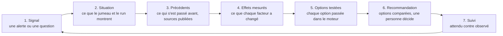
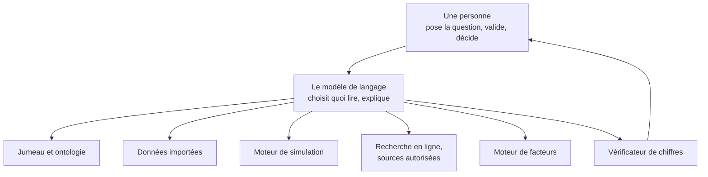

# La boucle d'aide à la décision

Obscyro ne décide pas. Il aide une personne à décider, en lui montrant ce qui est mesuré, ce qui a été essayé et ce que chaque option changerait, sans rien laisser au hasard.

La boucle vaut pour tout événement de santé, pas seulement une épidémie : une canicule, une panne, une grève, une pénurie.

## Les sept étapes

## Qui fait quoi

Le modèle orchestre et explique. Les faits viennent des outils ; les calculs, d'une calculatrice ; la décision, d'une personne.

## État

| Étape | État | Où |
|---|---|---|
| 1. Signal | **Livré** : une alerte arrive sur toutes les pages du studio. Les seuils sont évalués toutes les cinq secondes, le cadre lit un seul fil d'alertes toutes les trois secondes, un bandeau annonce ce qui vient de s'ouvrir, et un clic mène à la fiche de situation, à l'unité ou au signal. Le tableau Response se relit seul. Chaque alerte dit de quand date sa propre valeur, d'après ce que sa mesure lit et non d'après toute l'unité, et ce que cet âge vaut. De l'écriture d'une donnée à son alerte à l'écran : un peu plus de neuf secondes au pire. Un signal qui s'ouvre fait retester sur l'état du moment les réponses préparées pour son type (étape 6). Le tableau Response montre d'abord ce qui demande quelqu'un : les signaux d'alertes retombées que personne n'a touchés sont mis à part, toujours comptés, et se ferment en lot avec un motif ; un accusé de réception tient tant que la condition tient | [algorithms.md](algorithms.md), D5 |
| 2. Situation | **Livré** : l'analyste, onglet Ask. Vingt questions de référence disent ce qu'une bonne réponse doit contenir. Il lit aussi le direct : ce qui est ouvert maintenant et les chiffres d'une unité tels que sa page les montre, chacun avec son âge. Une alerte, un signal ou une unité ouvre une fiche de situation : les chiffres en direct avec leur âge, l'alerte, l'étape du signal et une question déjà écrite pour l'analyste, lisible même quand il est éteint. L'analyste est à un clic sur toutes les pages du Studio | [analyst.md](analyst.md) |
| 3. Précédents | **Livré** : onglet Event finder. Recherche en ligne dans les sources que le projet autorise, candidats avec lien et passage cité, acceptés ou refusés par une personne, calendrier sur la frise et lu par l'analyste (`list_events`). Un événement est un repère daté : il n'est relié à aucun territoire et n'entre pas dans le moteur | [analyst.md](analyst.md), [algorithms.md](algorithms.md), A10 |
| 4. Effets mesurés | À faire. Les briques de mesure existent (décalages, réplication par épisodes) sans être reliées | [algorithms.md](algorithms.md), C3 |
| 5. Options testées | **Livré** : onglet Options. Jusqu'à trois options par objectif, chacune passée dans le moteur sur le serveur, avec les mêmes chiffres que la page (tenu par un test). Une option est faite de capacité, de mesures, de transferts de patients ou d'une réponse enregistrée (celles de la page Events et celles du moteur), testés par le même run ; elle peut remplacer ou retirer un choix que le scénario contient déjà | [analyst.md](analyst.md), [algorithms.md](algorithms.md), A4 et A8 |
| 6. Recommandation | **Livré** : le scénario tel quel à côté de chaque option, niveaux de preuve attribués par le programme, mécanisme en une phrase, arbitrages laissés à la personne, aucun classement. Le coût que le moteur a compté est à côté de chaque option, et une option qui coûte autant ou plus qu'une autre pour autant ou plus d'attente est marquée comme dominée, d'après les runs. L'option entre dans le scénario sur un clic. Une option testée peut être gardée comme réponse préparée pour un type de signal ; la fiche de situation d'un signal de ce type la montre avec les chiffres de son test et ce qu'il vaut aujourd'hui, et un clic l'engage. Dès qu'un signal s'ouvre, le moteur reteste chaque réponse préparée pour son type sur le réseau tel qu'il est, sans modèle de langage ; la fiche montre ce résultat à la place du test gardé, avec l'heure du test. Le retest part à l'ouverture du signal seulement : pas encore à la demande ([issue 26](https://github.com/V1ktor7/obscyro/issues/26)) | [analyst.md](analyst.md), [algorithms.md](algorithms.md), A8, A9 et A11 |
| 7. Suivi | **Livré en partie** : la décision est enregistrée avec les chiffres du run testé, et peut être prise sur un signal, qu'elle fait avancer d'une étape ; et ses arrivées attendues se comparent à la série observée liée au scénario. Seules les arrivées se comparent : le jumeau n'a pas d'historique des files ni de l'occupation | [analyst.md](analyst.md), [algorithms.md](algorithms.md), A6 et A9 |

La mise en service de l'analyste ([issue 5](https://github.com/V1ktor7/obscyro/issues/5)) est faite : clé posée, test de bout en bout, questions de référence, guide de la page, deux défauts du moteur corrigés.

**Cette table se met à jour à la fin de chaque issue.**

## Ordre de construction

1. Mettre l'analyste en service et le fiabiliser : [issue 5](https://github.com/V1ktor7/obscyro/issues/5). **Fait.** Suite : rejouer les questions de référence par une commande, sans navigateur ([issue 10](https://github.com/V1ktor7/obscyro/issues/10)), **fait** : le serveur fait le run, le script demande la clé au terminal, et le jeu complet passe deux fois de suite contre la production.
2. Options testées par le moteur, recommandation, décision enregistrée : [issue 6](https://github.com/V1ktor7/obscyro/issues/6). **Fait.** Suites : le test d'une option raccourci d'une passe, et sa durée mesurée ([issue 8](https://github.com/V1ktor7/obscyro/issues/8), **fait**), laisser une option remplacer ou retirer un choix du scénario ([issue 9](https://github.com/V1ktor7/obscyro/issues/9), **fait**).
3. Recherche en ligne validée et calendrier d'événements : [issue 7](https://github.com/V1ktor7/obscyro/issues/7). **Fait.** Suite : réduire le coût en jetons d'une recherche ([issue 11](https://github.com/V1ktor7/obscyro/issues/11), **fait**).
4. Le direct : de l'alerte à la décision en un clic. Six issues, dans cet ordre.
   1. L'alerte arrive sur toutes les pages, avec un lien vers son unité : [issue 12](https://github.com/V1ktor7/obscyro/issues/12). **Fait.** Suites : garder le tableau Response lisible quand les alertes se referment seules ([issue 18](https://github.com/V1ktor7/obscyro/issues/18)), **fait** ; donner à chaque alerte l'âge de sa propre valeur ([issue 19](https://github.com/V1ktor7/obscyro/issues/19)) ; annuler un accusé de réception et rouvrir un signal clos en lot ([issue 32](https://github.com/V1ktor7/obscyro/issues/32)).
   2. Une fiche de situation s'ouvre depuis une alerte, avec l'analyste dedans : [issue 13](https://github.com/V1ktor7/obscyro/issues/13). **Fait.** Suite faite : la vue d'ensemble du jumeau dit qu'une unité peut porter sa capacité par ses sous-unités, à part de ce qui manque ([issue 21](https://github.com/V1ktor7/obscyro/issues/21)). Suite à faire : dire de même qu'une unité qui ne porte que des relevés n'est pas un site sans capacité ([issue 23](https://github.com/V1ktor7/obscyro/issues/23)).
   3. Des réponses préparées par type de signal, engagées d'un clic : [issue 14](https://github.com/V1ktor7/obscyro/issues/14). **Fait.** Suite : garder aussi une réponse de la page Events ([issue 22](https://github.com/V1ktor7/obscyro/issues/22)).
   4. Les réponses préparées retestées sur l'état du moment, dès qu'une alerte s'ouvre : [issue 15](https://github.com/V1ktor7/obscyro/issues/15). **Fait.** Suite : retester une réponse à la demande, et quand sa fiche est rouverte ([issue 26](https://github.com/V1ktor7/obscyro/issues/26)).
   5. Les deux moteurs d'options réunis, réponses enregistrées et tampons : [issue 16](https://github.com/V1ktor7/obscyro/issues/16). **Fait.** Suite : dire en une phrase pourquoi un outil de l'analyste refuse une entrée ([issue 27](https://github.com/V1ktor7/obscyro/issues/27)).
   6. Le suivi d'une décision rattaché à son signal : [issue 17](https://github.com/V1ktor7/obscyro/issues/17).
5. Ensuite, sans issue encore : historique du jumeau (lire le réseau à une date passée), moteur de facteurs, stocks et répartition des ressources rares, personnel dans le jumeau.

### Pourquoi le direct passe avant le reste

En santé on n'a pas toujours le temps de cliquer. Aujourd'hui, aller d'une alerte à une option testée demande une dizaine de clics et plusieurs minutes : changer de page, retrouver l'unité, bâtir un scénario, écrire un objectif, attendre le moteur. Le chantier inverse l'ordre du travail.

| | En temps calme | En direct |
|---|---|---|
| Ce qu'on fait | Bâtir des événements, tester des réponses, garder celles qui tiennent | Reconnaître la situation, confirmer une réponse déjà testée |
| Où | Scenarios, Events, Profiles | Une fiche de situation, ouverte d'un clic depuis l'alerte |
| Ce que fait le modèle de langage | Propose et explique des options | Prépare la fiche en arrière-plan et répond aux questions ; jamais sur le chemin d'un clic |
| Ce que fait le moteur | Teste chaque réponse | Reteste les réponses préparées sur l'état du moment |

Trois choses ne changent pas. Une personne décide : la décision devient un clic parce que le travail a été fait avant, pas parce que le système décide. Chaque chiffre en direct porte son âge, parce qu'agir vite sur une donnée vieille est le vrai danger. Et Obscyro enregistre et suit une décision ; il ne déclenche rien dans les systèmes de l'établissement.

## Ce qui rend la boucle générale

**Une fiche par type d'événement.** Elle dit : les signaux qui l'annoncent, sa dynamique, les portes qu'il touche, les leviers possibles, les preuves disponibles, l'objectif à tenir.

**Quatre portes.** Tout événement touche le réseau par l'une d'elles :

| Porte | Ce qui change | Exemple |
|---|---|---|
| Demande | Plus de gens ont besoin de soins | Épidémie, canicule |
| Capacité | Moins de quoi soigner | Panne, grève, lits fermés |
| Accès | On ne peut plus atteindre les soins | Route coupée, inondation |
| Soins | Chaque patient demande plus, ou plus longtemps | Souche plus sévère |

**Cinq familles.** Contagieux, exposition, choc soudain, panne de capacité, dérive lente.

**Deux vitesses.** La préparation, quand on a le temps d'essayer ; le direct, quand l'événement est là.

**Trois niveaux de preuve**, jamais mélangés à l'écran :

| Niveau | Ce que c'est |
|---|---|
| Mesuré | Lu dans le jumeau ou les données du réseau |
| Publié | Tiré d'une source officielle, avec son lien |
| Hypothèse | Posé par la personne ou par le scénario, et dit comme tel |

**Un événement inconnu** suit le même chemin : on dit par quelle porte il entre, on le fait passer dans le moteur, et tout ce qui n'est pas mesuré est marqué hypothèse.

## Répartir des ressources rares

Médicaments, vaccins, lits ouverts : deux sortes de ressources, ce qui soigne et ce qui prévient. Le jumeau devra en tenir les stocks, le moteur calculer ce qu'une répartition change. **Qui passe en premier est un choix de valeur : il revient à une personne**, et l'outil le présente comme tel au lieu de le trancher.

## Les règles

1. Aucun chiffre sans outil ni source.
2. Le modèle lit et explique ; une personne décide.
3. Ce que l'IA écrit est une proposition, validée par un clic.
4. Un run n'est pas une prévision.
5. Le système suit le réseau, jamais des personnes.
6. « Ça a marché dans le passé » ne suffit pas : une option se teste dans le moteur, sous les conditions d'aujourd'hui, et son mécanisme s'explique.
7. Une décision s'enregistre avec le résultat qu'on en attend, pour être confrontée à ce qui arrive.
