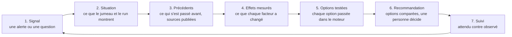
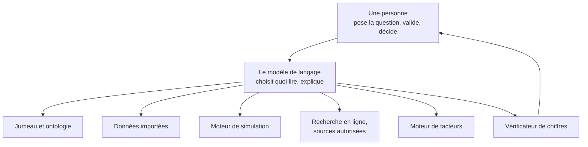

# La boucle d'aide à la décision

Obscyro ne décide pas. Il aide une personne à décider, en lui montrant ce qui est mesuré, ce qui a été essayé et ce que chaque option changerait, sans rien laisser au hasard.

La boucle vaut pour tout événement de santé, pas seulement une épidémie : une canicule, une panne, une grève, une pénurie.

## Les sept étapes

## Qui fait quoi

Le modèle orchestre et explique. Les faits viennent des outils ; les calculs, d'une calculatrice ; la décision, d'une personne.

## État

| Étape | État | Où |
|---|---|---|
| 1. Signal | Les alertes du jumeau et les signaux existent, mais ne lancent pas encore la boucle | [algorithms.md](algorithms.md), D5 |
| 2. Situation | **Livré et vérifié en production** avec le vrai modèle : l'analyste, onglet Ask. Treize questions de référence passent deux fois de suite | [analyst.md](analyst.md) |
| 3. Précédents | **Livré** : onglet Event finder. Recherche en ligne dans les sources que le projet autorise, candidats avec lien et passage cité, acceptés ou refusés par une personne, calendrier sur la frise et lu par l'analyste (`list_events`). La recherche est vérifiée en production avec le vrai modèle le 2026-11-17 ; l'acceptation d'un événement, le couloir de la frise et la citation par l'analyste sont couverts par les tests, pas encore exercés en production. Un événement est un repère daté : il n'est relié à aucun territoire et n'entre pas dans le moteur | [analyst.md](analyst.md), [algorithms.md](algorithms.md), A10 |
| 4. Effets mesurés | À faire. Les briques de mesure existent (décalages, réplication par épisodes) sans être reliées | [algorithms.md](algorithms.md), C3 |
| 5. Options testées | **Livré et vérifié en production** avec le vrai modèle : onglet Options. Jusqu'à trois options par objectif, chacune passée dans le moteur sur le serveur, avec les mêmes chiffres que la page (tenu par un test). Options faites de capacité et de mesures seulement | [analyst.md](analyst.md), [algorithms.md](algorithms.md), A4 et A8 |
| 6. Recommandation | **Livré et vérifié en production** : le scénario tel quel à côté de chaque option, niveaux de preuve attribués par le programme, mécanisme en une phrase, arbitrages laissés à la personne, aucun classement. L'option entre dans le scénario sur un clic | [analyst.md](analyst.md), [algorithms.md](algorithms.md), A8 |
| 7. Suivi | **Livré en partie, et vérifié en production** : la décision est enregistrée avec les chiffres du run testé, et ses arrivées attendues se comparent à la série observée liée au scénario. Seules les arrivées se comparent : le jumeau n'a pas d'historique des files ni de l'occupation | [analyst.md](analyst.md), [algorithms.md](algorithms.md), A6 et A9 |

La mise en service de l'analyste ([issue 5](https://github.com/V1ktor7/obscyro/issues/5)) est faite : clé posée, test de bout en bout, questions de référence, guide de la page, deux défauts du moteur corrigés.

**Cette table se met à jour à la fin de chaque issue.**

## Ordre de construction

1. Mettre l'analyste en service et le fiabiliser : [issue 5](https://github.com/V1ktor7/obscyro/issues/5). **Fait.**
2. Options testées par le moteur, recommandation, décision enregistrée : [issue 6](https://github.com/V1ktor7/obscyro/issues/6). **Fait.** Suites : raccourcir le test d'une option ([issue 8](https://github.com/V1ktor7/obscyro/issues/8)), laisser une option remplacer un choix du scénario ([issue 9](https://github.com/V1ktor7/obscyro/issues/9)).
3. Recherche en ligne validée et calendrier d'événements : [issue 7](https://github.com/V1ktor7/obscyro/issues/7). Livré ; la recherche est vérifiée en production, l'acceptation d'un événement reste à exercer en production.
4. Ensuite, sans issue encore : historique du jumeau (lire le réseau à une date passée), moteur de facteurs, stocks et répartition des ressources rares, personnel dans le jumeau.

## Ce qui rend la boucle générale

**Une fiche par type d'événement.** Elle dit : les signaux qui l'annoncent, sa dynamique, les portes qu'il touche, les leviers possibles, les preuves disponibles, l'objectif à tenir.

**Quatre portes.** Tout événement touche le réseau par l'une d'elles :

| Porte | Ce qui change | Exemple |
|---|---|---|
| Demande | Plus de gens ont besoin de soins | Épidémie, canicule |
| Capacité | Moins de quoi soigner | Panne, grève, lits fermés |
| Accès | On ne peut plus atteindre les soins | Route coupée, inondation |
| Soins | Chaque patient demande plus, ou plus longtemps | Souche plus sévère |

**Cinq familles.** Contagieux, exposition, choc soudain, panne de capacité, dérive lente.

**Deux vitesses.** La préparation, quand on a le temps d'essayer ; le direct, quand l'événement est là.

**Trois niveaux de preuve**, jamais mélangés à l'écran :

| Niveau | Ce que c'est |
|---|---|
| Mesuré | Lu dans le jumeau ou les données du réseau |
| Publié | Tiré d'une source officielle, avec son lien |
| Hypothèse | Posé par la personne ou par le scénario, et dit comme tel |

**Un événement inconnu** suit le même chemin : on dit par quelle porte il entre, on le fait passer dans le moteur, et tout ce qui n'est pas mesuré est marqué hypothèse.

## Répartir des ressources rares

Médicaments, vaccins, lits ouverts : deux sortes de ressources, ce qui soigne et ce qui prévient. Le jumeau devra en tenir les stocks, le moteur calculer ce qu'une répartition change. **Qui passe en premier est un choix de valeur : il revient à une personne**, et l'outil le présente comme tel au lieu de le trancher.

## Les règles

1. Aucun chiffre sans outil ni source.
2. Le modèle lit et explique ; une personne décide.
3. Ce que l'IA écrit est une proposition, validée par un clic.
4. Un run n'est pas une prévision.
5. Le système suit le réseau, jamais des personnes.
6. « Ça a marché dans le passé » ne suffit pas : une option se teste dans le moteur, sous les conditions d'aujourd'hui, et son mécanisme s'explique.
7. Une décision s'enregistre avec le résultat qu'on en attend, pour être confrontée à ce qui arrive.
