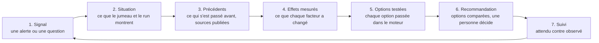
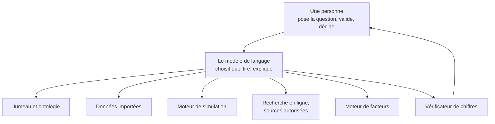

# La boucle d'aide à la décision

Obscyro ne décide pas. Il aide une personne à décider, en lui montrant ce qui est mesuré, ce qui a été essayé et ce que chaque option changerait, sans rien laisser au hasard.

La boucle vaut pour tout événement de santé, pas seulement une épidémie : une canicule, une panne, une grève, une pénurie.

## Les sept étapes

## Qui fait quoi

Le modèle orchestre et explique. Les faits viennent des outils ; les calculs, d'une calculatrice ; la décision, d'une personne.

## État

| Étape | État | Où |
|---|---|---|
| 1. Signal | **Livré** : une alerte arrive sur toutes les pages du studio. Les seuils sont évalués toutes les cinq secondes, le cadre lit un seul fil d'alertes toutes les trois secondes, un bandeau annonce ce qui vient de s'ouvrir, et un clic mène à l'unité ou au signal. Le tableau Response se relit seul. Chaque alerte dit de quand date sa valeur, et ce que cet âge vaut. **Vérifié en production** le 2026-11-19 ; le délai mesuré est sous la table. L'alerte ne propose pas encore de réponse : [issue 13](https://github.com/V1ktor7/obscyro/issues/13) et suivantes. Restes : le tableau Response est noyé sous les signaux d'alertes retombées ([issue 18](https://github.com/V1ktor7/obscyro/issues/18)), et l'âge affiché est celui de l'unité entière, à certaines heures un plancher ou un inconnu ([issue 19](https://github.com/V1ktor7/obscyro/issues/19)) | [algorithms.md](algorithms.md), D5 |
| 2. Situation | **Livré et vérifié en production** avec le vrai modèle : l'analyste, onglet Ask. Treize questions de référence passent deux fois de suite | [analyst.md](analyst.md) |
| 3. Précédents | **Livré et vérifié en production** avec le vrai modèle : onglet Event finder. Recherche en ligne dans les sources que le projet autorise, candidats avec lien et passage cité, acceptés ou refusés par une personne, calendrier sur la frise et lu par l'analyste (`list_events`). La recherche est vérifiée le 2026-11-17. L'acceptation, le couloir de la frise et la citation par l'analyste le sont le 2026-11-20 : le couvre-feu et la fermeture des écoles, acceptés dans le projet de démonstration, apparaissent sur la frise du scénario Omicron, et l'analyste les cite avec leur lien quand on lui demande ce qui se passait au pic des admissions. Un événement est un repère daté : il n'est relié à aucun territoire et n'entre pas dans le moteur | [analyst.md](analyst.md), [algorithms.md](algorithms.md), A10 |
| 4. Effets mesurés | À faire. Les briques de mesure existent (décalages, réplication par épisodes) sans être reliées | [algorithms.md](algorithms.md), C3 |
| 5. Options testées | **Livré et vérifié en production** avec le vrai modèle : onglet Options. Jusqu'à trois options par objectif, chacune passée dans le moteur sur le serveur, avec les mêmes chiffres que la page (tenu par un test). Options faites de capacité et de mesures seulement ; une option peut remplacer ou retirer un choix que le scénario contient déjà | [analyst.md](analyst.md), [algorithms.md](algorithms.md), A4 et A8 |
| 6. Recommandation | **Livré et vérifié en production** : le scénario tel quel à côté de chaque option, niveaux de preuve attribués par le programme, mécanisme en une phrase, arbitrages laissés à la personne, aucun classement. L'option entre dans le scénario sur un clic | [analyst.md](analyst.md), [algorithms.md](algorithms.md), A8 |
| 7. Suivi | **Livré en partie, et vérifié en production** : la décision est enregistrée avec les chiffres du run testé, et ses arrivées attendues se comparent à la série observée liée au scénario. Seules les arrivées se comparent : le jumeau n'a pas d'historique des files ni de l'occupation | [analyst.md](analyst.md), [algorithms.md](algorithms.md), A6 et A9 |

La mise en service de l'analyste ([issue 5](https://github.com/V1ktor7/obscyro/issues/5)) est faite : clé posée, test de bout en bout, questions de référence, guide de la page, deux défauts du moteur corrigés.

**Cette table se met à jour à la fin de chaque issue.**

### Le délai d'une alerte, mesuré

Mesuré en production le 2026-11-19 sur le projet de démonstration, dont les données arrivent une fois par heure. Onze alertes se sont ouvertes sur trois arrivées (14 h 46, 15 h 46 et 16 h 47 UTC).

| Du moment où… | au moment où… | Mesuré | Borne par construction |
|---|---|---|---|
| la donnée est écrite ici | l'alerte est ouverte | 0,1 à 3,1 s, médiane 2,1 s (11 alertes, `created_at - written_at`, à la seconde près) | 5 s d'attente, plus une évaluation (0,4 à 0,7 s mesurés) |
| l'alerte est ouverte | son signal est levé | 0,02 à 0,14 s, médiane 0,11 s (11 alertes). Avant : médiane 2,3 s, 14,3 s au 95e centile (436 alertes sur sept jours) | une passe du pont |
| l'alerte est ouverte | elle est à l'écran | lecture du fil toutes les 3,0 s (dix intervalles entre 2,99 et 3,01 s), chaque lecture en 0,11 à 0,41 s (12 lectures) : 3,4 s au plus | 3 s, plus une lecture |
| la donnée est écrite ici | l'alerte est à l'écran | 6,5 s au plus, en additionnant les deux pires cas mesurés | un peu plus de 9 s |

Ce que ces chiffres ne disent pas, et qu'il faut lire avec eux :

- **Le total est une somme de deux mesures, pas un chronomètre.** La part du serveur est mesurée sur chaque alerte. La part de l'écran est sa cadence de lecture. L'apparition du bandeau sur une vraie alerte n'a pas été observée en direct : le poste d'observation était en veille aux trois arrivées. À son réveil, la pastille et le tableau Response se sont mis à jour seuls (2 752, puis 2 754, puis 2 755 signaux, sans clic sur « Refresh »).
- **Cette veille a montré un défaut, corrigé depuis.** Un écran qui se réveillait n'annonçait pas ce qui s'était ouvert pendant son absence : le compteur changeait, sans dire quelle alerte. Il l'annonce maintenant, avec son retard.
- **Voir vite n'est pas voir une valeur fraîche.** Ce délai est celui que nous mettons à voir un dépassement une fois la donnée arrivée. La source, elle, publie une fois par heure. Et l'âge affiché n'est pas encore celui de la valeur, pour deux raisons relevées ce jour-là. Il change dans la journée avec ce que la source publie : à 14 h 37 UTC, aucune des 44 alertes ouvertes n'avait un âge exact (19 planchers, « au moins 2 h », et 25 inconnus, horodatage illisible) ; à 16 h 58 UTC, les 48 en avaient un. Et c'est l'âge de l'unité entière : une alerte sur les civières affichait 119 minutes quand le relevé des civières en avait 14, parce que le relevé de qualité de l'air de la même unité était plus vieux. L'écran dit ce qu'il sait, sans l'arrondir vers le rassurant ; comprendre la première raison et corriger la seconde est l'[issue 19](https://github.com/V1ktor7/obscyro/issues/19).
- **Onze alertes, un seul jour, un seul projet.** L'évaluation prend 0,4 à 0,7 s sur ce jumeau. Sur un jumeau où elle prendrait plus de 2,5 s, l'évaluateur espace ses passes de lui-même (deux fois la durée de la dernière, 30 s au plus) et l'écrit au journal du service : le délai s'allonge alors, et il se relit sur chaque alerte.

## Ordre de construction

1. Mettre l'analyste en service et le fiabiliser : [issue 5](https://github.com/V1ktor7/obscyro/issues/5). **Fait.** Suite : rejouer les questions de référence par une commande, sans navigateur ([issue 10](https://github.com/V1ktor7/obscyro/issues/10)) : livré, le serveur fait le run et le script demande la clé au terminal. Lancé contre la production le 2026-11-20 : 22 réponses justes sur les 24 reçues, puis le compte Claude de l'analyste est tombé à court de crédit. Il reste à rejouer six questions.
2. Options testées par le moteur, recommandation, décision enregistrée : [issue 6](https://github.com/V1ktor7/obscyro/issues/6). **Fait.** Suites : le test d'une option raccourci d'une passe, et sa durée mesurée ([issue 8](https://github.com/V1ktor7/obscyro/issues/8), **fait**), laisser une option remplacer ou retirer un choix du scénario ([issue 9](https://github.com/V1ktor7/obscyro/issues/9), **fait** : le clic « Apply to scenario » a été exercé en production le 2026-11-20, un seul tampon dans la recette et Run égal au test, puis le scénario de démonstration remis comme avant).
3. Recherche en ligne validée et calendrier d'événements : [issue 7](https://github.com/V1ktor7/obscyro/issues/7). **Fait.** Suite : réduire le coût en jetons d'une recherche ([issue 11](https://github.com/V1ktor7/obscyro/issues/11), **fait** : de 296 536 à 111 650 jetons sur la demande de référence, de 1,05 $ à 0,71 $).
4. Le direct : de l'alerte à la décision en un clic. Six issues, dans cet ordre.
   1. L'alerte arrive sur toutes les pages, avec un lien vers son unité : [issue 12](https://github.com/V1ktor7/obscyro/issues/12). **Fait.** Suites : garder le tableau Response lisible quand les alertes se referment seules ([issue 18](https://github.com/V1ktor7/obscyro/issues/18)), donner à chaque alerte l'âge de sa propre valeur ([issue 19](https://github.com/V1ktor7/obscyro/issues/19)).
   2. Une fiche de situation s'ouvre depuis une alerte, avec l'analyste dedans : [issue 13](https://github.com/V1ktor7/obscyro/issues/13).
   3. Des réponses préparées par type de signal, engagées d'un clic : [issue 14](https://github.com/V1ktor7/obscyro/issues/14).
   4. Les réponses préparées retestées sur l'état du moment, dès qu'une alerte s'ouvre : [issue 15](https://github.com/V1ktor7/obscyro/issues/15).
   5. Les deux moteurs d'options réunis, réponses enregistrées et tampons : [issue 16](https://github.com/V1ktor7/obscyro/issues/16).
   6. Le suivi d'une décision rattaché à son signal : [issue 17](https://github.com/V1ktor7/obscyro/issues/17).
5. Ensuite, sans issue encore : historique du jumeau (lire le réseau à une date passée), moteur de facteurs, stocks et répartition des ressources rares, personnel dans le jumeau.

### Pourquoi le direct passe avant le reste

En santé on n'a pas toujours le temps de cliquer. Aujourd'hui, aller d'une alerte à une option testée demande une dizaine de clics et plusieurs minutes : changer de page, retrouver l'unité, bâtir un scénario, écrire un objectif, attendre le moteur. Le chantier inverse l'ordre du travail.

| | En temps calme | En direct |
|---|---|---|
| Ce qu'on fait | Bâtir des événements, tester des réponses, garder celles qui tiennent | Reconnaître la situation, confirmer une réponse déjà testée |
| Où | Scenarios, Events, Profiles | Une fiche de situation, ouverte d'un clic depuis l'alerte |
| Ce que fait le modèle de langage | Propose et explique des options | Prépare la fiche en arrière-plan et répond aux questions ; jamais sur le chemin d'un clic |
| Ce que fait le moteur | Teste chaque réponse | Reteste les réponses préparées sur l'état du moment |

Trois choses ne changent pas. Une personne décide : la décision devient un clic parce que le travail a été fait avant, pas parce que le système décide. Chaque chiffre en direct porte son âge, parce qu'agir vite sur une donnée vieille est le vrai danger. Et Obscyro enregistre et suit une décision ; il ne déclenche rien dans les systèmes de l'établissement.

## Ce qui rend la boucle générale

**Une fiche par type d'événement.** Elle dit : les signaux qui l'annoncent, sa dynamique, les portes qu'il touche, les leviers possibles, les preuves disponibles, l'objectif à tenir.

**Quatre portes.** Tout événement touche le réseau par l'une d'elles :

| Porte | Ce qui change | Exemple |
|---|---|---|
| Demande | Plus de gens ont besoin de soins | Épidémie, canicule |
| Capacité | Moins de quoi soigner | Panne, grève, lits fermés |
| Accès | On ne peut plus atteindre les soins | Route coupée, inondation |
| Soins | Chaque patient demande plus, ou plus longtemps | Souche plus sévère |

**Cinq familles.** Contagieux, exposition, choc soudain, panne de capacité, dérive lente.

**Deux vitesses.** La préparation, quand on a le temps d'essayer ; le direct, quand l'événement est là.

**Trois niveaux de preuve**, jamais mélangés à l'écran :

| Niveau | Ce que c'est |
|---|---|
| Mesuré | Lu dans le jumeau ou les données du réseau |
| Publié | Tiré d'une source officielle, avec son lien |
| Hypothèse | Posé par la personne ou par le scénario, et dit comme tel |

**Un événement inconnu** suit le même chemin : on dit par quelle porte il entre, on le fait passer dans le moteur, et tout ce qui n'est pas mesuré est marqué hypothèse.

## Répartir des ressources rares

Médicaments, vaccins, lits ouverts : deux sortes de ressources, ce qui soigne et ce qui prévient. Le jumeau devra en tenir les stocks, le moteur calculer ce qu'une répartition change. **Qui passe en premier est un choix de valeur : il revient à une personne**, et l'outil le présente comme tel au lieu de le trancher.

## Les règles

1. Aucun chiffre sans outil ni source.
2. Le modèle lit et explique ; une personne décide.
3. Ce que l'IA écrit est une proposition, validée par un clic.
4. Un run n'est pas une prévision.
5. Le système suit le réseau, jamais des personnes.
6. « Ça a marché dans le passé » ne suffit pas : une option se teste dans le moteur, sous les conditions d'aujourd'hui, et son mécanisme s'explique.
7. Une décision s'enregistre avec le résultat qu'on en attend, pour être confrontée à ce qui arrive.
