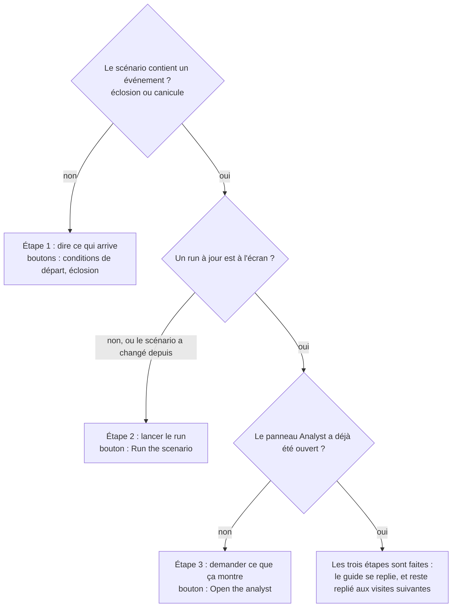

# La page Scenarios

La carte est la page. Tout le reste flotte dessus dans des panneaux repliables (`OverlayPanel`, `frontend/app/studio/map-overlay.tsx`) : jamais de panneau latéral, et à l'arrivée tout est replié sauf le guide d'une première visite.

## Ce qu'on y fait, en trois temps

La page est une phrase : dire ce qui arrive, le faire tourner, demander ce que ça montre. Le panneau **Start here** dit où l'on en est dans cette phrase, en lisant l'état de la page elle-même, et propose le bouton qui fait l'étape suivante.

**Règles.**
- Des conditions de départ seules ne suffisent pas pour passer à l'étape 2 : elles décrivent un réseau un jour ordinaire. C'est un événement qui donne quelque chose à faire tourner.
- Un scénario modifié après un run renvoie à l'étape 2 : le résultat à l'écran ne décrit plus le scénario.
- Ouvrir l'analyste par curiosité avant d'avoir lancé un run ne saute pas l'étape 2.
- Le guide s'ouvre à la première visite. Une fois replié, à la main ou parce que les trois étapes sont faites, il démarre replié (clé `obs_scenarios_guide_seen` dans le navigateur). Il reste disponible, sur une ligne, pour qui veut le rouvrir.
- Seule l'étape en cours est détaillée ; les autres ne montrent que leur titre. Écrites en entier, les trois étapes dépassaient la place qu'un portable de 1366 × 768 laisse sous la barre d'outils, et le guide s'ouvrait sur une barre de défilement.
- Ses boutons portent leur propre nom (« Run the scenario », « Set starting conditions ») : la barre d'outils a déjà un « Run » et un « Starting conditions », et deux commandes du même nom en font une de trop pour qui navigue au clavier ou au lecteur d'écran.

**Code.** `frontend/app/studio/simulation/hex/guide.ts` (les étapes, sans carte), `ScenarioGuide.tsx` (l'affichage), intégration dans `HexTwinView.tsx`. **Tests.** `guide.test.ts`, `HexTwinView.test.tsx`.

## Les panneaux

| Panneau | Où | Ce qu'il montre |
|---|---|---|
| Barre du scénario | En haut | Le scénario ouvert, l'horizon, l'activité lue, le bouton Run |
| Outils | En haut, au centre | Inspecter, conditions de départ, éclosion, canicule, mesure, capacité |
| Start here | À gauche | Le guide en trois étapes |
| Layers | À gauche | Ce que la carte colore : occupation, malades, résidents, couches ajoutées |
| Analyst | À gauche | Les questions et les réponses de l'analyste : [analyst.md](analyst.md) |
| Result | À droite | Le pic dans les deux passes, où ça casse, la comparaison à la réalité |
| Recipe | À droite | Les tampons du scénario, et ce que le moteur reçoit pour chacun |
| Frise | En bas | Le jour affiché, les couloirs de tampons, la courbe d'occupation |

Ce que fait un run, et comment se lisent ses résultats : [algorithms.md](algorithms.md), sections A4 à A7.
