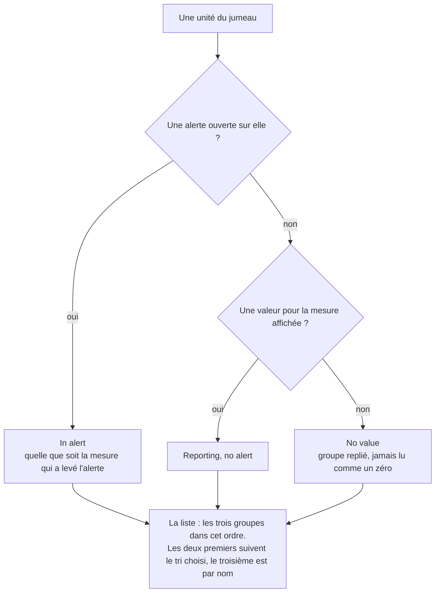

# La page Units

Toutes les unités du jumeau, en direct, classées sur une mesure. La page répond à une question : quelle unité lire en premier. Celles qui sont en alerte viennent d'abord, celles qui ne rapportent rien pour la mesure choisie sont repliées, et la fiche de l'unité choisie reste à côté de la liste.

Elle remplace une colonne de cartes sans ordre, où quatre cents unités faisaient une page de trente mille pixels, avec des noms coupés et une fenêtre de détail qui cachait tout.

## Trois états, jamais mélangés

On choisit une mesure dans le menu **Measure** : celles que l'organisation a définies, puis quatre comptes que tout jumeau a (objets liés, âge de la donnée, patients, lits). Chaque unité est alors dans un état, et un seul.

**Règles.**
- **Les compteurs sont les filtres.** « All units », « In alert », « Reporting, no alert », « No value » : les trois derniers s'additionnent toujours au premier. Un clic sur un compteur ne garde que ses unités.
- **Une alerte compte, quelle que soit sa mesure.** Une unité en alerte sur une autre mesure reste dans « In alert », et sa ligne écrit « no value ». L'en-tête du groupe n'ajoute « over the threshold » que si toutes les unités en alerte dépassent le seuil de la mesure affichée.
- **Sans valeur n'est pas zéro.** Une unité qui ne rapporte rien pour la mesure n'est jamais rangée dans le classement : elle va dans le groupe replié, qui s'ouvre d'un clic et dit qu'elle rapporte peut-être une autre mesure. Un vrai zéro est une valeur.
- **La couleur vient de la règle d'alerte.** Une pastille est rouge exactement quand la règle qui surveille la mesure se déclencherait sur l'unité, jaune à moins de 15 % du seuil, verte en deçà, grise quand la mesure n'a pas de seuil ou que l'unité n'a pas de valeur. La règle lue est celle du type de l'unité, comme le fait l'évaluateur d'alertes (D5).
- **Le tri.** Du plus haut au plus bas, l'inverse, ou par nom. Une unité sans valeur vient en dernier dans les deux sens : elle n'est pas la plus basse, elle est inconnue.
- **La recherche** porte sur le nom et le code, sans tenir compte des majuscules ni des accents. Elle ouvre le groupe replié quand il contient un résultat.
- **La barre** a une seule échelle pour toute la liste, de zéro au plus grand chiffre, arrondi. Elle ne change pas quand on filtre ou qu'on cherche : deux barres ne se comparent que sur la même échelle. Un trait marque le seuil de l'unité.
- **Un nom n'est jamais coupé.** S'il est long, il passe sur deux lignes.
- **Le type d'unité** (menu **Kind**) n'apparaît que si le jumeau en a plus d'un. Il réduit la liste et les compteurs à ce type.

## Quand le jumeau a une hiérarchie

Si des unités en contiennent d'autres, « All units » montre le haut de la hiérarchie, replié. Un clic sur une unité déplie ce qu'elle contient ; un second clic sur l'unité qu'on est en train de lire la replie.

- La valeur d'une unité compte tout ce qui est sous elle : c'est le calcul du jumeau, pas une somme faite par la page.
- Une unité repliée dit combien d'unités sous elle sont en alerte (« 2 in alert below »). Une branche fermée ne cache pas une alerte.
- Les frères sont classés selon le tri choisi.
- Un compteur autre que « All units » redonne une liste à plat : un filtre montre des unités, pas des branches.
- Une recherche ouvre le chemin jusqu'à chaque résultat et masque le reste.

## Les tuiles

La vue **Tiles** dessine une case par unité qui a une valeur, pour voir tout le réseau d'un coup d'œil. La couleur a trois pas au-delà du seuil, selon la distance : jusqu'à 20 % du seuil, de 20 à 60 %, plus de 60 %. Une case proche du seuil est jaune, les autres sont neutres.

- Quand toutes les unités ont le même seuil, la légende écrit ses chiffres (« over 160% », « over 120% », « over the threshold, 100% »). Quand les seuils diffèrent d'un type à l'autre, elle ne peut dire que la distance.
- Sans seuil sur la mesure, les cases n'ont pas de couleur, et la page le dit.
- Les unités sans valeur ne sont pas dessinées, et la page écrit combien.

## La fiche de l'unité

Elle est à côté de la liste, et passe dessous sur un écran étroit. Un clic sur une autre ligne la remplace : on compare sans rien fermer.

De haut en bas : le nom, où l'unité se situe par rapport à son seuil, sa valeur, la règle en mots (« alert when over 100% ») et l'âge de cette valeur ; l'historique de cette valeur sur 48 heures ; l'âge de la plus vieille source de l'unité et le nombre d'objets liés ; les alertes ouvertes, chacune avec l'âge de sa valeur ; les autres mesures que l'unité rapporte ; ce qu'elle contient, par type ; ses échanges avec d'autres unités ; la recommandation de la règle.

- **Trois âges, chacun nommé.** Sous la valeur : « This value was read 14m ago », l'âge de ce que la mesure affichée lit. Dans chaque alerte : « value read 14 min ago », l'âge de la valeur qui l'a levée, dans les mots du bandeau. Dans la case « Oldest source » : l'âge de l'unité entière, la plus vieille de toutes ses sources, qui répond à « tout ce que je vois ici est-il à jour ? ». Une unité qui reçoit un relevé de civières et un relevé de qualité de l'air peut afficher 14 minutes pour son occupation et 2 heures pour sa plus vieille source : les deux sont justes ([algorithms.md](algorithms.md), D7).
- **Un âge dit ce qu'il vaut.** Quand il est un plancher ou qu'il est inconnu, la fiche écrit pourquoi, en toutes lettres, et dit s'il s'agit de la mesure ou de l'unité.
- **Une valeur que le jumeau n'a pas datée n'a pas de phrase.** C'est le cas des quatre comptes que tout jumeau a : la fiche ne leur prête pas l'âge de l'unité sous un autre nom.
- **Chaque chiffre de la liste a son âge.** « Also reports » écrit une fois l'âge que partagent ses valeurs (« Values read 27m ago. »). Une valeur lue à une autre heure porte le sien sur sa ligne, et un chiffre de la veille dit quand il a été publié.
- **L'écart avec le relevé d'avant.** Sous la valeur, une phrase : « Up 6 pts since the reading of 16:45. », « No change since the reading of 16:45. », ou qu'aucun relevé d'avant n'a été gardé. La liste « Also reports » donne le même écart pour chaque autre mesure et dit une fois l'heure d'où il est compté ; un écart compté depuis une autre heure porte la sienne. L'écart est compté par le serveur, sur les relevés gardés ([algorithms.md](algorithms.md), D11). Il n'a pas de couleur : plus n'est pas toujours pire.
- **Un chiffre de la veille n'a pas l'âge de la dernière heure.** Une mesure dont la valeur décrit la veille, comme une durée moyenne de séjour republiée chaque heure, s'écrit « Yesterday's average, published 14m ago ». Sa moyenne suit : « 30-day average », ou « Average over 12 days kept » tant que l'historique a moins de trente jours (D7, D11).
- **Une valeur retenue dit pourquoi.** Une mesure qui a de quoi lire et ne donne rien l'écrit : plusieurs unités sous celle-ci publient chacune leur moyenne, et des moyennes ne se moyennent pas ; ou sa source n'a publié aucun chiffre au dernier relevé. Ce n'est ni un zéro ni un flux arrêté (D6).
- **D'où viennent les chiffres.** « About these figures » imprime ce que l'organisation a écrit sur les types d'objets que les mesures lisent : la source, sa licence, ses limites. Le texte se règle dans l'ontologie, sur le type ; aucun écran ne nomme une source.
- **L'historique de la valeur affichée.** Le jumeau note ses mesures toutes les cinq minutes, quand elles changent ([algorithms.md](algorithms.md), D11). La fiche en montre les 48 dernières heures : un trait en escalier, où chaque valeur tient jusqu'au relevé suivant, le plus bas et le plus haut écrits comme la valeur au-dessus, et la date du premier relevé gardé (« The first reading of this value was kept 3 h ago. Nothing earlier is known. »). Le trait s'interrompt là où la mesure n'avait pas de valeur. Un relevé rattrapé après coup depuis une copie gardée de la source ([algorithms.md](algorithms.md), D12) est tracé comme les autres et dit à part (« 2 of these 3 readings were caught up afterwards from kept copies of the source: the twin did not show them at the time. ») ; quand l'historique remonte à une telle copie, la fiche l'écrit (« The oldest reading comes from a copy of the source kept 92 d ago, caught up afterwards. »). Tant qu'aucun relevé n'est gardé, la fiche l'écrit au lieu de dessiner un graphique vide. Les comptes que tout jumeau a ne sont pas gardés, et la fiche le dit. Un historique qui ne peut pas être lu n'enlève rien au reste de la fiche.
- **Une alerte se traite d'ici.** « Open the situation » ouvre sa fiche de situation, « Acknowledge » l'accuse. Une unité sans alerte garde un lien vers sa fiche de situation.
- **« Ask the analyst »** ouvre l'analyste avec cette unité : la question porte sur elle.
- **Deux lectures.** Le nom, la valeur et la barre viennent de la liste, et sont à l'écran au clic. Le reste est lu pour cette unité seule, et relu à chaque nouvelle lecture du jumeau ; en attendant, la fiche écrit « Reading this unit… ». Elle ne montre jamais les alertes d'une unité sous le nom d'une autre.
- **Un lien mène à une unité.** Une alerte ou un signal ouvre la page avec `?unit=` : l'unité est choisie à l'arrivée, et sa ligne est amenée à l'écran, la branche dépliée ou le groupe ouvert s'il le faut. Si le projet n'a pas cette unité, la fiche le dit.

## Les autres commandes

- **Measures** : définir ce que le jumeau mesure. Une mesure peut être une durée (« Duration », écrite « 5 h 59 »), et l'agrégat `only` prend la valeur du seul objet qui la porte, sans jamais moyenner des moyennes. **Alert thresholds** : régler les seuils qui lèvent une alerte ; la liste reprend ses couleurs à la fermeture. **Live metrics** : les comptes du projet en direct.
- La pastille dit comment la liste se tient à jour. « Connecting » : le flux est demandé, rien n'est encore arrivé par lui. « Live stream » : le flux a livré une lecture, et la liste suit le jumeau en continu. « Polling » : le flux a échoué six fois de suite, et la liste est relue toutes les cinq secondes. La page n'écrit « Live stream » qu'après une première donnée reçue par le flux, jamais à la simple demande.
- « Seed demo » n'est proposé que sur un projet sans unité.

## Limites

- Le classement porte sur une mesure à la fois.
- La liste et les tuiles montrent l'état du moment. L'historique est sur la fiche, pour la valeur affichée seulement et sur 48 heures. Il commence le jour où le jumeau a commencé à noter ses mesures, ou à la plus ancienne copie de la source qui a été rattrapée depuis : rien d'avant n'est connu.
- La liste et les tuiles ne montrent pas l'âge de chaque valeur : il se lit sur la fiche de l'unité. La mesure « âge de la donnée » du menu Measure est l'âge de l'unité entière.
- Une date sans heure donne un âge au jour près : il peut être trop grand d'un jour au plus, jamais trop petit.
- La mesure et le type choisis sont gardés par projet, dans le navigateur. Le tri, la vue et la recherche ne le sont pas.
- L'écart et la moyenne viennent des relevés gardés : rien n'est dit d'avant le premier, et une moyenne écrit sur combien de jours elle repose.

**Code.** `frontend/app/studio/live/units-list.ts` (états, compteurs, tri, recherche, hiérarchie, échelle, couleurs, sans écran), `UnitsBoard.tsx` (les deux bandes, la liste, les tuiles), `UnitSheet.tsx` (la fiche), `unit-history.ts` (l'historique d'une valeur, sans écran), `unit-trends.ts` (l'écart, la moyenne et les phrases de la fiche, sans écran), `UnitsView.tsx` (les lectures : arbre, mesures, seuils, détail, historique) ; `twinMetricNumber` dans `frontend/app/studio/twin-ui.ts` ; `bandFor` dans `frontend/app/studio/command/site-metric.ts` ; `useOpenAnalyst` dans `frontend/app/studio/AnalystDock.tsx`. **Tests.** `units-list.test.ts`, `unit-history.test.ts`, `unit-trends.test.ts`, `UnitsBoard.test.tsx`, `UnitSheet.test.tsx`, `UnitsView.test.tsx`, `twin-ui.test.ts`, `AnalystDock.test.tsx`.
