---
# The English of docs/algorithms.md. When that page changes, bring this one up to date, then run `npm run docs:stamp`.
title: "Obscyro's algorithms"
description: "Every algorithm of the product has its section here: what it is for, its diagram, its rules, where it lives in the code and which tests hold it."
source: "docs/algorithms.md"
translatedFrom: "eed3d655846e4ed7"
---

Every algorithm of the product has its section here: what it is for, its diagram, its rules, where it lives in the code and which tests hold it.

**This file is updated with the code.** Adding, changing or removing an algorithm also means adding, changing or removing its section and its diagram, in the same commit (see [CLAUDE.md](https://github.com/V1ktor7/obscyro/blob/main/CLAUDE.md)). A diagram is drawn from the code one has just read.

## Table

| Ref. | Algorithm | Main file |
|---|---|---|
| **A** | **Decision support, the Scenarios page** | |
| [A1](#a1-the-analysts-loop) | The analyst's loop | `backend/src/services/analyst.ts` |
| [A2](#a2-number-verifier) | Number verifier | `backend/src/services/analyst-verify.ts` |
| [A3](#a3-calculator) | Calculator | `backend/src/services/analyst-calc.ts` |
| [A4](#a4-a-scenarios-run) | A scenario's run, in two passes, on the page and on the server | `frontend/app/studio/simulation/hex/engine.ts`, `backend/src/services/scenario-run.ts` |
| [A5](#a5-where-it-breaks) | Where it breaks: reading the queues | `frontend/app/studio/simulation/hex/results.ts` |
| [A6](#a6-comparison-with-reality) | Comparison with reality | `backend/src/services/observed-series.ts` |
| [A7](#a7-hexagon-grid-and-layers) | Hexagon grid and layers | `frontend/app/studio/simulation/hex/hex-grid.ts` |
| [A8](#a8-options-tested-by-the-engine) | Options tested by the engine | `backend/src/services/analyst-options.ts` |
| [A9](#a9-recorded-decision-and-follow-up) | Recorded decision and follow-up | `backend/src/services/decisions.ts` |
| [A10](#a10-online-search-and-calendar-of-events) | Validated online search and calendar of events | `backend/src/services/analyst-events.ts` |
| [A11](#a11-retest-of-a-prepared-response) | Retest of a prepared response, when a signal opens | `backend/src/services/response-retest.ts` |
| **B** | **Twin and simulation engine** | |
| [B1](#b1-export-of-the-twin) | Export of the twin to the engine | `backend/src/services/twin-export.ts` |
| [B2](#b2-one-step-of-the-event-engine) | One step of the event engine | `simulation-service/app/events/dynamics.py` |
| [B3](#b3-spread) | Spread between declared states | `simulation-service/app/events/spread.py` |
| [B4](#b4-policies-score-and-comparison) | Policies, score and comparison | `simulation-service/app/events/policy.py` |
| [B5](#b5-overlay-scenario) | A scenario as an overlay on the twin | `backend/src/services/scenario-overrides.ts` |
| [B6](#b6-event-drawn-from-an-observed-series) | Event drawn from an observed series | `backend/src/services/sim-event-from-rows.ts` |
| **C** | **Forecasting and lab** | |
| [C1](#c1-daily-forecast-loop) | Daily forecast loop | `backend/src/services/forecast-loops.ts` |
| [C2](#c2-forecasting-a-series-and-learning-on-a-table) | Forecasting a series, learning on a table | `simulation-service/app/lab/timeseries.py` |
| [C3](#c3-leading-signals) | Leading signals: lag and replication | `backend/src/services/lag-scan.ts` |
| [C4](#c4-causal-lab) | Causal lab | `backend/src/services/causal-lab.ts` |
| [C5](#c5-hybrid-simulation) | Hybrid simulation, graph of models | `simulation-service/app/runner.py` |
| **D** | **Data** | |
| [D1](#d1-clinical-extraction) | Clinical extraction from a text | `nlp-service/app/main.py` |
| [D2](#d2-data-pipelines) | Data pipelines | `backend/src/services/pipeline.ts` |
| [D3](#d3-identity-of-objects) | Identity of objects | `backend/src/services/identity.ts` |
| [D4](#d4-data-quality) | Data quality, six layers | `backend/src/services/data-quality.ts` |
| [D5](#d5-twin-alerts-and-signals) | Twin alerts and signals | `backend/src/services/twin-alert-scheduler.ts` |
| [D6](#d6-twin-metrics) | Twin metrics | `backend/src/services/twin-metrics.ts` |
| [D7](#d7-freshness-of-a-value) | Freshness of a value: the age of a unit, and of each measure | `backend/src/services/observed-at.ts` |
| [D8](#d8-zone-correspondence) | Zone correspondence | `backend/src/services/zone-correspondence.ts` |
| [D9](#d9-live-reading-and-situation-card) | Live reading and situation card | `backend/src/services/live-reading.ts`, `situation.ts` |
| [D10](#d10-sites-and-units-on-the-network-map) | Sites and units on the network map | `frontend/app/studio/command/units-tree.ts` |
| [D11](#d11-history-of-twin-measures) | History of twin measures | `backend/src/services/twin-history.ts` |

---

# A. Decision support, the Scenarios page

## A1. The analyst's loop

**Purpose.** Answer a question about the twin, the open scenario or the run on screen, relying only on what tools returned. The language model chooses what to read and writes; it holds no fact, does no arithmetic and does not decide. Detail: [The analyst](/docs/product/analyst).

The same loop serves three kinds of exchange. What tells them apart is their **closing**: the instructions given to the model, the tool through which it delivers, and the way that delivery is checked. A question closes with `give_answer`; an objective closes with `give_options`, after tests (A8); an event search closes with `give_events`, after online searches (A10).

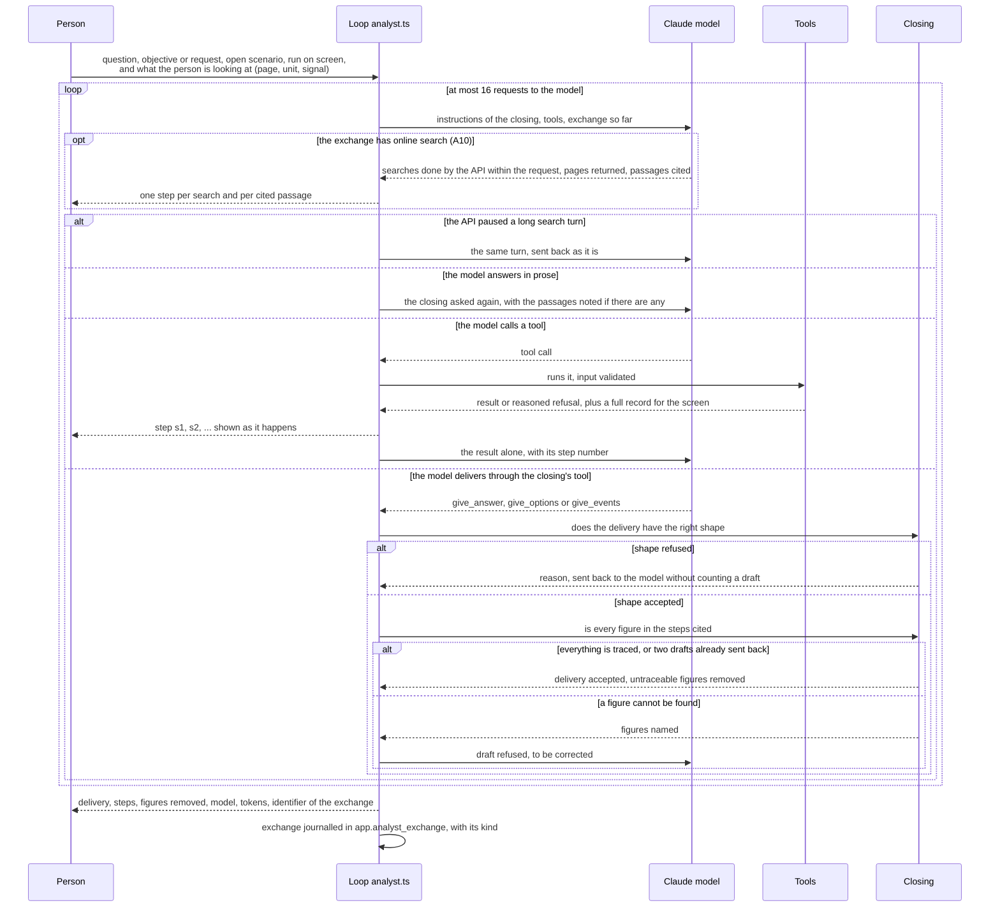

**Rules.**
- Model: the one named by the `ANALYST_MODEL` variable of the service, among `claude-opus-5-5` (taken when it is empty), `claude-sonnet-5-5` and `claude-haiku-5-5`. A value outside that list switches the analyst off, which says so, instead of making it fall back on another model. Effort `medium`, free choice of tool. A request refused by a safeguard is replayed on the fallback model the API provides (`fallbacks: "default"`).
- At most 16 requests to the model per exchange, and 2 drafts sent back for untraceable figures.
- Delivery goes through the closing's tool, alone in its turn. An answer in prose is asked for again once, then abandoned. Twice when the exchange searches online: there, prose is a step, since it is where the cited passages come from (A10).
- Online search is not run by the loop but by the API, inside a request. The loop reads in each response what the API searched, the pages returned and the passages cited, and makes numbered steps of them like the others. A returned page carries no citable figure; only a passage does.
- A turn the API pauses (`pause_turn`) is sent back to it as it is, without a word from us: an added message would close the turn. A delivery requested at the same time as a search is refused once, while the search runs.
- A tool's refusal (unknown name, no run on screen) is a step the model reads; it carries no citable figure. A failure on our side is never disguised as a refusal.
- A tool can keep, beside its result, a full record (`Recorded`): it is shown and journalled, never sent to the model. So no sentence can rest on it.
- What the person is looking at arrives as ids (`focus`: page, unit, signal). The server looks the names up itself, in this project only, and writes them into the context of the question: no text typed by the caller enters the instructions.
- The tools read two sources, and each says which: the twin's export, which is what a run uses, and the live reading (D9), which is what the screens show.
- A refusal by the model produces no invented answer.
- If the person leaves, nothing more is asked of the model.
- The identifier of the exchange is chosen before starting and leaves with the last line of the stream: it is what a decision will name (A9).

**Code.** `backend/src/services/analyst.ts` (`converse`, `Closing`, `askClosing`), `analyst-web.ts` (`WebReader`), `backend/src/routes/analyst.ts`, `backend/src/lib/ndjson.ts`, `frontend/app/studio/simulation/hex/AnalystPanel.tsx`, `frontend/app/studio/AnalystDock.tsx`.
**Tests.** `analyst.unit.test.ts`, `analyst-options.unit.test.ts`, `analyst-events.unit.test.ts`, `analyst-web.unit.test.ts`, `routes/analyst.unit.test.ts`, `lib/ndjson.unit.test.ts`, `AnalystPanel.test.tsx`.

## A2. Number verifier

**Purpose.** Prevent a figure from reaching the screen without a tool having returned it, or beside the wrong name. Each paragraph is checked against the steps it cites itself, not against everything that was read: that is what gives a source chip a meaning.

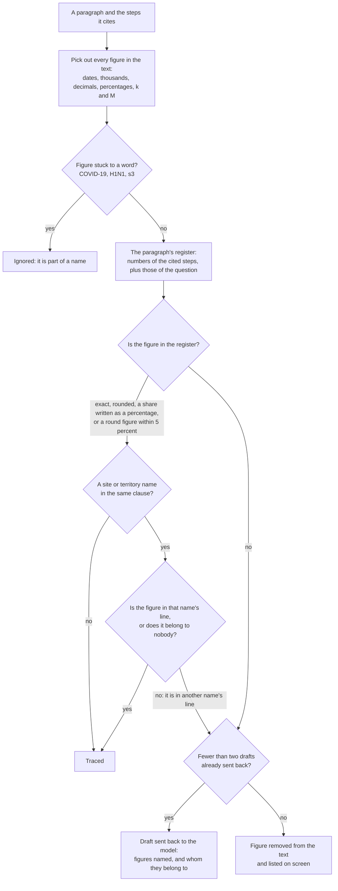

**Rules.**
- The register of a step holds: every number of the result, every number written in a string, every date and its parts (year, month, day), and the length of every list.
- Rounding allowed: “94” for 93.6; “94 %” for a share of 0.941; “6,000” for 5,999. A round figure cannot be off by more than 5 %: “100” does not stand for 60.
- Assumptions and limits cite no step: they are checked against everything that was read.
- **Whose figure it is.** A tool's result is made of lines that carry a name (a site, a territory). The text is cut into clauses, at sentence ends, at commas and at the words that join two clauses. A figure written in the same clause as a name is at fault when three things are true: no line of that name holds it, it is not a figure that belongs to nobody (a total, the question, a calculation), and the line of another name holds it. So the check catches a swap, and stays silent when it cannot decide.
- A name is recognised by its distinctive words (“lakeshore”, “santa cabrini”), ignoring case and accents. A name made only of words common to all (“Hôpital général de Montréal”) attributes nothing.
- **What the check proves:** the figure exists in a cited tool result, and not in the line of a name other than the one it is written beside. **What it does not prove:** that the sentence around it is right. That is why every step can still be consulted under the answer.
- Origin of the attribution rule: the first answer given in production, every figure “found”, gave Lachine the day that belonged to LaSalle.
- **What comes from the web.** The register of a cited passage holds the figures of the passage and of its page's title, and the dates they spell out (“31 décembre 2021” stands for 2021-12-31); never the figures of the page's address. A figure that came from the web must therefore be found in the cited passage. The rules specific to candidates (word-for-word quotation, stated date) are in A10.

**Code.** `backend/src/services/analyst-verify.ts`. **Tests.** `analyst-verify.unit.test.ts`.

## A3. Calculator

**Purpose.** Do the arithmetic in the model's place, and refuse to compute on a number that comes from nowhere.

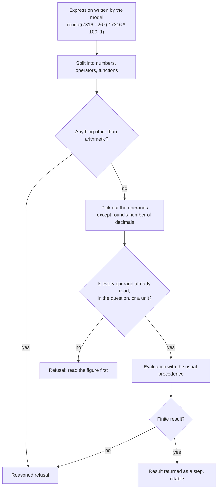

**Rules.** Operators `+ - * / ^` and parentheses. Functions `round, abs, sqrt, floor, ceil, min, max, sum, mean`. No variable, no access to anything, nothing is executed as code. Units allowed without a source: 0, 1, 2, 7, 10, 24, 100, 1000.

**Code.** `backend/src/services/analyst-calc.ts`, the `calculate` tool in `analyst-tools.ts`. **Tests.** `analyst-calc.unit.test.ts`, `analyst-tools.unit.test.ts`.

## A4. A scenario's run

**Purpose.** Say what the planner's choices change. The scenario goes through the engine twice: once with what happens to the city, once with the choices added. The difference between the two is the effect of the choices, built rather than deduced.

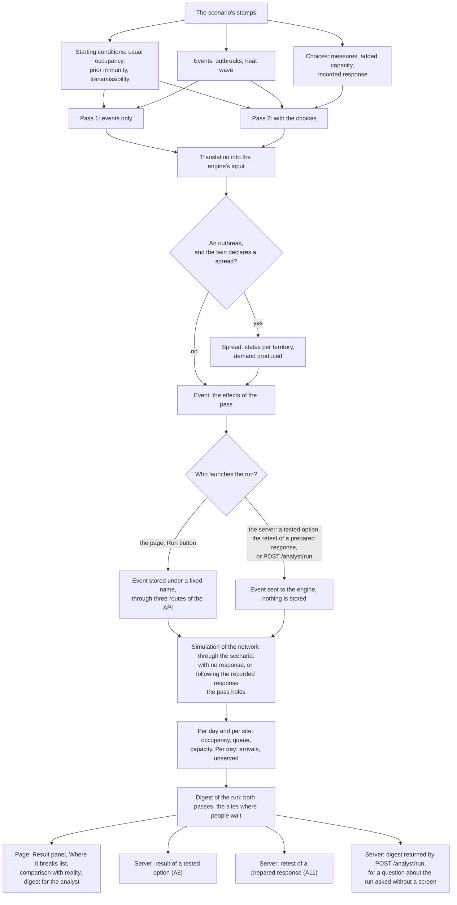

**Rules.**
- The conditions are in both passes: they say where one starts from, not what one chooses.
- The engine seeds only once: every outbreak starts on the day of the first, and the screen says so.
- Two conditions of the same kind: the higher one wins, and the screen says so.
- On the page, the two stored events are rewritten at each run under a fixed name. On the server, nothing is stored: a tested option is not an event of the library, and the analyst writes nothing.
- The island's occupancy is weighted by the capacity of each site, added capacity included from the day it opens.
- Both sides read the twin the same way: the context (sites, territories, declared model) comes from the twin as it is, and the engine receives the twin read through the scenario.
- **A recorded response is a stamp like the others** (`response`). Every other stamp is something that happens on a given day; this one carries rules the engine evaluates at every step (B4). It is a choice: only the pass “with the choices” follows it, in place of the “do nothing” response; the “events only” pass never responds. Three origins: the organisation's library (Events page), whose rules travel in the stamp as they were when it was placed; a response the engine writes itself from the network, which goes by its name; and a transfer written by the test of an option of the analyst (A8).
- **The day of a response.** The rules of a response placed on day 12 do not apply before day 12: each rule is shifted, and a rule its author already made start later keeps its own day (`rulesFromStep`, the function the replay of the units page branches with). A response the engine writes itself holds for the whole run: the engine writes its rules, and they cannot be shifted.
- **One response per run.** The engine follows one at a time. If the recipe holds two, the first by day is followed, and the Result panel names the one that is not.
- **What a response cost.** The server reads from the table of steps what the engine counted: the cost each rule declares for its action, each time the action fired (`PassDigest.cost`). Zero when the pass follows no response, or one none of whose rules declares a cost; what that zero means is settled in A8.
- **A limit that is said.** A response that adds or moves units during the run changes the capacity of the sites, and the engine does not return the capacity of each day. The island's occupancy is then weighted by the usual capacity, and the run says so in its notes.

**The same scenario gives the same figures on the page and on the server.** The translation of the stamps and the reading of the tables exist in two copies, one per side. What holds them together is a recording of the real engine, `backend/src/services/scenario-run-parity.fixture.json`: a small twin, a scenario, options, what each run asks of the engine (the effects, and the response followed when there is one), what the engine answers, and the digest that comes out. The server's test and the page's test both replay it, each with its own code. Each must send the engine the recorded requests and find the recorded figures: changing one side alone makes the other fail.

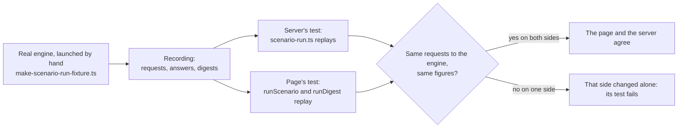

The recording holds six runs: the scenario as it is; the scenario with the stamps of an option; the scenario where an option replaced a choice (the old stamp removed, the new one written); and three runs with a recorded response: a response of the library (a transfer of patients, placed on a given day, at a declared cost), a response the engine writes itself, and the transfer as the analyst's test writes it. All but the first are what guarantees that applying a tested option to the scenario and then launching Run gives the figures of the test again, a recorded response included. It is regenerated by hand when the engine or the translation changes (`cd backend && npx tsx scripts/make-scenario-run-fixture.ts`, with Python and the dependencies of the simulation service), then both suites are run again.

On the server, the run exists in two forms. `ScenarioRunner.digest` does both passes, like the page: it is the one the parity test replays, and the one `serverRun` calls for the route `POST /v1/ontology/:env/analyst/run`. That route returns the digest a person would have on screen after Run, so that a question about the run can be asked by a script, without a browser ([The analyst](/docs/product/analyst), the reference questions). It calls no model, writes nothing, and refuses an activity no site offers before calling on the engine. `ScenarioRunner.full` does only the “with the choices” pass: that is what a tested option reads (A8), because the options' table compares the scenario with its choices to the scenario with the option added, and the “events only” pass shows nothing there. The retest of a prepared response (A11) reads the same pass, for the same reason. Both forms go through the same digest of a pass (`passFigures`), so a column of the table cannot differ from what Run displays for the same pass; a test checks it on the recording.

Testing several options does not redo everything: a spread is kept according to what was asked of it, so an option that only adds beds does not reintegrate the epidemic. Each call to the engine is timed (`timings`), so that the duration of a test is a measurement and not an impression.

**Code.** Page: `frontend/app/studio/simulation/hex/engine.ts` (`runScenario`), `stamps.ts` (`engineInput`), `run-digest.ts`, `frontend/app/studio/command/branch.ts` (`rulesFromStep`). Server: `backend/src/services/scenario-run.ts` (`ScenarioRunner`, `serverRun`, `costByStep`), `scenario-stamps.ts` (`engineInput`, `rulesFromStep`, `twinContext`), `scenario-run-recording.ts`, route `POST /v1/ontology/:env/analyst/run` in `backend/src/routes/analyst.ts`. Recording: `backend/scripts/make-scenario-run-fixture.ts`, `simulation-service/scripts/engine_once.py`.
**Tests.** `hex.test.ts`, `HexTwinView.test.tsx`, `run-parity.test.ts` (page); `scenario-run.unit.test.ts` (server).

## A5. Where it breaks

**Purpose.** A peak of 96 % across all sites says the network held. It does not say that four hospitals were full for three weeks. Occupancy caps at 100 % and says nothing about those who were turned away: it is the queue, site by site, that says it.

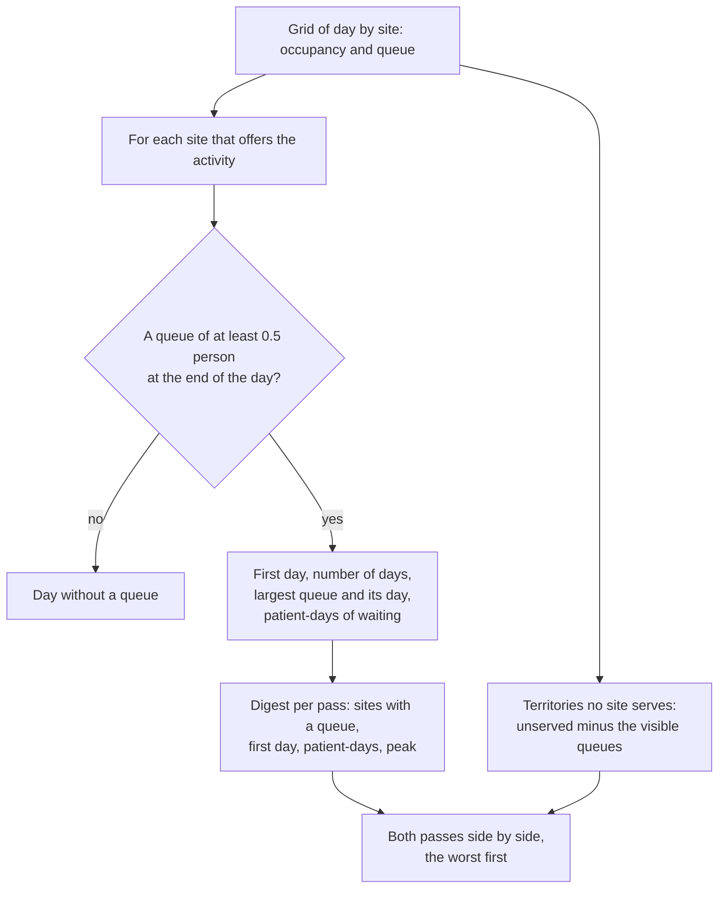

**Rules.** A queue under 0.5 is arithmetic, not a person. A patient-day of waiting counts one person waiting one day: one person for three days counts three. A territory with no site for the activity appears in no line of the engine: it is named apart, so that a tenth of the island is not waiting under a panel that says nobody waits.

**Code.** `frontend/app/studio/simulation/hex/results.ts`, `BreakList.tsx`. **Tests.** `results.test.ts`.

## A6. Comparison with reality

**Purpose.** Set an observed series on the axis of the run and say how far apart the two are, starting with what misleads least.

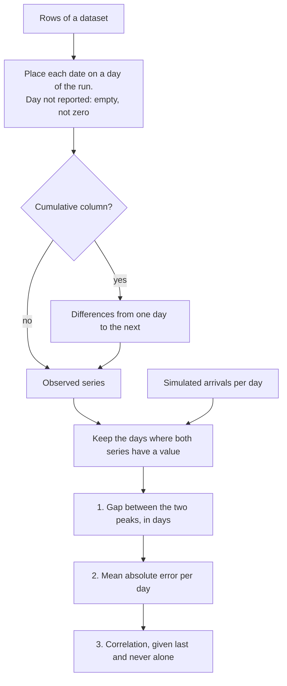

**Rules.** A repeated date: the last row wins, there is no summing. Two curves that rise then fall correlate strongly whether the model is right or not: correlation only comes last. A fit after the fact is not a forecast, and the screen says so.

**Code.** `backend/src/services/observed-series.ts`, route `POST /v1/ontology/:env/observed-series`, `frontend/app/studio/simulation/hex/RealityCheck.tsx`. **Tests.** `observed-series.unit.test.ts`.

## A7. Hexagon grid and layers

**Purpose.** A single grid for everything shown on the map: a stretcher reading, the population of a territory and a drawn measure fall on the same cells, so they overlay without a join.

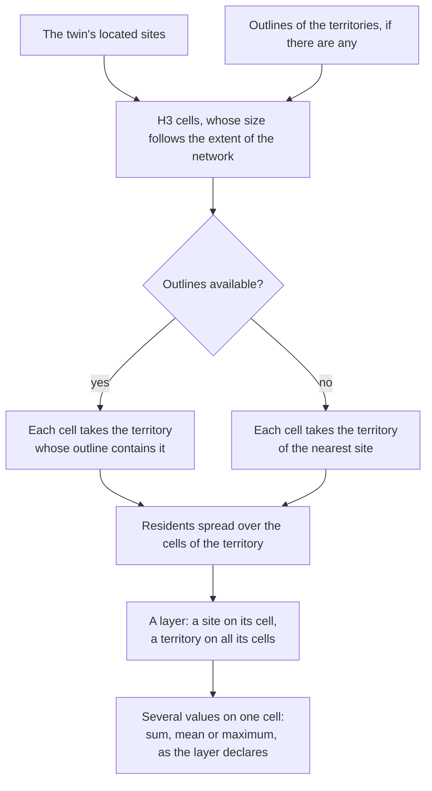

**Rules.** The grid is built from the twin, never shipped with the client. The way of combining is declared by the layer: beds add up, a temperature does not.

**Code.** `frontend/app/studio/simulation/hex/hex-grid.ts`, `layers.ts`, `backend/src/services/twin-layers.ts`. **Tests.** `hex.test.ts`, `twin-layers.unit.test.ts`.

## A8. Options tested by the engine

**Purpose.** A recommendation that rests on no run is an opinion. The person states their objective; the analyst proposes up to three options, and each goes through the engine before being shown, beside the scenario as it is. The model writes sentences; the figures of the table, the stamps and the levels of evidence come from the program.

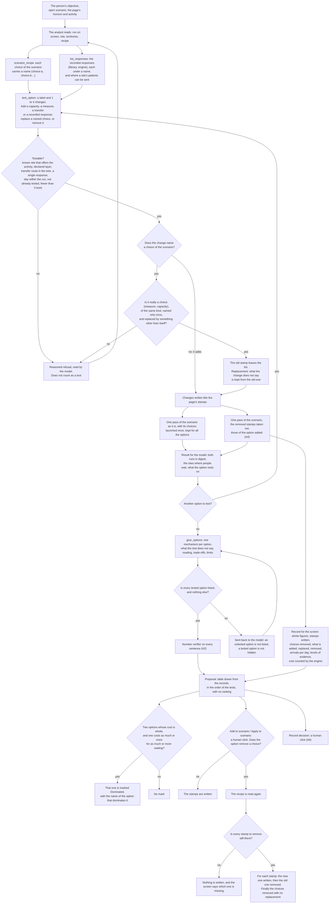

**Rules.**
- Three options at most per objective, four changes at most per option. Each test costs the engine one pass of the network, plus a spread if the option changes a contact; the scenario as it is costs one pass, once only. So three options make four passes. The “events only” pass that Run does on the page is not launched: nothing in the table reads it.
- The passes follow one another; they do not run at the same time. The simulation service is a single process: measured locally, launching two passes together gains only 18 % over launching them one after the other, for twice the memory.
- Each test keeps in its record what its duration was made of: reading the twin (on the first test only), then each call to the engine. That record goes to the journal, not to the model.
- A capacity is tested at a site that already offers the activity; negative, it closes units, never more than the site has. A measure is tested on a contact layer the twin declares.
- **A recorded response in an option.** The `response` change names a response by the name `list_responses` gives it: `response-a`, `response-b`… for those of the organisation's library, sorted by name; `transfer-when-full` and `surge-then-transfer` for the two the engine writes itself. As for a choice, never a UUID. A response of the library can start on a given day; a response of the engine holds for the whole run, and giving it a day is refused. It becomes a `response` stamp of the option, tested by the same run as the other stamps (A4).
- **A transfer of patients.** The `transfer` change names two sites, a number of patients per day and a day. The program writes its rule (`transferRule`): when somebody waits at the first site for the activity the run reads, and the second has a free unit of it, up to that number of patients are sent there. The condition on the destination is not one precaution more: without it patients are sent to wait behind those of a full hospital. Several transfers of one option make a single response, one rule each. Refused, with what can be asked instead: two sites between which the twin holds no transfer route (the refusal lists where the patients of the first can go), a destination that does not offer the activity, more patients a day than a route carries.
- **What a route carries.** The twin holds the flow of no route. So the run gives each the same: twenty patients a day (`ROUTE_CAPACITY`), on the page as on the server. It is an assumption of the engine, and it appears as such among what the option rests on; that the route exists is a measure of the twin.
- **One response per run, hence per option.** An option holds either one `response` change or `transfer` changes. If the scenario already follows a response, the test is refused until the option removes it (`remove`, by its choice name): testing another in its place is then a single test.
- **The cost is what the engine counted, and nothing else** (`costOf`). The engine counts one thing: the cost a rule of a response declares for its action, each time it fires. A capacity and a measure have no price in the twin, and a response none of whose rules declares a cost is unpriced, not free: the card writes that in place of a figure. The cost of an option is called **whole** only when it is made of a response with a declared price and of nothing else; with a capacity beside it, the count is shown and said to be incomplete. The transfer the program writes declares no cost: nobody gave one, and inventing one would put on screen a figure no tool returned.
- **A dominated option is marked, from the runs.** Between two options whose cost is whole, the one that costs as much or more and leaves as much or more waiting (strictly worse on one of the two) carries “Dominated” and the name of the other. It is the only comparison of cost and effect that needs no exchange rate between a dollar and a patient-day: whatever value one gives them, that option is not the one to prefer on these two counts. The waiting counted includes that of the territories no site serves, so that a queue moved out of sight does not pass for a queue avoided. The marking is made by the function of the replay of the units page (`dominatedBy`, `frontend/app/studio/command/options.ts`): both screens make it the same way. An option with a capacity or a measure is neither dominated nor dominating: it would take a price nobody gave.
- **Replacing or removing a choice.** A change can take the place of a choice the scenario already holds (`replaces`), or remove it (`remove`). “40 beds instead of 60” is then a single stamp at +40, and not a −20 stacked on a +60: the test runs on the scenario without the old stamp and with the new one, and that is what the recipe will hold. A replacement says only what differs (the units, the day, the duration); the rest is kept from the choice replaced.
- **A choice is designated by a name, not by its identifier.** `scenario_recipe` gives each choice a name made of letters (`choice-a`, `choice-b`…), valid for the time of the exchange. A stamp's identifier is a UUID: thirty-six characters to copy without a mistake, and full of digits the verifier would then find “in a step”. The record of the test, for its part, keeps the stamp's identifier: that is what the page removes.
- **Only a choice can be replaced.** A starting condition says where the run begins, an event says what happens: an option that removed one would test another scenario while calling it a response. Neither has a name, and designating them is refused, with the list of what can be. Also refused: replacing a capacity by a measure (one is removed and the other added, in the same option), naming the same choice twice, replacing a choice by itself.
- **What is removed is said.** The record lists what the option adds, replaces and removes, in sentences written by the program from the stamps; the option's card shows them as they are, and “Takes out of the scenario: …” appears among what the option rests on, at the **assumption** level. A recorded decision keeps them.
- A refusal by the engine (a scenario with no event, for example) is read by the model. An engine that cannot be reached is a failure: the exchange stops and says so, with no invented option.
- The level of evidence of each item is assigned by the program, from where it comes from: **measured** for what the twin holds (units of a site, residents of a territory), **published** for the rate of a heat wave, **assumption** for the scenario's conditions, the choices, the option itself (the rules of a response included: when they fire, their delay, their effectiveness, their cost are what their author wrote), the engine's routing rule and the flow of a route. The model chooses none of them.
- The mechanism of an option is checked against the result of its own test; the reading, against the steps it cites; the rest, against everything that was read. A figure of the objective belongs to the person and can be repeated.
- The mechanism and the reading get both checks of the verifier (A2), like the paragraphs of an answer: a figure nobody returned, and a figure that exists but is written beside the wrong site or the wrong territory.
- The table follows the order of the tests, whatever order the model lists the options in: an order it chose would be a ranking. Nothing ranks the options: saying which ones reach the objective according to the runs is a reading, choosing between them belongs to the person. Trade-offs of values are presented apart, as such. “Dominated” is not a ranking: the mark says nothing of two options neither of which dominates the other, and choosing between those stays with the person.
- The analyst writes nothing. An option enters the scenario on the “Add to scenario” click, written like a stamp placed on the map; Run then gives the figures of the test again (A4). When the option removes a choice, the button reads “Apply to scenario”: the recipe is read again, and if a stamp to remove is no longer there (someone edited it since the test), nothing is written and the screen says so. Otherwise the new stamp is written then the old one removed, as the recipe does when a stamp is edited by hand: a stop half-way leaves one stamp too many, which can be seen, rather than one too few. The parity fixture covers a replacement: the figures of the test and those of Run after the click are the same. If the scenario is no longer the one that was tested, the screen says which of three cases it is: one option added from the tab (Run must give its column again, the other columns no longer describe this scenario), several options added together (no test covered them together), or an edit made elsewhere (every column is out of date).
- A run is not a forecast: the table carries it in its title.

**Code.** `backend/src/services/analyst-options.ts` (`testOption`, `choiceNamed`, `stampOf`, `responseStamp`, `transfersStamp`, `costOf`, `benchFor`, `optionsClosing`), `analyst-responses.ts` (`listResponses`, `listedResponses`, `transferRule`, `transferRoutes`, `whatRulesDo`, `declaresCost`), `scenario-stamps.ts` (`basisOfStamp`, `choiceRefs`, `choiceLine`), `scenario-run.ts` (`ScenarioRunner.withOption`, `ROUTE_CAPACITY`), `analyst-tools.ts` (`scenario_recipe`), route `POST /v1/ontology/:env/analyst/options` in `backend/src/routes/analyst.ts`; `frontend/app/studio/simulation/hex/OptionsTab.tsx`, `option-cards.tsx` (`weighOptions`, `CostLine`), `analyst-parts.tsx` (`OptionChanges`), `option-write.ts` (`writeOption`), `addOption` in `HexTwinView.tsx`, `frontend/app/studio/command/options.ts` (`dominatedBy`).
**Tests.** `analyst-options.unit.test.ts`, `scenario-run.unit.test.ts` (parity, including the replacement and the recorded responses), `option-cards.test.tsx`, `command/options.test.ts`, `analyst-tools.unit.test.ts`, `routes/analyst.unit.test.ts`, `OptionsTab.test.tsx`, `option-write.test.ts`, `run-parity.test.ts`, `DecisionsTab.test.tsx`, `HexTwinView.test.tsx`. The fixture `scenario-run-parity.fixture.json` is written by `backend/scripts/make-scenario-run-fixture.ts`.

## A9. Recorded decision and follow-up

**Purpose.** Keep what a person retained with the result they expected of it, so that it can be set later against what happened. Without that, only a memory is compared with a result.

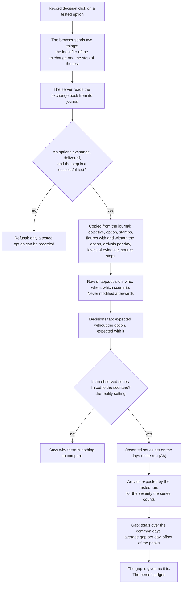

**Rules.**
- No figure of a decision comes from the browser. The server copies them from the journalled exchange (`app.analyst_exchange`, kind `options`): a figure sent with the request is ignored, and a step that is not a successful test is refused.
- A decision stands on its own: it keeps the name of the scenario and a copy of the source steps, to stay readable if the scenario or the exchange disappears.
- A decision cannot be edited. Revising it means recording another one.
- The follow-up compares arrivals, nothing else: it is the only thing the tested run expected that the network also counts day by day. The twin keeps the readings of its own measures (D11), but those are not the queue or the occupancy the engine counts, and nothing sets them beside a run yet. So the expected queue has nothing observed beside it, and the screen says so.
- A day the series does not report is not compared. A series that reports nothing does not give a gap of zero, it gives no gap.
- The follow-up does not conclude. It gives the gap; saying whether the decision held belongs to the person.

**Prepared response and engagement.** A decision can also be taken on a signal, by engaging a response prepared in calm time.

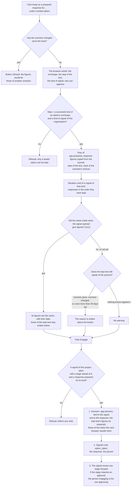

- **Only a tested option can be kept.** Like a decision, a prepared response is copied by the server from the journalled exchange. No figure comes from the browser: an untested response cannot pass for a tested one.
- **A test carries its date and its state.** `tested_at` is the date of the exchange. `scenario_mark` is a mark of the scenario's choices when the response is kept: it depends neither on the order of the choices nor on the rows that hold them, and changes as soon as a choice is added, removed or modified.
- **What the test is worth is said before the click.** Three things can be known without running anything again: the scenario no longer exists, its choices have changed, the test is more than thirty days old (`OLD_AFTER_DAYS`). Each is written in one sentence. None says the response is bad. These three sentences are about the kept test: when the retest made as the signal opened gave figures (A11), those are the ones the card shows, and it is their date that is said.
- **The decision keeps both tests.** `expected` stays that of the kept test, with its sites and its arrivals. When the card showed a retest, `expected.retested` holds its two runs and their date, and the Decisions tab writes it under the expected figures.
- **Nothing is ranked.** The responses are listed in the order they were kept.
- **Every refusal comes before the first write.** A signal's trail cannot be rewritten: an engagement that cannot go through is refused before it leaves a line there (`stageAhead`).
- **Retiring is not erasing.** A retired response is no longer offered; the decisions that engaged it still read.
- **Nothing is triggered elsewhere.** Engaging records and follows. The screen says so.

**Code.** `backend/src/services/decisions.ts` (`decisionFromExchange`, `followUp`, `realityOf`, `listDecisionsForSignalType`), `prepared-responses.ts` (`scenarioMark`, `standingOf`, `onCard`), `response-retest.ts` (`expectedOnEngage`), `signals.ts` (`stageAhead`, `recordOptionTaken`, `moveSignal`), `backend/src/routes/decisions.ts`, `routes/prepared-responses.ts`, migrations `060_analyst_exchange_kind.sql`, `061_decision.sql` and `065_prepared_response.sql`; `frontend/app/studio/simulation/hex/DecisionsTab.tsx`, `KeepPrepared.tsx`, `frontend/app/studio/situation/PreparedResponses.tsx`.
**Tests.** `decisions.unit.test.ts`, `prepared-responses.unit.test.ts`, `analyst-options.unit.test.ts` (from a tested option to a decision), `routes/decisions.unit.test.ts`, `DecisionsTab.test.tsx`, `KeepPrepared.test.tsx`, `PreparedResponses.test.tsx`.

## A10. Online search and calendar of events

**Purpose.** Say what was happening around the network at a given date: a curfew, a school closure, a heat wave. The analyst knows only the twin; here it can search online, in the only sources the project authorises. Each find is a **candidate**, and a candidate is nothing until a person has accepted it. This is the “Precedents” step of the [loop](/docs/product/decision-loop).

```mermaid
flowchart TD
    A["The person's request:<br/>a place, a period, a subject"] --> B["A separate exchange: no tool that reads the twin,<br/>a scenario or a dataset"]
    B --> C["Web search of the Claude API, called directly:<br/>the project's domains only, 8 searches at most,<br/>planned in advance and launched together"]
    C --> D["web_search step: the query and the pages returned<br/>address and title; the content stays encrypted"]
    D --> E["The model writes what the pages say,<br/>one sentence per event: the API attaches its citations to it"]
    E --> F["One web_passage step per citation:<br/>address, title, passage of 150 characters at most"]
    F --> F2{"At least one passage noted?"}
    F2 -->|"no"| F3["The conversation continues as it is:<br/>the model still has to write from the pages"]
    F3 --> E
    F2 -->|"yes"| G["A fresh conversation: the request, the searches made,<br/>the passages noted with their step number.<br/>The pages are not sent again, search is no longer offered"]
    G --> H["give_events: for each candidate a title, dates,<br/>a place, a gate, its passages, a quotation"]
    H --> I{"Is every cited passage<br/>a web_passage step?"}
    I -->|"no"| H
    I -->|"yes"| J{"Quotation word for word in a passage, under 15 words?<br/>Dates stated by a passage?<br/>Figures of the title in the passages?<br/>Page among the authorised sources?"}
    J -->|"no, and fewer than two drafts sent back"| K["Draft sent back to the model,<br/>with what is missing and the passages"]
    K --> H
    J -->|"no, on the last draft"| L["What is missing is removed: date left empty,<br/>quotation replaced by the start of the passage,<br/>figure of the title removed, candidate outside the sources set aside"]
    J -->|"yes"| M["Candidates on screen: Published level,<br/>WEB chip with the link, quotation in quotation marks"]
    L --> M
    M --> N{"The person"}
    N -->|"Reject"| O["Nothing is sent to the server:<br/>the candidate enters no table"]
    N -->|"Accept, dates corrected if need be"| P["The browser sends the exchange, the candidate and the dates"]
    P --> Q["The server copies from its journal the title, the place,<br/>the gate, the link, the quotation and the passages"]
    Q --> R["Row of app.health_event:<br/>validated dates, proposed dates, who, when"]
    R --> S["Context lane of the timeline:<br/>placed from the date of the scenario's day 0"]
    R --> T["The analyst's list_events tool:<br/>events, days of the run, source, quotation"]
    T --> U["Answer of the Ask tab: WEB chip with the link,<br/>Published level, never “measured”"]
```

**Rules.**
- **Nothing from the twin leaves in a search.** The exchange has no reading tool and its context names neither the project nor the scenario: the model has at hand only the person's request, the list of sources and today's date. So a query can hold only a place, a period and a subject. Every query is a step, shown and journalled.
- **Sources.** The list of domains can be set per project (`app.project_web_source`). With nothing set, the starting list applies: inspq.qc.ca, quebec.ca, msss.gouv.qc.ca, donneesquebec.ca, canada.ca, who.int. A domain covers its subdomains; ASCII only, twenty entries at most. The API restricts the search to that list (`allowed_domains`), and the server checks in turn that a candidate's page is in it.
- **Cap.** Eight searches per request (`max_uses`). They are called directly (`allowed_callers: ["direct"]`) and not from the API's code sandbox: that way each search is a visible step, and the cap holds for the whole exchange, which it does not for a search launched from the code sandbox.
- **The searches start together.** The instructions ask for the searches to be planned before the first and launched in the same step. A search launched on its own makes the model read again everything the earlier ones returned. One more search remains possible afterwards, for what the first results did not return. It is an instruction: nothing forces the model to follow it.
- **The pages are read only once.** What a search returns is by far the largest part of what the exchange reads: about 14,000 tokens per search, ten pages each. Yet nothing of a page can reach a candidate other than through a cited passage. As soon as passages are noted, delivery is therefore asked for in a fresh conversation that holds only the request, the list of searches made and the passages. Before, the pages set off again with the delivery, then a third time when a draft was sent back: more than half the tokens of a request. Once that hand-off is made, the search tool is no longer offered: the cap holds for the whole exchange because the tool is no longer there, and not because the API would count from one conversation to the next. What was read stays whole in the steps and in the journal. What a search costs is in [The analyst](/docs/product/analyst), “What a search costs”.
- **The passage is the unit of evidence.** The API returns in the clear only the address and the title of the pages and, under each sentence the model writes from a page, the passage that supports it (150 characters at most). It is the only text of a web page the server holds. A page merely returned by a search supports nothing.
- **Quotation.** Under fifteen words, copied word for word from a passage the candidate cites (give or take spaces and typographic quotation marks). A quotation that cannot be found is replaced, on the last draft, by the first words of the passage, and the screen says so.
- **Dates.** A date holds when a passage (or the title of its page) states the day and the month, in French or in English; the year must be written there, or be a year the passages or the request name. “In January 2022” states no day. A date that cannot be found is removed and left empty: the person reads the source and enters it.
- **Gates.** Each candidate says through which gate it touches a health network: demand, capacity, access, care. The model chooses it; the person sees it before accepting.
- **Level of evidence.** “Published”, assigned by the program. A validated event is never presented as measured by the twin or as the result of a run.
- **Validation.** Accepting sends the identifier of the exchange, that of the candidate and the validated dates, nothing else: the server copies the rest from the journalled exchange (`app.analyst_exchange`, kind `events`), as for a decision (A9). A candidate the search did not deliver cannot be accepted; the same candidate cannot be accepted twice. The dates proposed by the analyst are kept beside the validated dates.
- **Rejection.** There is no route for rejecting: a rejected candidate enters no table of events, and neither `list_events` nor the timeline sees it. It stays, like everything the analyst wrote, in the journal of the exchange where it was proposed, which no tool reads back.
- **Removal.** An accepted event is removed from the calendar on a confirmed click, kept in the audit log.
- **On the timeline.** The “Context” lane places each event from the date the scenario gives to its day 0 (the “reality” setting). Without that date, nothing is drawn and the lane says why. Events there are outlined, not filled: they are not stamps, the engine never receives them.
- **For the analyst.** `list_events` returns the validated events, with their days on the axis of the run when day 0 has a date: the program counts the days, not the model. Each event's link stays in the record of the step, for the screen.

**Code.** `backend/src/services/analyst-events.ts` (`eventsClosing`, `handoff`, `EVENTS_PROMPT`), the `converse` loop of `analyst.ts` (`Closing.handoff`, `usage.byRequest`), `analyst-web.ts` (`webSearchTool`, `WebReader`, `statedDates`, `dateStated`, `quotedFrom`), `web-sources.ts`, `health-events.ts` (`eventFromExchange`), the `listEvents` tool in `analyst-tools.ts`, route `POST /v1/ontology/:env/analyst/events` in `backend/src/routes/analyst.ts`, `backend/src/routes/health-events.ts`, migration `062_health_event.sql`; `frontend/app/studio/simulation/hex/EventFinderTab.tsx`, `ContextLane.tsx`, `context-lane.ts`, `WebChip` in `analyst-parts.tsx`.
**Tests.** `analyst-events.unit.test.ts`, `analyst-web.unit.test.ts`, `web-sources.unit.test.ts`, `health-events.unit.test.ts`, `analyst-tools.unit.test.ts` (`list_events`), `routes/health-events.unit.test.ts`, `routes/analyst.unit.test.ts`; `EventFinderTab.test.tsx`, `ContextLane.test.tsx`, `context-lane.test.ts`, `AnalystPanel.test.tsx`, `HexTwinView.test.tsx`.

---

# B. Twin and simulation engine

## A11. Retest of a prepared response

**Purpose.** Say what a prepared response would give on the network as it is now, without anyone asking. The test kept in calm time says what it gave the day it was kept. So when a signal opens, the server runs every response prepared for its kind through the engine again, while the person reads the card. No language model takes part.

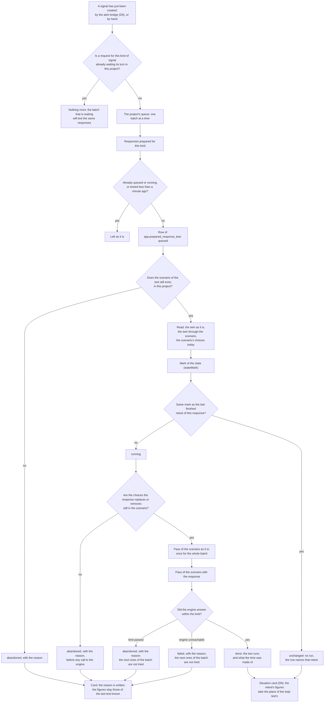

**Rules.**
- **The trigger is a signal opening**, through the alert bridge or by hand. The request leaves after the signal is created and nobody waits for it: raising a signal, reading its card and engaging a response do not depend on the engine. An unreachable engine leaves the card whole and “Engage” usable.
- **No language model.** A retest is made of passes of the engine and of nothing else.
- **The scenario as it is now.** The retest runs on the choices the scenario holds today and on the twin read at that instant, with the horizon and the activity of the original test. The choices the response replaces or removes are found by what they are, not by the row that held them: a choice deleted and written again is the same choice. If it is no longer in the scenario, the retest is abandoned and says so, rather than run on something else.
- **The same figures as Run.** The passes are those of a tested option (`ScenarioRunner.full`, A4). A test replays the parity recording and finds the page's figures.
- **One run at a time per project.** A project's batches follow one another. Signals of one kind that open together ask for a single batch.
- **No run when nothing changed.** The mark of the state (`stateMark`) covers what the engine receives: the sites and what they hold, the catchments, the routes, the declared model, the scenario's choices, the horizon and the activity. The time of the reading is not part of it. With the same mark as the last finished retest, the row is `unchanged`, names that retest, and the engine is not asked.
- **A response tested less than a minute ago is left as it is** (`MIN_GAP_MS`), like one already queued or running.
- **The scenario as it is runs once per batch.** Three responses make four passes, not six.
- **A limit.** Past three minutes (`RETEST_TIMEOUT_MS`), the retest is abandoned and says so. When the engine does not answer, the next responses of the batch are not tried: each would only wait for the same silence.
- **Never an unfinished run as a result.** Queued, running, abandoned or failed: the card says where it stands and why, and its figures stay those of the last test known. The queue lives in the server's memory: at start-up, a row left queued or running is closed as abandoned.
- **“The current state” has a duration.** A retest is called “on the current state” for fifteen minutes (`CURRENT_FOR_MS`) after its run, or after the last time the state was found unchanged. After that the card writes how old it is (“Tested on the network as it was 3 h ago”) and flags it before the click.
- **The card states the conditions of the run.** Under the figures of a retest, it writes that the starting state is the twin read when the test ran, hence measured, and that the response, the events and the choices of the scenario are assumptions. A run remains the result of a model under those conditions, not a forecast.
- **The decision keeps what the card showed**: the kept test's figures as expected, and those of the retest beside them, with their date (A9).
- **Duration.** On the Montréal twin, the first response of a batch is retested in one minute: two seconds to read the twin, then two passes of the engine of twenty-nine seconds each, the scenario as it is then the scenario with the response; the spread takes less than a second. Each further response of the batch adds one pass. Each retest keeps what its time was made of (`timing`): a measure, not a result.
- **What the retest does not do.** It starts when a signal opens, not for as long as the card stays open: the card of a signal opened hours ago shows a retest from hours ago, and says so ([issue 26](https://github.com/V1ktor7/obscyro/issues/26)). And it keeps only the figures of the two runs: the sites and the day-by-day arrivals of a decision stay those of the kept test.
- Units and aggregated values, never a person.

**Code.** `backend/src/services/response-retest.ts` (`stateMark`, `retiredNow`, `retestOne`, `Retests`, `sqlStore`, `liveTest`, `expectedOnEngage`, `startRetests`, `requestRetests`), `alert-bridge.ts` and `backend/src/routes/signals.ts` (the request), `backend/src/index.ts` (start-up), `prepared-responses.ts` (`onCard`), `backend/src/routes/situation.ts`, migration `066_prepared_response_test.sql`; `frontend/app/studio/situation/PreparedResponses.tsx`, `SituationView.tsx`, `prepared-api.ts`.
**Tests.** `response-retest.unit.test.ts`, `alert-bridge.unit.test.ts`; `PreparedResponses.test.tsx`, `SituationView.test.tsx`, `DecisionsTab.test.tsx`.

## B1. Export of the twin

**Purpose.** Put the twin into the shape the engine reads. The engine is in Python and the ontology in Postgres: what crosses over is a payload, not a connection. Nothing here recognises the name of a type or of a link: everything is declared (the role of the type, the behaviour of the link, the mechanics of the property).

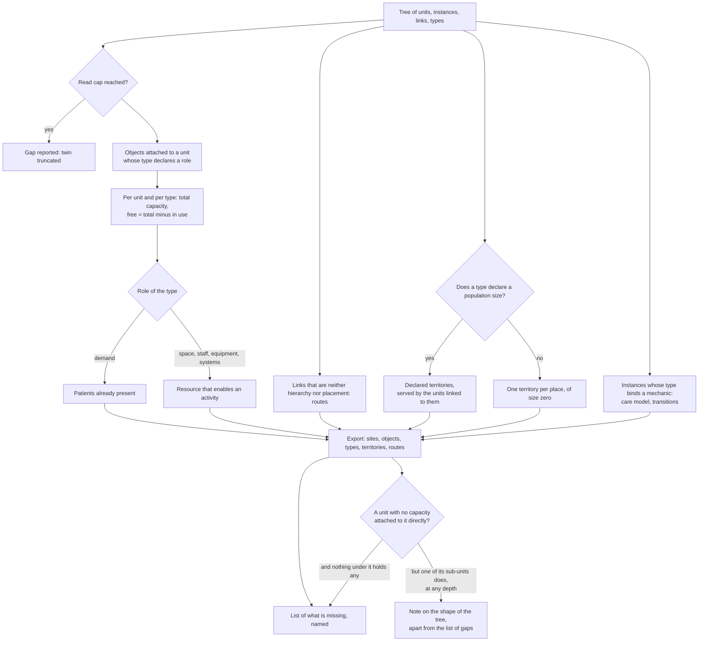

**Rules.** Only what is attached to a unit itself counts for it (`facilitiesFrom`): a hospital's wards are sites in their own right, and their beds are theirs. That is the difference with the unit page, which adds up everything under a unit (D6, D9). So a unit can come out with no capacity for two reasons that have nothing in common, and the export tells them apart (`capacityFindings`). If one of its sub-units holds capacity, that is the shape of the tree: an institution whose beds are all in its facilities. The export notes it apart (`structure`, code `CAPACITY_IN_SUBUNITS`), never among the gaps, and the unit's page shows that capacity. If nothing under it holds any, that is a gap (`FACILITY_WITHOUT_RESOURCES`), and the page shows none. “Under” means here what it means on the unit page: both readings walk the tree with the same function (`buildDescendantMap`). A bed already occupied is not free capacity. A territory with no population figure still appears, at zero, in the list of gaps. A route has no throughput in the ontology: it comes out at zero, and that is reported. The read cap is `ROLLUP_INSTANCE_CAP`; reaching it is said, because everything else would be a silent underestimate.

**Code.** `backend/src/services/twin-export.ts` (`buildTwinExport`, `facilitiesFrom`, `capacityFindings`), `twin.ts` (`buildDescendantMap`), `property-schema.ts`. **Tests.** `twin-export.unit.test.ts`, `twin-figures.unit.test.ts`, `scenario-lens-links.unit.test.ts`.

## B2. One step of the event engine

**Purpose.** Move the network forward by one step: apply the event, decide the response, treat or not, propagate failures, write everything down. The order within a step is a modelling decision, written once only.

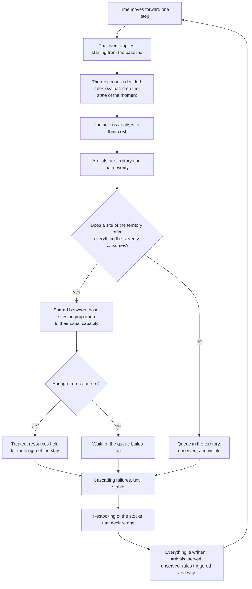

**Rules.**
- The response is decided before care: a policy reacts in the step where the event arrives.
- A capacity is rebuilt from a baseline at each step; a queue accumulates. The way of composing belongs to the quantity, not to the author of the event (see `simulation-service/app/events/README.md`).
- A full site remains the right place to wait; a site that does not offer the activity never becomes one.
- The weight of a site is its usual capacity for the scarcest resource the severity consumes, not what it has free that day. Weighting by what is free would give the network a perfect and free balancing, which is exactly what a transfer policy is supposed to buy.
- The usual occupancy of a scenario is held at each site for the whole run.
- A change of capacity is a change of what is free, by the same amount, and nothing else. Beds opened arrive empty. Beds closed leave first from what is free; the rest are beds still occupied, carried as an overrun until enough patients have left: a closure admits nobody and sends nobody away. When it ends, the beds come back the same way.
- Same system, same event, same policy, same seed: same trajectory.

**Code.** `simulation-service/app/events/dynamics.py` (`Engine.run`, `_apply_perturbations`, `_deliver_care`), `domain.py`, `objects.py`, `ontology.py`, `mechanics.py`. **Tests.** `simulation-service/tests/`, including `test_events_occupancy.py` for the usual occupancy and the changes of capacity.

## B3. Spread

**Purpose.** Make a condition circulate in the population without the engine knowing the word “infectious”. The twin declares states and transitions; the engine knows only three forms of transition.

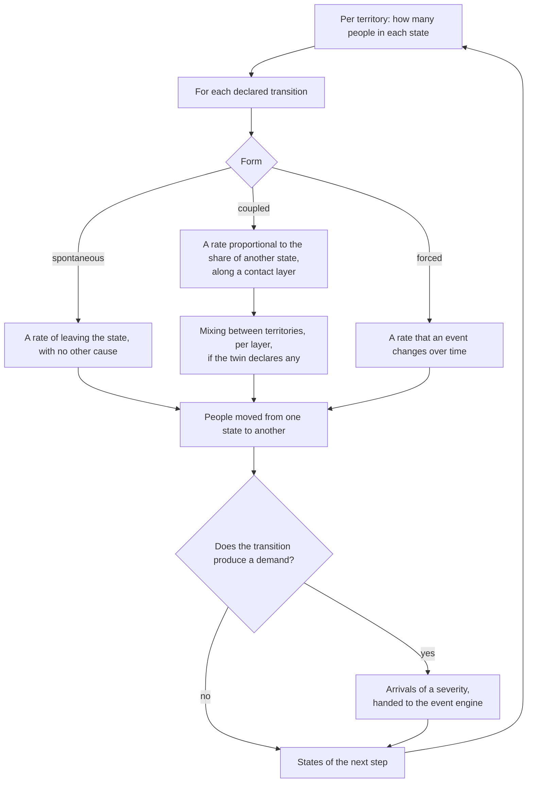

**Rules.** A measure or a variant multiplies a contact layer, between two steps, for some territories or for all. Two transitions that describe the same passage with two rates are refused, not arbitrated. With no mixing declared, an outbreak does not leave its territory. Accepted approximation: a visitor meets the residents of the place visited, at their prevalence.

**Code.** `simulation-service/app/events/spread.py`, `backend/src/services/spread-payload.ts`. **Tests.** `simulation-service/tests/`, `spread-payload.unit.test.ts`.

## B4. Policies, score and comparison

**Purpose.** Compare responses on the same event, with a score that can be argued about.

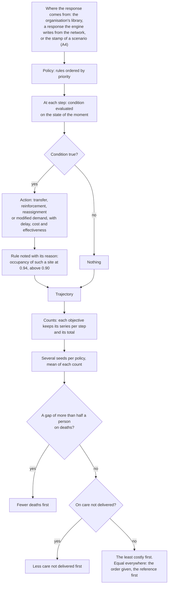

**Rules.**
- A condition is a typed tree, not an evaluated string: it can be shown and varied by program.
- The ranking is done on counts, in this order: deaths, care not delivered, cost. A count only separates responses that are equal on the earlier ones, and a gap of less than half a person is a tie.
- It is an order of priorities, not a price: a weighted sum would require an exchange rate between a life, care not delivered and a dollar, and there is no honest one. The order remains a judgement, and the screen says so.
- The screen names the count that decided the first place. When nothing separates the first two responses, neither is marked as best.
- Comparing on a single seed would amount to optimising the seed.
- **A response is run from two places.** The Events page and the replay of the units page compare several responses on one event and rank them, as above. The Scenarios page follows one, placed as a stamp of the recipe, in the pass “with the choices” of its run (A4); that is how the analyst tests a transfer of patients (A8). What each path can do that the other cannot: [The analyst](/docs/product/analyst), “Two ways of asking ‘what if’”.
- **A dominated option is marked the same way on both sides**: costing as much or more to obtain as much or less, strictly worse on one of the two (`dominatedBy`). The replay of the units page counts every cost the engine returns; the Options tab weighs only the options whose cost is whole (A8).

**Code.** `simulation-service/app/events/policy.py`, `scoring.py`, `harness.py` (`rank`, `decided_by`), `api.py` (`RANK_BY`), `frontend/app/studio/events/ranking.ts`, `frontend/app/studio/command/options.ts` (`rankOptions`, `dominatedBy`), `backend/src/services/sim-policies.ts`. **Tests.** `tests/test_events_ranking.py`, `ranking.test.ts`, `command/options.test.ts`.

## B5. Overlay scenario

**Purpose.** A scenario is not a copy of the twin: it is an ordered list of modifications read on top of it. Reading the twin “through” a scenario gives the world as it would be.

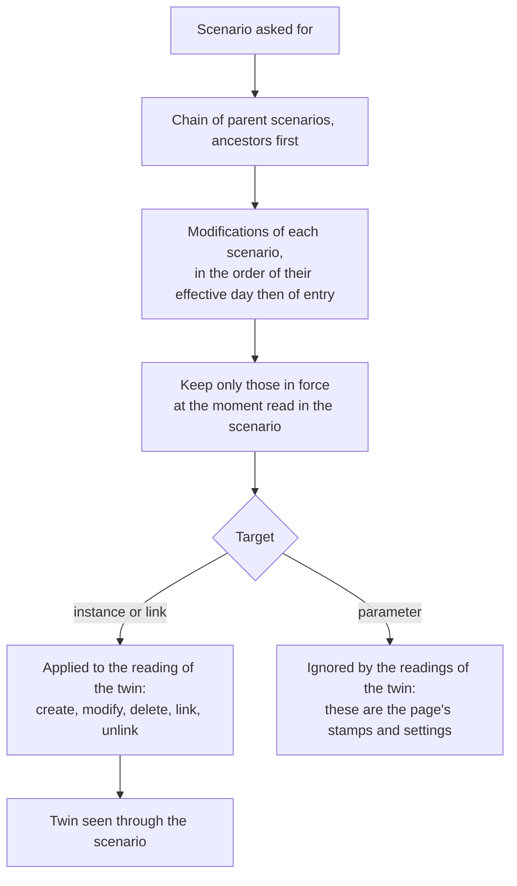

**Rules.** A reading that receives a lens it cannot honour fails loudly: silently comparing reality with itself would be the worst result. What a scenario invents receives a stable, derived identifier, so that it does not appear and disappear from one reading to the next. Reading “at a past date” is declared but not done: properties are overwritten in place.

**Code.** `backend/src/services/scenario-overrides.ts`, `scenario-apply.ts`, `ontology-lens.ts`. **Tests.** `scenario-overrides.unit.test.ts`, `scenario-apply.unit.test.ts`, `ontology-lens.unit.test.ts`.

## B6. Event drawn from an observed series

**Purpose.** The shortest path between a published file and a run: what was admitted each day becomes the arrivals of the event, with no script written by hand.

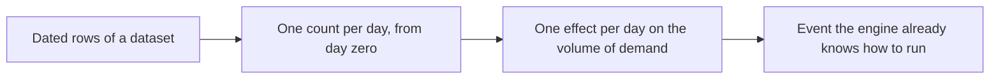

**Rules.** The target is a volume, not an incidence: an incidence is per thousand people and would require a population size the file does not carry.

**Code.** `backend/src/services/sim-event-from-rows.ts`. **Tests.** `sim-event-from-rows.unit.test.ts`.

---

# C. Forecasting and lab

## C1. Daily forecast loop

**Purpose.** Know what a forecast made every morning with what was known that morning is worth. Each forecast is frozen the day it is made; nobody can retouch it afterwards.

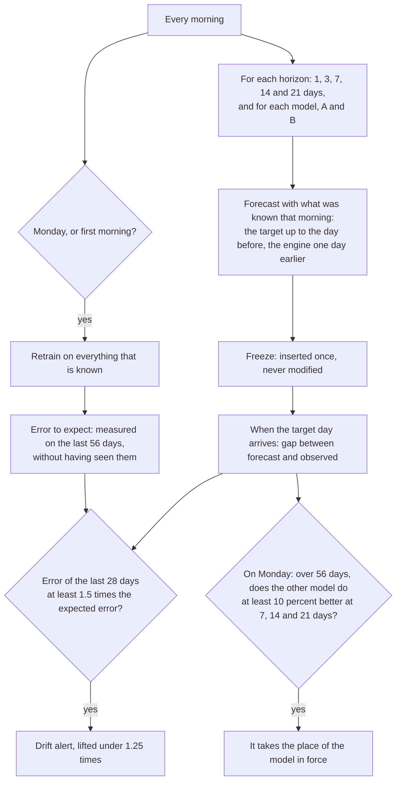

**Rules.**
- Model A: ridge regression on 14 days of the target and the calendar. Model B: gradient boosting, with the engine if there is one.
- At least 90 days of history are needed before the first morning, and 60 rows for a retraining.
- Drift requires at least 14 scored forecasts in the window; replacement, at least 28 per horizon.
- The model in force, the alerts and the replacements are not stored: they are rules set in advance, applied to frozen forecasts. They give the same answer at every reading.
- The replay is done in blocks of 28 mornings, in any order.

**Code.** `backend/src/services/forecast-loops.ts`, `simulation-service/app/lab/loop.py`, `frontend/app/studio/lab/loop-rules.ts`, migration `058_forecast_loops.sql`. **Tests.** `forecast-loops.unit.test.ts`, `tests/test_lab_loop.py`, `loop-rules.test.ts`.

## C2. Forecasting a series and learning on a table

**Purpose.** A forecast is a regression whose variables are the past. What changes is not the model, it is the way of scoring it.

```mermaid
flowchart TD
    A["Dated series"] --> B["Variables: lags of the target, calendar,<br/>lags of another series if needed"]
    B --> C["One model per horizon, trained for that horizon"]
    C --> D["Walk-forward evaluation:<br/>several successive origins"]
    D --> E["Reference: same as last time"]
    E --> F["Score: error divided by that of the reference.<br/>1.0 means doing nothing"]
    T["Any table"] --> U["Target, variables, estimator"]
    U --> V{"Time column?"}
    V -->|"yes"| W["Chronological split possible, and noted"]
    V -->|"no"| X["Random split"]
    W --> Y["Score compared with a reference that predicts the mean"]
    X --> Y
    Y --> Z["Rows set aside: counted and reported"]
```

**Rules.** A model that does not beat the reference is not deployed. A random split on a table ordered in time trains on next week: when a time column exists, the honest split is offered. The training context is kept with the score.

**Code.** `simulation-service/app/lab/timeseries.py`, `tabular.py`, `sandbox.py` (the user's code, isolated), `backend/src/services/lab-models.ts`. **Tests.** `simulation-service/tests/`.

## C3. Leading signals

**Purpose.** Say which signal precedes another and by how much, with the reasons to doubt it computed in the same pass.

```mermaid
flowchart TD
    A["A signal and a target"] --> B["Effective size: a smooth curve of 90 days<br/>may carry only 10 independent points"]
    B --> C["Correlation at each lag"]
    C --> D["Threshold raised: many tests were made"]
    D --> E["Lag retained, checked on a period<br/>held out of the search"]
    E --> F["Long series cut into episodes,<br/>one wave each"]
    F --> G["Same question asked of each episode"]
    G --> H["What is reported: the agreement between episodes,<br/>not the strength of one"]
```

**Rules.** Choosing the lag that maximises the correlation and then reporting that correlation is circular: hence the period held apart. A long series is not many observations: it is replication from one wave to the next that settles it.

**Code.** `backend/src/services/lag-scan.ts` (`effectiveSize`, `crossCorrelate`, `findLead`), `episodes.ts` (`findEpisodes`, `replicationAcross`). **Tests.** `lag-scan.unit.test.ts`, `episodes.unit.test.ts`.

## C4. Causal lab

**Purpose.** Explore, on the live data of an environment, which signals precede others, and what a series would become if another were perturbed.

```mermaid
flowchart TD
    A["Hourly signals: creations per type,<br/>mean of a property, activity of a channel"] --> B["For each pair: correlation at the best lag"]
    B --> C["Edges: who precedes whom"]
    A --> D["One-step model, ridge regression on the past"]
    D --> E["Forecast: the model iterated forward"]
    E --> F["Injected event: a future variable is perturbed"]
    F --> G["Simulated trajectory"]
```

**Rules.** The lag goes from 1 to the maximum asked for, so that the direction follows time. An edge is a precedence, not a proven cause: see C3 for the reasons to doubt it.

**Code.** `backend/src/services/causal-lab.ts`. **Tests.** no dedicated unit test to date.

## C5. Hybrid simulation

**Purpose.** Run a graph of models on a scenario branch: a mechanistic model as the base, learned models on top when they exist.

```mermaid
flowchart TD
    A["Payload: branch of the twin, parameters"] --> B["Contact graph:<br/>membership through the place links, neighbourhood through the contact links"]
    B --> C["Graph of models, executed in the order of its dependencies"]
    C --> D["Mechanistic node: SEIR with a fixed seed"]
    D --> E["Learned nodes: residual, graph network,<br/>surrogate, forecast"]
    E --> F["Quantile bands, gap from the base,<br/>importance of the variables"]
    C --> G{"Simulation service absent,<br/>or heavy model not installed?"}
    G -->|"yes"| H["Fall back to the mechanistic SEIR, in the API"]
```

**Rules.** The Python SEIR reproduces the API's at equal seed. The service is stateless: it never touches the database. Without the service, the simulation route falls back on the API's SEIR.

**Code.** `simulation-service/app/runner.py`, `graph.py`, `contacts.py`, `mechanistic.py`, `uncertainty.py`, `training.py`, `models/`; `backend/src/services/simulation.ts`, `ml-simulation.ts`. **Tests.** `simulation-service/tests/`, `simulation.unit.test.ts`, `ml-simulation.unit.test.ts`.

---

# D. Data

## D1. Clinical extraction

**Purpose.** Draw from a clinical text coded concepts and their context, without a generative model.

```mermaid
flowchart TD
    A["Clinical text"] --> B["Spotting the mentions"]
    B --> C["Embedding of each mention"]
    C --> D["Search for the nearest SNOMED descriptions,<br/>in Postgres"]
    D --> E{"Closeness and margin over the next one"}
    E -->|"clear"| F["Resolved"]
    E -->|"doubtful"| G["Flagged"]
    E -->|"insufficient"| H["Unresolved"]
    A --> I["Context by rules, in French and in English:<br/>affirmed or negated, subject, temporality"]
    F --> J["Decision: accept, flag, escalate"]
    G --> J
    I --> J
    J --> K{"Persistence asked for?"}
    K -->|"yes"| L["Clinical finding written to the ontology,<br/>with its provenance"]
```

**Rules.** The SNOMED matching uses only Obscyro's Postgres database. A patient is attached only by an explicit identifier, never guessed from a name or the text.

**Code.** `nlp-service/app/main.py`, `ner.py`, `context.py`, `embeddings.py`, `pg_index.py`; `backend/src/services/persist-extract.ts`. **Tests.** `nlp-service/tests/`, `persist-extract.integration.test.ts`.

## D2. Data pipelines

**Purpose.** Turn datasets into objects of the ontology or into other datasets, through a graph of nodes.

```mermaid
flowchart LR
    A["Input: dataset_input"] --> B["Table: filter, select, derive, cast,<br/>expand, join, latest"]
    B --> C["Clinical text: text_field,<br/>extract_snomed, validate_confidence"]
    B --> D["Outputs: object_output, dataset_output"]
    C --> D
```

**Rules.** The list of node kinds exists in one place only (`NODE_KINDS`): the route's schema is built from it, so that an accepted node is always an executable node. The objects written go through identity (D3). The ingestion channels (`channel-runner.ts`) do the same work for a payload received by webhook or by REST call.

**Code.** `backend/src/services/pipeline.ts`, `channel-runner.ts`, `rest-connector.ts`, `connectivity.ts`. **Tests.** `pipeline*.unit.test.ts`, `channel-*.unit.test.ts`, `rest-connector*.unit.test.ts`.

## D3. Identity of objects

**Purpose.** Say which properties make an object “the same real thing”, so that two pipelines do not create the same bed twice.

```mermaid
flowchart TD
    A["Object to write"] --> B["Identity keys declared on its type"]
    B --> C{"Does an object already carry these values?"}
    C -->|"yes"| D["Update of that object"]
    C -->|"no"| E["Creation"]
    D --> F["Constraint held by the database itself"]
    E --> F
```

**Rules.** Identity is declared on the type, not supplied by whichever pipeline passes. The constraint lives in the database (migration 043).

**Code.** `backend/src/services/identity.ts`, `ontology.ts` (`upsertInstanceByIdentity`). **Tests.** `identity.unit.test.ts`.

## D4. Data quality

**Purpose.** Check every object of the ontology in layers, from the simplest to the most statistical.

```mermaid
flowchart TD
    A["An object"] --> L1["L1 Shape: type of each property,<br/>existing SNOMED code"]
    L1 --> L2["L2 Value: declared bounds,<br/>no negative, valid date"]
    L2 --> L3["L3 Consistency: order of the dates,<br/>object with no link at all"]
    L3 --> L4["L4 Population: outlying value<br/>among the objects of the same type"]
    L4 --> L5["L5 Source: source silent for 7 days,<br/>identical values repeated"]
    L5 --> L6["L6 Anomaly: interquartile range<br/>or robust deviation from the median"]
    L6 --> F["Findings, each with its layer and its code"]
```

**Rules.** In L6, either of the two tests is enough to flag. At least 12 values of the same type are needed; the thresholds can be set (`DQ_IQR_K`, `DQ_ZSCORE_THRESHOLD`, `DQ_ANOMALY_MIN_SAMPLE`). Layers L4 to L6 read the whole population, to stay stable.

**Code.** `backend/src/services/data-quality.ts`. **Tests.** `data-quality.unit.test.ts`, `data-quality.integration.test.ts`.

## D5. Twin alerts and signals

**Purpose.** That a threshold crossed reaches a person within seconds, wherever they are in the Studio, with what it takes to judge: which unit, since when, how old the value is, and one click to the unit and to the signal. A rule fires at the time the threshold is crossed, not at the time someone opens the page.

```mermaid
flowchart TD
    A["Evaluator: one evaluation finished,<br/>wait 5 s, or twice its duration if it was slow"] --> B["Projects that have at least one rule"]
    B --> C["Metrics of each unit, with no lens:<br/>reality, never a scenario.<br/>Each measure a rule watches is dated<br/>on what it reads (D7)"]
    C --> D["Each rule evaluated"]
    D --> E{"The condition"}
    E -->|"holds, and no alert already holds<br/>this unit and this rule"| F["Alert opened, with two times:<br/>how old its value is, from what its measure reads<br/>(and what that age rests on),<br/>when the data was written here"]
    E -->|"holds, and an alert already holds it:<br/>open, or acknowledged at a severity at least as high"| F2["Value, age of the value and what it rests on refreshed;<br/>the write time that opened the alert does not move.<br/>Nothing new is opened"]
    E -->|"held, and demonstrably no longer holds"| G["Alert resolved, whether open or acknowledged"]
    F -->|"a person acknowledges it"| F3["Alert acknowledged: it leaves the list of open ones<br/>and stays on file for as long as the condition holds"]
    F3 -->|"next evaluation"| D
    F --> H["Bridge launched at once, one pass at a time"]
    G --> H
    H -->|"open alert with no signal"| I["Signal created, titled once"]
    H -->|"resolved alert"| I3["Note on its signal: the condition no longer holds.<br/>The signal stays open"]
    I --> I2["Responses prepared for this kind:<br/>retest requested, in the background (A11)"]
    I --> J["Workflow: steps, approval if needed.<br/>An engaged prepared response moves it forward (A9)"]
    F --> K["Alert feed: GET /alerts/feed<br/>open alerts, unit named, ages, signal, last evaluation"]
    I --> K
    K --> L["The Studio's shell: read every 3 s,<br/>a single read for all the pages"]
    L --> M["Badge: how many are open, and whether the list is up to date"]
    L --> N{"Alert absent from the previous read,<br/>and opened since?"}
    N -->|"yes"| O["Banner on every page, two minutes:<br/>Situation, Open unit, Signal"]
    N -->|"no, or first read"| M
    L --> P["Pages of the twin: the same alerts on the map, the list of units, the unit sheet"]
    L --> Q["Response: the board refreshes when the signals change"]
    Q --> V{"Signal raised by a resolved alert,<br/>and that nobody has touched?"}
    V -->|"no"| W["Active view, the one on arrival:<br/>the card says if its alert is acknowledged or has cleared"]
    V -->|"yes"| X["Alert cleared view: set apart,<br/>and counted in the header"]
    X -->|"a person, a domain, a reason"| Y["Batch close: all or none,<br/>one line in each signal's log, with who and why"]
    O -->|"click on Signal"| R["Response asks for that signal by its name:<br/>it is listed even if older than the board's 500,<br/>and whatever its view"]
    R --> S{"In this project?"}
    S -->|"yes"| T["Its sheet opens, in its domain"]
    S -->|"no"| U["The screen says the link leads nowhere"]
```

**Rules.**
- **Cadence.** The evaluator paces itself: an evaluation never starts before the previous one has ended, and the wait is five seconds, or twice the duration of the last evaluation if it was slow, without exceeding thirty seconds. So it cannot take more than a third of the database's attention, whatever the size of the twin. A slow evaluation is written to the service log.
- **Only reality raises alerts.** A reading made through a scenario, or at another date, evaluates nothing: an emergency department overflowing in a “what if” must not land on every screen as if it were happening.
- **Resolution never happens in a reading**: under a lens that hides units, their absence would look like an emptied department. One project's failure does not cost the others their evaluation.
- **Two times besides the opening.** `observed_at`: when the value was true, according to the timestamp the source publishes (D7); empty when the source does not say. `written_at`: when the data that crossed the threshold was written here; set at opening. `created_at - written_at` is the time we took to see the crossing, measured on each alert. An alert opened three seconds after its write can be about a value fifty minutes old: the screen says both.
- **An alert's age is the age of its own value.** It is counted on the sources the rule's measure reads, not on everything under the unit (D7). A stretcher occupancy alert, at a unit that also carries an air quality station, has the age of the stretcher census: before, it took the station's, two hours for a value fourteen minutes old. Two alerts of the same unit can therefore have two ages. And a value never borrows the age of another source: if what the measure reads publishes no time, the alert says the age is unknown, even when another source of the unit has one. The evaluator and a page's read of the tree date things the same way: the roll-up is given the measures the rules watch.
- **An age says what it is worth.** `observed_basis` keeps what the age rests on, as the twin computes it for the rule's measure (D7), and follows the value at each evaluation. `observed`: the source's timestamp, the screen writes “value read 37 min ago”. `partial`: one of the sources the measure reads published no readable time, the age is a floor and the screen writes “value read at least 2 h ago”. The others (`undeclared`, `unreadable`, `zone-unknown`, `empty`): no age, the screen writes “age of the value unknown” and gives the reason, on hover in the banner and in full on the unit sheet. The reason speaks of the measure (“one of the sources this measure reads…”), not of the unit. The qualifier is in the text, not in a tooltip: a figure gets repeated without its tooltip.
- **The bridge follows the evaluator.** An evaluation that opens or closes an alert launches the bridge at once; the bridge's own clock (fifteen seconds) stays as a safety net. The bridge's passes follow one another, never two at a time: “one signal per alert” rests on a `NOT EXISTS` that two simultaneous passes would both get through.
- **A signal that opens has what was prepared for its kind tested again.** The bridge asks for it after creating the signal and does not wait for the answer: the retest runs behind, one run at a time per project, without a language model (A11). A signal created by hand asks for it too.
- **A single read for the whole Studio.** The shell reads the alert feed every three seconds and gives it to every page. Before, each page had its own clock: ten seconds on the unit sheet, thirty on the globe, one request per unit on the tree, a button on Response.
- **What counts as news.** An alert is announced when it is in a read, was not in the previous one, and opened since that previous read (within two minutes, for an alert written during the read). The first read announces nothing: those alerts were open before anyone looked, and a screen that shouts forty old alerts on arrival teaches people to stop reading it. An alert already open at the previous read, which enters the list only now because the list was full, is not news.
- **A screen that comes back announces what it missed.** Computer asleep, tab frozen by the browser, network cut: at its first read, the screen announces what opened while it was not reading, and says its delay (“on this screen 26 min after it opened”). The counter going from 44 to 45 without saying which one is the silence this banner has to prevent. The announcement lasts two minutes, or until it is closed; closing it does not touch the alert.
- **Silence is not calm.** With no successful read for fifteen seconds, the badge says the list is no longer up to date and for how long; the last list read stays displayed, marked as old. The list also says when the thresholds were last checked.
- **Ages are counted on the server's clock**, not on the machine's: a computer set five minutes off does not age an alert by five minutes.
- **One click.** From an alert: its situation card (`/studio/situation?alert=…&unit=…&signal=…`, D9), its unit (`/studio/live?unit=…`, the sheet opens by itself) and its signal (`/studio/response?signal=…`). From a signal: its situation card and its unit. The link carries the project, and an alert's link carries its unit too: the card knows what to read once the alert has cleared.
- **A link finds its signal, whatever its age.** The Response board lists only the 500 most recent signals. An emergency department above its threshold for weeks has an alert still open, and a signal far older than that. So the board asks the API for the signal the link names (`?signal=` on `GET /command-board`): it is added to the list, at the top, closed or not, set apart or not, looked for in this project and this scope only. If it is not there, the screen says so instead of showing a board where nothing opens.
- **An acknowledgement holds for as long as the condition holds.** Acknowledging says “seen”, not “over”. The alert leaves the list of open alerts: no badge, no ring on the map, no announcement. It stays on file as acknowledged, and each evaluation refreshes it instead of opening another: no new alert, no new signal, no new banner for that unit and that rule. Its signal says “acknowledged” and does not get the note “the condition no longer holds”. When the condition stops, the evaluator resolves the acknowledged alert like an open one; if the condition comes back afterwards, it is a new episode, so a new alert. Only an open alert can be acknowledged: acknowledging one that has already cleared changes nothing.
- **One notch of severity more is news.** An acknowledgement covers the severity that was acknowledged. The severity is the rule's: two thresholds on the same metric (a warning at 85%, a critical at 100%) are two rules, so two alerts, and acknowledging the first does not silence the second. If the rule itself moves to a severity higher than that of the acknowledged alert, a new alert opens. A lowered severity stays covered.
- **The board shows first what needs somebody.** Each signal says what became of its alert (`alert`): it holds (`holds`), it is acknowledged and still holds (`acknowledged`), it has cleared (`cleared`), or nothing for a signal no alert raised. Response has two views. “Active”, the one on arrival: everything that is not set apart. “Alert cleared”: the signals raised by a resolved alert and that nobody has touched. A signal somebody has taken up (moved forward, decided on, annotated) stays in the active view even after its alert has cleared, with “alert cleared” on its card: it is work in progress, not noise. “Touched” is read from the log: a line written by a person, or a line that is neither the detection nor a note. The bridge's note is a system note and does not count.
- **What is set apart is counted, never hidden.** The API returns three figures over all the open signals, whatever the view (`counts`: open, active, set apart), and the two tabs display them. `total` is the number of signals of the view asked for; when the list stops at 500, the header writes “Showing 500 of 2,810 signals whose alert has cleared” rather than “500”.
- **The counters by domain are counted in the database**, over all the open signals of the view and not over the 500 listed: past 500 signals, counted on the list, they were wrong.
- **Closing in a batch is a decision, not housekeeping.** Nothing closes by itself: a condition that cleared is not a condition that was fixed. From the “Alert cleared” view, a person closes in one go the signals set apart in the domain on screen, and has to write a reason. It is a single statement: all of them close or none does. Each signal gets its own `closed` line in its log, with who and why. A signal somebody takes up between the count on screen and the click is no longer set apart and stays open; the screen displays the number actually closed.
- **Three ways to close, never mixed.** Reached the last step of its workflow: handled. “False positive”: it should not have been raised (`false positive: …`). Closed in a batch: real, cleared on its own, without anyone having to act (`alert cleared: …`). Mixing them would make all three rates unreadable.
- An alert is a unit and an aggregated value, never a person.

**Delay.** From the moment a piece of data is written here to the moment the alert is on screen: at most five seconds of waiting by the evaluator, the duration of an evaluation, then at most three seconds of reading. That is a little over nine seconds at worst.

**Code.** `backend/src/services/twin-alert-scheduler.ts` (`nextEvaluationDelay`, `evaluationPulse`, `evaluateProject`), `alert-bridge.ts`, `response-retest.ts` (`requestRetests`), `alert-feed.ts`, `signals.ts` (`listSignals`, `countSignals`, `countOpenSignals`, `countOpenByType`, `domainCounters`, `closeClearedSignals`), `twin.ts` (`evaluateAlerts`, `valueAgeOf`, `ackAlert`, `readsReality`, `getTwinTreeSnapshot`), `twin-alert-scheduler.ts` (`alertsOnFile`, `resolveAlerts`), routes `GET /v1/ontology/:env/alerts/feed`, `GET /v1/ontology/:env/twin/units/:id` and `PATCH /v1/ontology/:env/twin/alerts/:id` in `backend/src/routes/twin.ts`, `GET /v1/ontology/:env/command-board` and `POST /v1/ontology/:env/signals/close-cleared` in `backend/src/routes/signals.ts`, migrations `063_twin_alert_times.sql` and `064_twin_alert_observed_basis.sql`; `frontend/app/studio/AlertFeed.tsx`, `alert-feed-state.ts`, `AlertBanner.tsx`, `StudioShell.tsx`, `signals-api.ts`, `response/ResponseView.tsx`, `live/UnitsView.tsx`, `live/UnitSheet.tsx`.
**Tests.** `twin-alert-scheduler.unit.test.ts`, `twin-alert-ack.unit.test.ts`, `alert-bridge.unit.test.ts`, `alert-feed.unit.test.ts`, `twin-value-age.unit.test.ts`, `signals.unit.test.ts`; `alert-feed-state.test.ts`, `AlertBanner.test.tsx`, `live/UnitSheet.test.tsx`, `response/ResponseView.test.tsx`, `platform-nav.test.ts`.

## D6. Twin metrics

**Purpose.** Let each institution define its measures, without the engine knowing what a bed is.

```mermaid
flowchart LR
    A["Definition: one aggregate,<br/>divided by a second one if needed"] --> B["Objects of a unit's subtree"]
    B --> C["Count, sum, mean, minimum or maximum,<br/>over the objects retained"]
    C --> D["Value of the metric for the unit"]
```

**Rules.** Nothing rests on a type name or a status value written in the code: “occupied beds over beds” is a definition, not a special case. The value of a unit covers its whole subtree: a hospital's occupancy is that of its wards taken together, not an average of averages. The computation (`rollupFrom`) is kept apart from its database reads, and a test holds it against the twin's export on one twin: for a unit with no sub-unit the two give the same figure, and the page's figure for a unit is exactly the sum of the export's over everything under it.

**Code.** `backend/src/services/twin-metrics.ts`, `twin.ts` (`rollupAllUnits`, `rollupFrom`). **Tests.** `twin-metrics.unit.test.ts`, `twin-self-rollup.unit.test.ts`, `twin-figures.unit.test.ts`.

## D7. Freshness of a value

**Purpose.** Measure the age of a value from the moment it was true, not from our last download. And date each value on what it reads: the age of a whole unit and the age of one of its measures are two answers.

```mermaid
flowchart TD
    A["An age to give"] --> B{"Of what?"}
    B -->|"of a whole unit"| C["Everything under the unit"]
    B -->|"of a measure, where it has a value"| D["Only what the measure looks at:<br/>the types and roles of its definition,<br/>before its filters"]
    C --> E{"Objects, and a property declared<br/>as carrying the moment of the measurement?"}
    D --> E
    E -->|"no object"| X1["No age: nothing is linked (empty)"]
    E -->|"no declared property"| X2["Age unknown, and said to be so (undeclared)"]
    E -->|"one or several"| F["For each declared property:<br/>the newest timestamp among the objects"]
    F --> G{"How it is written"}
    G -->|"with its zone"| H["Read as it stands"]
    G -->|"date and time with no zone,<br/>the hour on one or two digits"| I["Placed on the declared clock.<br/>With no declared clock: zone-unknown"]
    G -->|"a date with no hour"| J["The start of that day on the declared clock:<br/>the oldest the reading can be"]
    G -->|"anything else, or a timestamp cut short"| K["Unreadable (unreadable)"]
    H --> L{"How many declared properties<br/>gave a time?"}
    I --> L
    J --> L
    K --> L
    L -->|"all of them"| M["The age of the oldest (observed)"]
    L -->|"some of them"| N["The age of the oldest of those read:<br/>a floor (partial)"]
    L -->|"none"| O["Age unknown, with the reason of the first"]
```

**Rules.**
- **The moment is declared, never guessed**: a column that looks like a date is not necessarily the time of the measurement. A timestamp with no zone and no declared zone is reported unreadable rather than interpreted.
- **An hour written on one digit is read.** The MSSS emergency file writes `2026-11-19T9:45` from midnight to ten in the morning, and `2026-11-19T10:45` after. Read strictly, the first was refused: for ten hours a day no emergency reading had an age, and every alert said “age of the value unknown” until the hour reached two digits. Only the hour is completed. A timestamp cut short (`2026-11-19T9:`) stays unreadable: what is missing is never filled in, and the time of our download never stands in for it.
- **A date with no hour is read as a day.** `2026-07-02`, what a registry or a weekly sample publishes, names a day on the declared clock. The age is counted from the start of that day: the oldest the reading can be. So it can be too large by a day at most, and never too small. Like a time with no zone, a date needs a declared clock.
- **Two ages, two questions.** A unit's age answers “is everything I see here up to date?”: it is counted on everything under it, and takes the oldest of its sources. A value's age answers “how old is this figure?”: it is counted on what its measure looks at. At a unit that receives a stretcher census and an air quality reading, the two differ, and both are right. The screen names them: “Oldest source” for the unit, “This value was read…” for the value.
- **What a measure looks at.** The types and roles its definition names, before its filters: a count of closed beds was made by looking at every bed, so it has the age of their latest reading, and a count of zero has an age too. A built-in measure says it in its name: `count:Lit` looks at the beds, `mean:attente` at whatever declares that number; `linkedInstanceCount` and `freshnessSeconds` are about everything under the unit, and so is their age.
- **A value does not borrow the age of another source.** A unit's age only counts the timestamps that are declared. A wastewater reading that declares no time, beside a station that declares one, leaves the unit with the station's age. The wastewater value itself has no age, and says so with its reason.
- **A measure is dated only where it has a value.** A unit with no air quality station has no index, so nothing to date.
- **A time in the future is not floored at zero.** A negative age points to a wrong clock somewhere; showing it as “just now” would hide it.

**Code.** `backend/src/services/observed-at.ts` (`readStamp`, `freshnessOf`, `freshnessAcross`), `twin-metrics.ts` (`metricLooksAt`), `twin.ts` (`measureReads`, `agesOfValues`, `valueAgeOf`, `rollupFrom`, `selfRollup`, `rollupPlaces`); `frontend/app/studio/twin-ui.ts` (`formatReadingAge`, `explainFreshness`), `alert-feed-state.ts` (`valueAge`), `live/UnitSheet.tsx`.
**Tests.** `observed-at.unit.test.ts`, `twin-value-age.unit.test.ts`, `twin-self-rollup.unit.test.ts`; `twin-ui.test.ts`, `alert-feed-state.test.ts`, `live/UnitSheet.test.tsx`.

## D8. Zone correspondence

**Purpose.** Read a signal measured on one geography (a sewershed, a station) on the territories of the network.

```mermaid
flowchart TD
    A["Signal per source zone"] --> B["Overlaps: share of each zone<br/>that goes to each territory"]
    B --> C{"Basis of the weight"}
    C -->|"population"| D["Preferred whenever it exists"]
    C -->|"area or declared"| E["Allowed, and labelled as such"]
    D --> F{"Nature of the quantity"}
    E --> F
    F -->|"a count"| G["The shares add up"]
    F -->|"a concentration, a rate"| H["Weighted mean"]
```

**Rules.** Weighting by area misleads: a sewershed that covers 30 % of the hectares can carry 70 % of the people. Two plants at 500 copies per litre do not make 1,000.

**Code.** `backend/src/services/zone-correspondence.ts`. **Tests.** `zone-correspondence.unit.test.ts`.

## D9. Live reading and situation card

**Purpose.** To say what is happening now, to the analyst and to the person alike, with the very figures the screens show and the age of each. An alert opens a card that reads in full without the language model.

```mermaid
flowchart TD
    A["One live reading (readLive):<br/>reality only, once per question or per card"] --> B["Unit tree"]
    A --> C["Computation of the unit page (rollupAllUnits):<br/>everything under the unit, sub-units included"]
    A --> D["Alert feed of the banner (readAlertFeed)"]
    A --> E["Measures the organisation defined,<br/>number of alert rules,<br/>open signals by stage"]
    D --> F["Signals raised by the listed alerts:<br/>kind, stage, place in the workflow"]
    B --> G["unitNow: measures rounded like the page,<br/>each with the age of its own value,<br/>what stands under the unit by type,<br/>age of the whole unit, the unit's alerts"]
    C --> G
    D --> H["alertsNow: alerts, worst first,<br/>value, since when, age of the value,<br/>signal and stage, last check of the thresholds"]
    E --> H
    F --> H
    G --> I["The analyst's unit_now tool"]
    H --> J["The analyst's list_alerts tool"]
    G --> K["Situation card: GET /situation<br/>named by a unit, an alert or a signal"]
    H --> K
    K --> L{"Is the named alert<br/>among the open alerts?"}
    L -->|"yes"| M["Its reading, with the age of its value"]
    L -->|"no"| N["The card says it is no longer open;<br/>the unit is read all the same"]
    K --> O{"Is a signal named?"}
    O -->|"yes, in this project"| P["Its kind, its stage and the path of its workflow,<br/>even if its alert has cleared"]
    O -->|"yes, elsewhere"| Q["Refusal: signal not found"]
    K --> R["A question already written by the program,<br/>from the unit and the alert"]
    O -->|"yes, in this project"| S["Responses prepared for its kind, and what their test is worth;<br/>the retest of each on the current state (A11);<br/>decisions already taken on this kind of signal (A9)"]
```

**Rules.**
- **One reading, two readers.** What the analyst gets from `unit_now` and what the card shows for the same unit come out of the same function (`unitNow`), and likewise for an alert (`alertNow`). The screen and the analyst cannot give two figures for one ward.
- **The screen's source, not the engine's.** The reading starts from the computation of the unit page and the alert feed of the banner, not from the export (B1): the export counts only what is attached to the unit itself. A test holds the two together (D6).
- **Rounded like the page.** A measure is handed to the analyst as the page writes it: a percentage with no decimals, a ratio with two. It has no rounding to do, so it cannot round differently.
- **An age says what it is worth.** Exact (“value read 37 min ago”), a floor (“value read at least 2 h ago”) when one of the sources read published no time, or unknown with its reason. These are the three cases of the banner (D5), in the same words. The time the data was written here is given apart: it is not the age of the value.
- **Each figure has its age.** An alert and a measure carry the age of what the measure reads (D7). The unit keeps its own, that of the oldest of all its sources, which answers another question and can be older than the age of one of its values. The card shows each measure's age in its tile, and names the unit's (“Oldest source under this unit”). The analyst is given both, with what each one means.
- **Nothing open is not nothing to report.** The reading says how many alert rules exist and when the thresholds were last checked. With no rule at all, it says that nothing could have opened.
- **Reality only.** No scenario raises an alert, and a live figure read through a “what if” would speak of a world that does not exist.
- **No history.** The reading is that of now; it says so, to the analyst and on the card.
- **The card does not wait for the model.** `GET /situation` calls no model and writes nothing. The question for the analyst is written by the program; asking it is the person's move.
- **A signal is looked up in its project.** A signal of another project is not found, whoever the caller is.
- **A signal brings what was prepared for its kind.** The prepared responses, with the figures of their test and what it is worth today, what the engine made of them when the signal opened (the retest, A11), and the decisions already taken on signals of that kind (A9). A card with no signal shows none: nothing there says which kind it is. The card also says whether a response can be engaged now, and why not.
- **On screen.** The card (`/studio/situation`) reads itself again every thirty seconds, and every five seconds while a prepared response is queued or being retested, so that the result shows without a click; only the most recent reading is shown, and a reading that fails leaves the last one on screen, said to be no longer up to date. The shell's “Analyst” button and the card send the page and the selection with the question, as ids (A1).
- A unit and an aggregate value, never a person.

**Code.** `backend/src/services/live-reading.ts` (`readLive`, `unitNow`, `alertsNow`, `alertNow`, `ageOfValue`, `whyAge`, `shown`), `situation.ts` (`situationOf`, `preparedQuestion`), `backend/src/routes/situation.ts`, the tools `list_alerts` and `unit_now` in `analyst-tools.ts`; `frontend/app/studio/situation/SituationView.tsx`, `situation-api.ts`, `AnalystDock.tsx`, `alert-feed-state.ts` (`situationHref`).
**Tests.** `live-reading.unit.test.ts`, `twin-figures.unit.test.ts`, `routes/situation.unit.test.ts`; `situation/SituationView.test.tsx`, `AnalystDock.test.tsx`, `AlertBanner.test.tsx`.

## D10. Sites and units on the network map

**Purpose.** Make the network map answer the explorer set beside it, when the two do not show the same objects: the map draws sites, the explorer lists units, and a site does not carry a unit's identifier.

```mermaid
flowchart TD
    C["Click on a line of the explorer:<br/>a unit, or a heading of a grouping"] --> A{"Does a site count this unit?<br/>the site is the unit, or names it among its units"}
    A -->|"yes"| S["That site's panel opens,<br/>the map moves to it"]
    A -->|"no"| B{"Does a site count a unit above it?<br/>the nearest first"}
    B -->|"yes"| S2["That site's panel opens.<br/>The explorer says the unit has no place of its own"]
    B -->|"no"| D{"Do sites count units under it?"}
    D -->|"yes"| F["No panel. The map frames those sites,<br/>and the explorer says how many"]
    D -->|"no"| N["No panel.<br/>The explorer says the unit is not on the map"]
    M["Click on a site of the map"] --> L["The explorer lights the unit that site counts,<br/>opens the branch that hides it and scrolls to it"]
```

**Rules.**
- **The link is the list of units each site says it counts** (`contributingUnits`). A site names only the topmost unit standing on it: a ward inside a hospital is on the hospital's site without being named there. Hence the climb to the unit above.
- **Three gestures go through this link.** Hiding a branch of the explorer hides a site when all its units are hidden, and leaves it while a single one stays visible. A site's alerts are the ones raised on its units. A click on a line opens the site that counts the unit. Comparing a site's identifier with a unit's finds nothing: that is the mistake each of the three has known.
- **A click is never left without a result.** When no panel opens, the explorer writes why: the unit has no place of its own and the map shows the sites of what is under it, or no site counts it.
- **A unit counted by several sites** opens the first, and the explorer says how many sites count it.
- **A site nothing stands for in the explorer**, a sensor for instance, lights no line there, and the explorer cannot hide it.
- **The line lit from the map is shown once**: the branch that hides it opens and the list scrolls to it. Folding it again afterwards is the person's choice, and a new reading of the twin does not reopen it.

**Code.** `frontend/app/studio/command/units-tree.ts` (`isSiteHidden`, `alertsForSite`, `pickFromExplorer`, `lineOfSite`, `lineAndBelow`, `unitsAbove`), `NetworkTwinView.tsx` (`pickLine`), `frontend/app/studio/TreeExplorer.tsx` (`pathTo`). **Tests.** `units-tree.test.ts`, `TreeExplorer.test.tsx`.

## D11. History of twin measures

**Purpose.** That the twin can say something other than “now”. A unit's measures are computed when they are read, from the objects as they stand: when one piece of data replaced another, the earlier value was lost. The twin now writes down what it measures, so that one can say what an emergency department showed this morning, and later what is usual for it and what a decision changed.

```mermaid
flowchart TD
    A["Recorder: one pass finished,<br/>wait 5 min"] --> B["Each project, one after another"]
    B --> C{"Does the project have units?"}
    C -->|"no"| C1["Nothing is read"]
    C -->|"yes"| D["Measures of each unit, with no lens:<br/>reality, never a scenario"]
    D --> E["One candidate per unit and per defined measure:<br/>the value, and the time it was true<br/>according to what the measure reads (D7)"]
    E --> F{"Against the last reading kept<br/>for that unit and that measure"}
    F -->|"no reading yet, and a value"| G["Reading written down"]
    F -->|"a different value,<br/>including no value at all any more"| G
    F -->|"same value, read at another time<br/>(more than 90 s apart)"| G
    F -->|"same value, same time"| H["Nothing is written"]
    F -->|"no reading yet, and no value"| H
    G --> I["app.twin_reading: unit, measure, value,<br/>the source's time and what it is worth,<br/>the time we wrote it down"]
    I --> J["GET /twin/units/:id/history:<br/>the readings of a measure over a period"]
    J --> K["The reading in force when the period opens<br/>is put first"]
    K --> L["The unit's sheet: a staircase,<br/>each value holds until the next reading"]
    L --> M{"A reading with no value?"}
    M -->|"yes"| N["The line breaks:<br/>a gap is not a zero"]
    M -->|"no"| O["The lowest, the highest,<br/>and the date of the first reading kept"]
```

**Rules.**
- **Only what changes.** A reading is written down when the value differs from the last reading kept, or when the same value is read at a new time. An hourly file read twelve times in the hour gives one reading, not twelve. An identical value read an hour later gives a second one: “still 143% at 3 pm” is information.
- **Two times, which do not say the same thing.** `observed_at`: when the value was true, according to the source's timestamp, counted on what the measure reads (D7); empty when the source does not say. `recorded_at`: when we wrote it down. `observed_basis` keeps what the first one is worth: an age that is only a floor stays a floor.
- **A tolerance of 90 seconds.** The twin gives a value's age in whole seconds; so the same source time comes back one or two seconds apart from one pass to the next. Two times less than 90 seconds apart are the same reading. Sources publish by the hour or by the day: that margin hides no reading.
- **Absence shows.** A measure that no longer has a value is written down with an empty value, once. A gap in the readings is not a zero. A measure that never had a value starts no history.
- **Reality only.** The twin is read with no lens. A reading made through a scenario describes a world that does not exist.
- **No invented past.** The history starts the day the recorder started. Nothing from before is reconstructed, and the route returns the date of the first reading kept (`since`): the screen writes it. An empty list with an empty `since` means “nothing was kept”, not “nothing changed”.
- **The measures the organisation defined, not the built-in counts.** The number of linked objects, the age of the data and the counts by type are computed on the spot and are not kept. The sheet says so for those measures instead of showing an empty history.
- **A staircase.** Between two readings kept, the twin showed the first: the recorder passes every five minutes and writes down any change. So the line holds flat until the next reading, and nothing is drawn between two readings that was not read. A reading is placed at its source's time; when the source declares none, at the time it was written down.
- **Cadence.** One pass every five minutes, never two at once: the next starts five minutes after the previous one ended. So a change is written down at most five minutes after it happened, with its source's time. One project's failure does not cost the others their reading. `TWIN_HISTORY_DISABLED=1` stops the recording; what was kept stays.
- **A bounded read.** 48 hours by default, 90 days at most, 2,000 readings per answer. When the period holds more, the oldest are left out and the answer says so (`cut`).
- **A unit that is removed does not lose its past.** Readings are not tied to the object by a foreign key: the history tells what was, not what is still there. A deleted project takes its own with it.
- **What is not kept.** The objects themselves, their links and the capacities at a past date: the whole twin cannot yet be read as it was. The situation card and the analyst's tools do not read the history: they say so, and point to the unit's page.
- A reading is a unit and an aggregated value, never a person.

**Code.** `backend/src/services/twin-history.ts` (`readingsNow`, `recordReadings`, `recordProject`, `recordAllProjects`, `readUnitHistory`, `startTwinHistory`), route `GET /v1/ontology/:env/twin/units/:id/history` in `backend/src/routes/twin.ts`, migration `067_twin_reading.sql`; `frontend/app/studio/live/unit-history.ts` (`historyView`), `UnitSheet.tsx`, `UnitsView.tsx`.
**Tests.** `twin-history.unit.test.ts`; `live/unit-history.test.ts`, `live/UnitSheet.test.tsx`, `live/UnitsView.test.tsx`.
