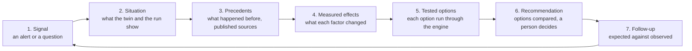
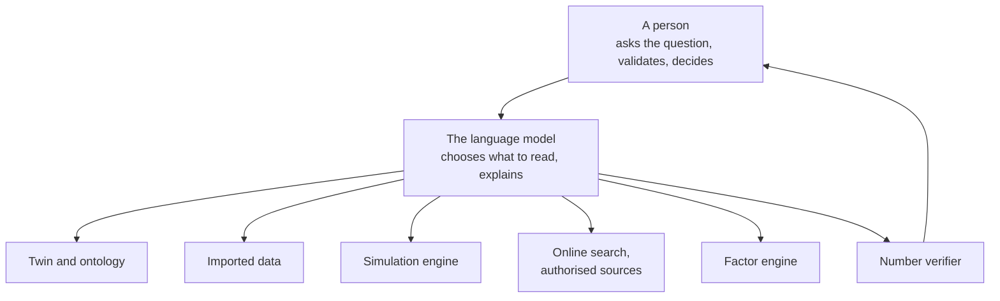

---
# The English of docs/decision-loop.md. When that page changes, bring this one up to date, then run `npm run docs:stamp`.
title: "The decision loop"
description: "Obscyro does not decide. It helps a person decide, by showing what is measured, what has been tried and what each option would change."
source: "docs/decision-loop.md"
translatedFrom: "959d3fc79342e910"
---

Obscyro does not decide. It helps a person decide, by showing what is measured, what has been tried and what each option would change, leaving nothing to chance.

The loop holds for any health event, not only an epidemic: a heat wave, an outage, a strike, a shortage.

## The seven steps

## Who does what

The model orchestrates and explains. Facts come from tools; arithmetic, from a calculator; the decision, from a person.

## Where it stands

| Step | State | Where |
|---|---|---|
| 1. Signal | **Delivered**: an alert reaches every page of the Studio. Thresholds are evaluated every five seconds, the shell reads a single alert feed every three seconds, a banner announces what has just opened, and one click leads to the unit or to the signal. The Response board refreshes on its own. Each alert says how old its value is, and what that age is worth. **Verified in production** on 2026-11-19; the measured delay is under the table. The alert does not offer a response yet: [issue 13](https://github.com/V1ktor7/obscyro/issues/13) and the ones after it. Still open: the Response board is buried under the signals of alerts that have cleared ([issue 18](https://github.com/V1ktor7/obscyro/issues/18)), and the age shown is that of the whole unit, at some hours a floor or an unknown ([issue 19](https://github.com/V1ktor7/obscyro/issues/19)) | [Algorithms](/docs/product/algorithms), D5 |
| 2. Situation | **Delivered and verified in production** with the real model: the analyst, Ask tab. Thirteen reference questions pass twice in a row | [The analyst](/docs/product/analyst) |
| 3. Precedents | **Delivered and verified in production** with the real model: Event finder tab. Online search in the sources the project authorises, candidates with a link and a quoted passage, accepted or rejected by a person, a calendar on the timeline that the analyst reads (`list_events`). The search was verified on 2026-11-17. Acceptance, the timeline lane and the analyst's citation were verified on 2026-11-20: the curfew and the school closure, accepted in the demonstration project, appear on the timeline of the Omicron scenario, and the analyst cites them with their link when asked what was happening at the peak of admissions. An event is a dated marker: it is tied to no territory and does not enter the engine | [The analyst](/docs/product/analyst), [Algorithms](/docs/product/algorithms), A10 |
| 4. Measured effects | To do. The measuring pieces exist (lags, replication across episodes) without being connected | [Algorithms](/docs/product/algorithms), C3 |
| 5. Tested options | **Delivered and verified in production** with the real model: Options tab. Up to three options per objective, each run through the engine on the server, with the same figures as the page (held by a test). Options made of capacity and measures only; an option can replace or remove a choice the scenario already holds | [The analyst](/docs/product/analyst), [Algorithms](/docs/product/algorithms), A4 and A8 |
| 6. Recommendation | **Delivered and verified in production**: the scenario as it is beside each option, levels of evidence assigned by the program, the mechanism in one sentence, trade-offs left to the person, no ranking. The option enters the scenario on a click | [The analyst](/docs/product/analyst), [Algorithms](/docs/product/algorithms), A8 |
| 7. Follow-up | **Partly delivered, and verified in production**: the decision is recorded with the figures of the tested run, and its expected arrivals are compared with the observed series linked to the scenario. Only arrivals can be compared: the twin has no history of queues or of occupancy | [The analyst](/docs/product/analyst), [Algorithms](/docs/product/algorithms), A6 and A9 |

Putting the analyst into service ([issue 5](https://github.com/V1ktor7/obscyro/issues/5)) is done: key set, end-to-end test, reference questions, the page's guide, two engine defects fixed.

**This table is updated at the end of every issue.**

### The delay of an alert, measured

Measured in production on 2026-11-19 on the demonstration project, whose data arrives once an hour. Eleven alerts opened over three arrivals (14:46, 15:46 and 16:47 UTC).

| From the moment… | to the moment… | Measured | Bound by construction |
|---|---|---|---|
| the data is written here | the alert is open | 0.1 to 3.1 s, median 2.1 s (11 alerts, `created_at - written_at`, to the second) | 5 s of waiting, plus one evaluation (0.4 to 0.7 s measured) |
| the alert is open | its signal is raised | 0.02 to 0.14 s, median 0.11 s (11 alerts). Before: median 2.3 s, 14.3 s at the 95th percentile (436 alerts over seven days) | one pass of the bridge |
| the alert is open | it is on screen | the feed is read every 3.0 s (ten intervals between 2.99 and 3.01 s), each read taking 0.11 to 0.41 s (12 reads): 3.4 s at most | 3 s, plus one read |
| the data is written here | the alert is on screen | 6.5 s at most, adding the two worst cases measured | a little over 9 s |

What these figures do not say, and has to be read with them:

- **The total is a sum of two measurements, not a stopwatch.** The server's share is measured on every alert. The screen's share is its reading cadence. The banner appearing on a real alert was not observed live: the observation machine was asleep at all three arrivals. When it woke, the badge and the Response board updated on their own (2,752, then 2,754, then 2,755 signals, with no click on “Refresh”).
- **That sleep showed a defect, fixed since.** A screen that woke up did not announce what had opened while it was away: the counter changed, without saying which alert. It now announces it, with its delay.
- **Seeing quickly is not seeing a fresh value.** This delay is the time we take to see a threshold crossed once the data has arrived. The source itself publishes once an hour. And the age shown is not yet that of the value, for two reasons noted that day. It changes during the day with what the source publishes: at 14:37 UTC, none of the 44 open alerts had an exact age (19 floors, “at least 2 h”, and 25 unknowns, an unreadable timestamp); at 16:58 UTC, all 48 had one. And it is the age of the whole unit: an alert on stretchers showed 119 minutes when the stretcher reading was 14 minutes old, because the air-quality reading of the same unit was older. The screen says what it knows, without rounding it towards the reassuring; understanding the first reason and fixing the second is [issue 19](https://github.com/V1ktor7/obscyro/issues/19).
- **Eleven alerts, one day, one project.** The evaluation takes 0.4 to 0.7 s on this twin. On a twin where it would take more than 2.5 s, the evaluator spaces its passes out by itself (twice the duration of the last one, 30 s at most) and writes it to the service log: the delay then grows, and it can be read on each alert.

## Order of construction

1. Put the analyst into service and make it reliable: [issue 5](https://github.com/V1ktor7/obscyro/issues/5). **Done.** Next: replay the reference questions with a command, without a browser ([issue 10](https://github.com/V1ktor7/obscyro/issues/10)): delivered, the server does the run and the script asks for the key in the terminal. Launched against production on 2026-11-20: 22 right answers out of the 24 received, then the analyst's Claude account ran out of credit. Six questions remain to be replayed.
2. Options tested by the engine, recommendation, recorded decision: [issue 6](https://github.com/V1ktor7/obscyro/issues/6). **Done.** Next: the test of an option shortened by one pass, and its duration measured ([issue 8](https://github.com/V1ktor7/obscyro/issues/8), **done**), letting an option replace or remove a choice of the scenario ([issue 9](https://github.com/V1ktor7/obscyro/issues/9), **done**: the “Apply to scenario” click was exercised in production on 2026-11-20, a single stamp in the recipe and Run equal to the test, then the demonstration scenario put back as it was).
3. Validated online search and the calendar of events: [issue 7](https://github.com/V1ktor7/obscyro/issues/7). **Done.** Next: reduce the token cost of a search ([issue 11](https://github.com/V1ktor7/obscyro/issues/11), **done**: from 296,536 to 111,650 tokens on the reference request, from $1.05 to $0.71).
4. Live: from the alert to the decision in one click. Six issues, in this order.
   1. The alert reaches every page, with a link to its unit: [issue 12](https://github.com/V1ktor7/obscyro/issues/12). **Done.** Next: keep the Response board readable when alerts close by themselves ([issue 18](https://github.com/V1ktor7/obscyro/issues/18)), give each alert the age of its own value ([issue 19](https://github.com/V1ktor7/obscyro/issues/19)).
   2. A situation sheet opens from an alert, with the analyst inside: [issue 13](https://github.com/V1ktor7/obscyro/issues/13).
   3. Responses prepared per type of signal, committed with one click: [issue 14](https://github.com/V1ktor7/obscyro/issues/14).
   4. The prepared responses retested on the state of the moment, as soon as an alert opens: [issue 15](https://github.com/V1ktor7/obscyro/issues/15).
   5. The two option engines brought together, recorded responses and stamps: [issue 16](https://github.com/V1ktor7/obscyro/issues/16).
   6. The follow-up of a decision attached to its signal: [issue 17](https://github.com/V1ktor7/obscyro/issues/17).
5. After that, with no issue yet: the twin's history (reading the network at a past date), the factor engine, stocks and the allocation of scarce resources, staff in the twin.

### Why live comes before the rest

In health care there is not always time to click. Today, going from an alert to a tested option takes about ten clicks and several minutes: changing page, finding the unit, building a scenario, writing an objective, waiting for the engine. This work reverses the order of the job.

| | In calm times | Live |
|---|---|---|
| What you do | Build events, test responses, keep the ones that hold | Recognise the situation, confirm a response already tested |
| Where | Scenarios, Events, Profiles | A situation sheet, opened with one click from the alert |
| What the language model does | Proposes and explains options | Prepares the sheet in the background and answers questions; never on the path of a click |
| What the engine does | Tests each response | Retests the prepared responses on the state of the moment |

Three things do not change. A person decides: the decision becomes one click because the work was done beforehand, not because the system decides. Every live figure carries its age, because acting fast on old data is the real danger. And Obscyro records and follows a decision; it triggers nothing in the institution's systems.

## What makes the loop general

**One sheet per type of event.** It says: the signals that announce it, its dynamics, the gates it touches, the possible levers, the evidence available, the objective to hold.

**Four gates.** Every event touches the network through one of them:

| Gate | What changes | Example |
|---|---|---|
| Demand | More people need care | Epidemic, heat wave |
| Capacity | Less to care with | Outage, strike, closed beds |
| Access | Care can no longer be reached | Road cut, flood |
| Care | Each patient needs more, or for longer | A more severe strain |

**Five families.** Contagious, exposure, sudden shock, capacity failure, slow drift.

**Two speeds.** Preparation, when there is time to try; live, when the event is here.

**Three levels of evidence**, never mixed on screen:

| Level | What it is |
|---|---|
| Measured | Read from the twin or the network's data |
| Published | Taken from an official source, with its link |
| Assumption | Set by the person or by the scenario, and said to be so |

**An unknown event** follows the same path: one says through which gate it enters, runs it through the engine, and everything that is not measured is marked as an assumption.

## Allocating scarce resources

Medicines, vaccines, open beds: two kinds of resources, what treats and what prevents. The twin will have to hold their stocks, and the engine compute what an allocation changes. **Who goes first is a choice of values: it belongs to a person**, and the tool presents it as such instead of settling it.

## The rules

1. No figure without a tool or a source.
2. The model reads and explains; a person decides.
3. What the AI writes is a proposal, validated by a click.
4. A run is not a forecast.
5. The system follows the network, never people.
6. “It worked in the past” is not enough: an option is tested in the engine, under today's conditions, and its mechanism is explained.
7. A decision is recorded with the result expected of it, to be set against what happens.
