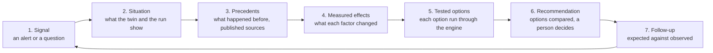
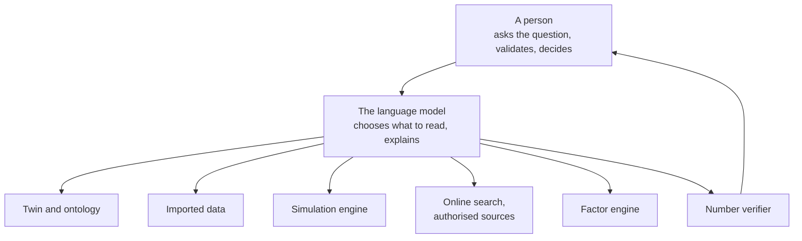

---
# The English of docs/decision-loop.md. When that page changes, bring this one up to date, then run `npm run docs:stamp`.
title: "The decision loop"
description: "Obscyro does not decide. It helps a person decide, by showing what is measured, what has been tried and what each option would change."
source: "docs/decision-loop.md"
translatedFrom: "e43aa25ceab2de88"
---

Obscyro does not decide. It helps a person decide, by showing what is measured, what has been tried and what each option would change, leaving nothing to chance.

The loop holds for any health event, not only an epidemic: a heat wave, an outage, a strike, a shortage.

## The seven steps

## Who does what

The model orchestrates and explains. Facts come from tools; arithmetic, from a calculator; the decision, from a person.

## Where it stands

| Step | State | Where |
|---|---|---|
| 1. Signal | **Delivered**: an alert reaches every page of the Studio. Thresholds are evaluated every five seconds, the shell reads a single alert feed every three seconds, a banner announces what has just opened, and one click leads to the unit or to the signal. The Response board refreshes on its own. Each alert says how old its own value is, from what its measure reads and not from the whole unit, and what that age is worth. From the writing of a piece of data to its alert on screen: a little over nine seconds at worst. A signal that opens has the responses prepared for its kind retested on the current state (step 6). The Response board shows first what needs somebody: the signals of alerts that cleared and that nobody has touched are set apart, always counted, and close in a batch with a reason; an acknowledgement holds for as long as the condition holds. Still open: a signal's card keeps the figure of the moment it was raised, without saying so ([issue 33](https://github.com/V1ktor7/obscyro/issues/33)); a measure whose source declares no time, such as wastewater, has an unknown age ([issue 34](https://github.com/V1ktor7/obscyro/issues/34)) | [Algorithms](/docs/product/algorithms), D5 |
| 2. Situation | **Delivered**: the analyst, Ask tab. Twenty reference questions say what a good answer must contain. It also reads live: what is open now, and the figures of a unit as its page shows them, each with its age. A unit's sheet and the inspector of the network map give, for each measure, the change since the reading kept before; a figure of the day before is said to be one, with its 30-day mean; a measure without a value says why; and the source of the figures is written, from the twin's own text. An alert, a signal or a unit opens a situation card: the live figures with their age, the alert, the stage of the signal and a question already written for the analyst, readable even when it is switched off. The analyst is one click away on every page of the Studio | [The analyst](/docs/product/analyst) |
| 3. Precedents | **Delivered**: Event finder tab. Online search in the sources the project authorises, candidates with a link and a quoted passage, accepted or rejected by a person, a calendar on the timeline that the analyst reads (`list_events`). An event is a dated marker: it is tied to no territory and does not enter the engine | [The analyst](/docs/product/analyst), [Algorithms](/docs/product/algorithms), A10 |
| 4. Measured effects | To do. The measuring pieces exist (lags, replication across episodes) without being connected | [Algorithms](/docs/product/algorithms), C3 |
| 5. Tested options | **Delivered**: Options tab. Up to three options per objective, each run through the engine on the server, with the same figures as the page (held by a test). An option is made of capacity, measures, transfers of patients or a recorded response (those of the Events page and those of the engine), tested by the same run; it can replace or remove a choice the scenario already holds. When the twin declares a price list, a capacity is tested in a mode (normal, rush), and a day the mode's delay does not allow is refused | [The analyst](/docs/product/analyst), [Algorithms](/docs/product/algorithms), A4, A8 and A12 |
| 6. Recommendation | **Delivered**: the scenario as it is beside each option, levels of evidence assigned by the program, the mechanism in one sentence, trade-offs left to the person, no ranking. Each option is read on three counts: what it changes, the day it can be ready, what it costs. The cost comes from two places: what the engine counted for a recorded response, and what the twin's price list gives for the capacity opened, line by line, in whole cents, with its source or the “demo price” mark. A click on a cost opens its lines. An option that costs as much or more than another for as much or more waiting is marked as dominated, from the runs; those no other beats on both counts are marked too, without being ranked among themselves, and no score mixes waiting and money. Limits: only the capacity opened is priced, not a measure nor a transfer ([issue 39](https://github.com/V1ktor7/obscyro/issues/39)); the cost is that of the choices, not that of the network; a twin with no price list has no price. The option enters the scenario on a click. A tested option can be kept as a prepared response for a kind of signal; the situation card of a signal of that kind shows it with the figures of its test and what it is worth today, and one click engages it. As soon as a signal opens, the engine retests every response prepared for its kind on the network as it is, without a language model; the card shows that result in place of the kept test, with the time of the test. The retest starts when the signal opens only: not yet on request ([issue 26](https://github.com/V1ktor7/obscyro/issues/26)) | [The analyst](/docs/product/analyst), [Algorithms](/docs/product/algorithms), A8, A9, A11 and A12 |
| 7. Follow-up | **Partly delivered**: the decision is recorded with the figures of the tested run, the expected cost and the prices it was counted from, and can be taken on a signal, which it moves one stage forward; and its expected arrivals are compared with the observed series linked to the scenario. On a signal's situation card, the decision is read back with what was measured afterwards: the measure that raised the signal at the decision, then the lowest, the highest and the last reading, the delay between the signal and the decision, what became of the alert, and what the tested run gave. Measured and expected are set side by side and never subtracted: the run and the twin do not count the same thing. The threshold editor gives, by rule, the share of signals closed as false positives. Limits: a change measured after a decision is not its effect; the history starts on 22 November 2026 | [The analyst](/docs/product/analyst), [Algorithms](/docs/product/algorithms), A6, A9 and D11 |

Putting the analyst into service ([issue 5](https://github.com/V1ktor7/obscyro/issues/5)) is done: key set, end-to-end test, reference questions, the page's guide, two engine defects fixed.

**This table is updated at the end of every issue.**

## Order of construction

1. Put the analyst into service and make it reliable: [issue 5](https://github.com/V1ktor7/obscyro/issues/5). **Done.** Next: replay the reference questions with a command, without a browser ([issue 10](https://github.com/V1ktor7/obscyro/issues/10)), **done**: the server does the run, the script asks for the key in the terminal, and the whole set passes twice in a row against production.
2. Options tested by the engine, recommendation, recorded decision: [issue 6](https://github.com/V1ktor7/obscyro/issues/6). **Done.** Next: the test of an option shortened by one pass, and its duration measured ([issue 8](https://github.com/V1ktor7/obscyro/issues/8), **done**), letting an option replace or remove a choice of the scenario ([issue 9](https://github.com/V1ktor7/obscyro/issues/9), **done**).
3. Validated online search and the calendar of events: [issue 7](https://github.com/V1ktor7/obscyro/issues/7). **Done.** Next: reduce the token cost of a search ([issue 11](https://github.com/V1ktor7/obscyro/issues/11), **done**).
4. Live: from the alert to the decision in one click. Six issues, in this order.
   1. The alert reaches every page, with a link to its unit: [issue 12](https://github.com/V1ktor7/obscyro/issues/12). **Done.** Next: keep the Response board readable when alerts close by themselves ([issue 18](https://github.com/V1ktor7/obscyro/issues/18)), **done**; give each alert the age of its own value ([issue 19](https://github.com/V1ktor7/obscyro/issues/19)), **done**; undo an acknowledgement and reopen a signal closed in a batch ([issue 32](https://github.com/V1ktor7/obscyro/issues/32)); say on a signal's card the value now and the value when it was raised ([issue 33](https://github.com/V1ktor7/obscyro/issues/33)); read the age of alerts one morning and give an age to the readings that declare none ([issue 34](https://github.com/V1ktor7/obscyro/issues/34)).
   2. A situation card opens from an alert, with the analyst inside: [issue 13](https://github.com/V1ktor7/obscyro/issues/13). **Done.** Follow-up done: the overview of the twin says that a unit can hold its capacity through its sub-units, apart from what is missing ([issue 21](https://github.com/V1ktor7/obscyro/issues/21)). Follow-up to do: say likewise that a unit holding only readings is not a site without capacity ([issue 23](https://github.com/V1ktor7/obscyro/issues/23)).
   3. Responses prepared per kind of signal, engaged with one click: [issue 14](https://github.com/V1ktor7/obscyro/issues/14). **Done.** Next: also keep a response of the Events page ([issue 22](https://github.com/V1ktor7/obscyro/issues/22)).
   4. The prepared responses retested on the state of the moment, as soon as an alert opens: [issue 15](https://github.com/V1ktor7/obscyro/issues/15). **Done.** Next: retest a response on request, and when its card is opened again ([issue 26](https://github.com/V1ktor7/obscyro/issues/26)).
   5. The two option engines brought together, recorded responses and stamps: [issue 16](https://github.com/V1ktor7/obscyro/issues/16). **Done.** Follow-up: say in one sentence why a tool of the analyst refuses an input ([issue 27](https://github.com/V1ktor7/obscyro/issues/27)).
   6. The follow-up of a decision attached to its signal: [issue 17](https://github.com/V1ktor7/obscyro/issues/17). **Delivered.**
5. The twin's history: keeping the readings of each measure, by unit, and showing them on a unit's sheet ([issue 35](https://github.com/V1ktor7/obscyro/issues/35)). **Done.** Next, with no issue yet: have the situation card and the analyst read those readings, and keep the built-in counts too.
6. The ministry's open data, live. The full hourly emergency census, read by a sync, and all its figures on a unit's sheet and the inspector of the network map ([issue 36](https://github.com/V1ktor7/obscyro/issues/36)). **Done.** Next: say on an alert that a value is a figure of the day before ([issue 40](https://github.com/V1ktor7/obscyro/issues/40)); pause and resume a sync from the Studio ([issue 41](https://github.com/V1ktor7/obscyro/issues/41)); manage the twin's layers from the Studio ([issue 38](https://github.com/V1ktor7/obscyro/issues/38)), then the surgery waiting list by region, as a layer on the map ([issue 37](https://github.com/V1ktor7/obscyro/issues/37)).
7. After that, with no issue yet: reading the whole network at a past date (its objects, and not only its measures), the factor engine, stocks and the allocation of scarce resources, staff in the twin.

### Why live comes before the rest

In health care there is not always time to click. Today, going from an alert to a tested option takes about ten clicks and several minutes: changing page, finding the unit, building a scenario, writing an objective, waiting for the engine. This work reverses the order of the job.

| | In calm times | Live |
|---|---|---|
| What you do | Build events, test responses, keep the ones that hold | Recognise the situation, confirm a response already tested |
| Where | Scenarios, Events, Profiles | A situation sheet, opened with one click from the alert |
| What the language model does | Proposes and explains options | Prepares the sheet in the background and answers questions; never on the path of a click |
| What the engine does | Tests each response | Retests the prepared responses on the state of the moment |

Three things do not change. A person decides: the decision becomes one click because the work was done beforehand, not because the system decides. Every live figure carries its age, because acting fast on old data is the real danger. And Obscyro records and follows a decision; it triggers nothing in the institution's systems.

## What makes the loop general

**One sheet per type of event.** It says: the signals that announce it, its dynamics, the gates it touches, the possible levers, the evidence available, the objective to hold.

**Four gates.** Every event touches the network through one of them:

| Gate | What changes | Example |
|---|---|---|
| Demand | More people need care | Epidemic, heat wave |
| Capacity | Less to care with | Outage, strike, closed beds |
| Access | Care can no longer be reached | Road cut, flood |
| Care | Each patient needs more, or for longer | A more severe strain |

**Five families.** Contagious, exposure, sudden shock, capacity failure, slow drift.

**Two speeds.** Preparation, when there is time to try; live, when the event is here.

**Three levels of evidence**, never mixed on screen:

| Level | What it is |
|---|---|
| Measured | Read from the twin or the network's data |
| Published | Taken from an official source, with its link |
| Assumption | Set by the person or by the scenario, and said to be so |

**An unknown event** follows the same path: one says through which gate it enters, runs it through the engine, and everything that is not measured is marked as an assumption.

## Allocating scarce resources

Medicines, vaccines, open beds: two kinds of resources, what treats and what prevents. The twin will have to hold their stocks, and the engine compute what an allocation changes. **Who goes first is a choice of values: it belongs to a person**, and the tool presents it as such instead of settling it.

## The rules

1. No figure without a tool or a source.
2. The model reads and explains; a person decides.
3. What the AI writes is a proposal, validated by a click.
4. A run is not a forecast.
5. The system follows the network, never people.
6. “It worked in the past” is not enough: an option is tested in the engine, under today's conditions, and its mechanism is explained.
7. A decision is recorded with the result expected of it, to be set against what happens.
