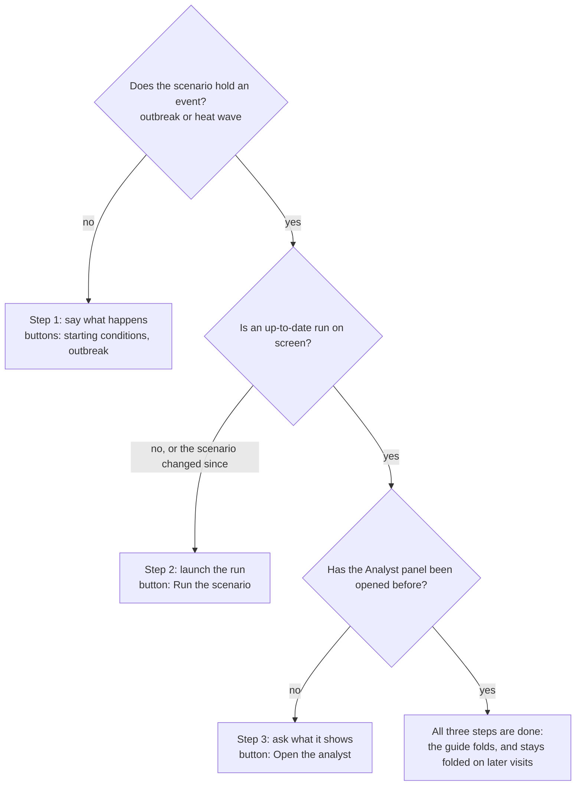

---
# The English of docs/scenarios-page.md. When that page changes, bring this one up to date, then run `npm run docs:stamp`.
title: "The Scenarios page"
description: "The map is the page. Everything else floats over it in panels that fold away."
source: "docs/scenarios-page.md"
translatedFrom: "881adf3b996233e5"
---

The map is the page. Everything else floats over it in panels that fold away (`OverlayPanel`, `frontend/app/studio/map-overlay.tsx`): never a side panel, and on arrival everything is folded except the guide on a first visit.

## What you do there, in three beats

The page is a sentence: say what happens, run it, ask what it shows. The **Start here** panel says where you are in that sentence, by reading the state of the page itself, and offers the button that does the next step.

**Rules.**
- Starting conditions alone are not enough to move to step 2: they describe a network on an ordinary day. An event is what gives something to run.
- A scenario edited after a run goes back to step 2: the result on screen no longer describes the scenario.
- Opening the analyst out of curiosity before launching a run does not skip step 2.
- The guide opens on the first visit. Once folded, by hand or because the three steps are done, it starts folded (key `obs_scenarios_guide_seen` in the browser). It stays available, on one line, for whoever wants to reopen it.
- Only the current step is detailed; the others show their title alone. Written in full, the three steps took more room than a 1366 × 768 laptop leaves under the toolbar, and the guide opened on a scrollbar.
- Its buttons carry their own names (“Run the scenario”, “Set starting conditions”): the toolbar already has a “Run” and a “Starting conditions”, and two controls with the same name are one too many for someone using a keyboard or a screen reader.

**Code.** `frontend/app/studio/simulation/hex/guide.ts` (the steps, without a map), `ScenarioGuide.tsx` (the display), wired into `HexTwinView.tsx`. **Tests.** `guide.test.ts`, `HexTwinView.test.tsx`.

## The panels

| Panel | Where | What it shows |
|---|---|---|
| Scenario bar | Top | The open scenario, the horizon, the activity read, the Run button |
| Tools | Top, centre | Inspect, starting conditions, outbreak, heat wave, measure, capacity |
| Start here | Left | The three-step guide |
| Layers | Left | What the map colours: occupancy, sick people, residents, added layers |
| Analyst | Left | Four tabs: questions and their answers (Ask), the search for events in official sources (Event finder), the options tested by the engine, each with its effect, its delay and its cost when the twin declares a price list (Options), the recorded decisions and their follow-up (Decisions): [The analyst](/docs/product/analyst) |
| Result | Right | The peak in both passes, where it breaks, the comparison with reality |
| Recipe | Right | The scenario's stamps, and what the engine receives for each. A recorded response is a stamp like the others there, filed with the measures: it enters through “Add to scenario” on an option of the analyst, and no tool of the bar places one by hand. A response of the library or a transfer can be moved from one day to another; a response the engine writes itself holds for the whole run |
| Timeline | Bottom | The day shown, the Context lane (the validated events, placed from the date of day 0; they are not stamps, the engine does not receive them), the stamp lanes, the occupancy curve |

What a run does, and how its results are read: [Algorithms](/docs/product/algorithms), sections A4 to A7.

## How it looks

The page follows the Studio's dark theme ([design/PALETTE.md](https://github.com/V1ktor7/obscyro/blob/main/design/PALETTE.md)). Three things are its own:

- **The basemap is dark** (`frontend/app/studio/map-style.ts`). Everything drawn on the map is chosen for that ground: a label has a dark halo, a site with no occupancy is an empty circle.
- **The ramps go from dark to bright.** The low end of the scale stays close to the ground and each step up is brighter: what stands out is what is high. Pressure keeps its hues: green under 90 %, yellow, orange, red, then magenta at 200 % and over. The values are in `HexTwinView.tsx` (`OCC_STEPS`, `SICK_STEPS`, `DENSITY_STEPS`) and `layers.ts`.
- **The pages of the Twin section are tabs above the map**, not a column beside it: the map keeps the full width.
