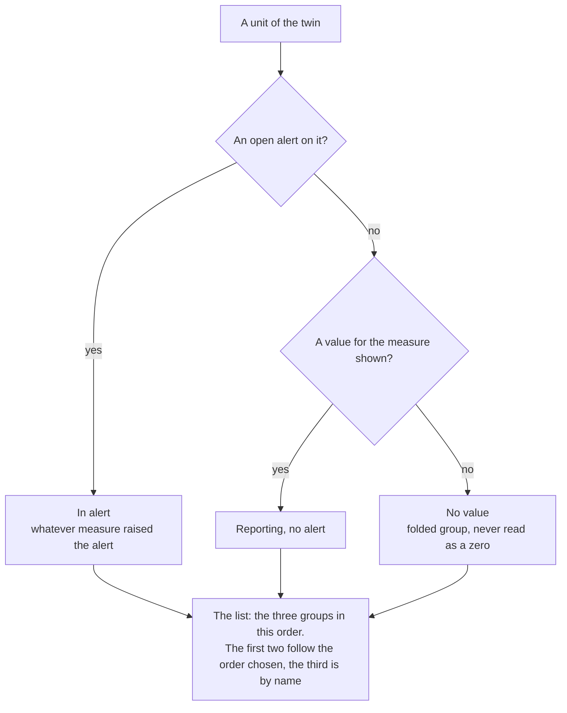

---
# The English of docs/units-page.md. When that page changes, bring this one up to date, then run `npm run docs:stamp`.
title: "The Units page"
description: "Every unit of the twin, live, ranked on one measure: the ones in alert first, and the sheet of the unit you pick beside the list."
source: "docs/units-page.md"
translatedFrom: "c7f14639218561fe"
---

Every unit of the twin, live, ranked on one measure. The page answers one question: which unit to read first. The ones in alert come first, the ones that report nothing for the measure chosen are folded away, and the sheet of the unit you pick stays beside the list.

It replaces a column of cards in no order, where four hundred units made a page thirty thousand pixels tall, with names cut short and a detail window that covered everything.

## Three states, never mixed

You choose a measure in the **Measure** menu: the ones the organisation defined, then four counts every twin has (linked objects, age of the data, patients, beds). Each unit is then in one state, and only one.

**Rules.**
- **The counters are the filters.** “All units”, “In alert”, “Reporting, no alert”, “No value”: the last three always add up to the first. A click on a counter keeps only its units.
- **An alert counts, whatever its measure.** A unit in alert on another measure stays in “In alert”, and its line reads “no value”. The group's heading adds “over the threshold” only if every unit in alert is past the threshold of the measure shown.
- **No value is not zero.** A unit that reports nothing for the measure is never put in the ranking: it goes into the folded group, which opens on a click and says that the unit may report another measure. A real zero is a value.
- **The colour comes from the alert rule.** A dot is red exactly when the rule that watches the measure would fire on the unit, yellow within 15% of the threshold, green short of it, grey when the measure has no threshold or the unit has no value. The rule read is the one for the unit's kind, as the alert evaluator does (D5).
- **The order.** Highest to lowest, the reverse, or by name. A unit with no value comes last in both directions: it is not the lowest, it is unknown.
- **The search** looks at the name and the code, without regard to capitals or accents. It opens the folded group when that group holds a result.
- **The bar** has one scale for the whole list, from zero to the largest figure, rounded. It does not change when you filter or search: two bars compare only on the same scale. A tick marks the unit's threshold.
- **A name is never cut.** If it is long, it runs onto two lines.
- **The kind of unit** (**Kind** menu) appears only if the twin has more than one. It narrows the list and the counters to that kind.

## When the twin has a hierarchy

If units contain other units, “All units” shows the top of the hierarchy, folded. A click on a unit unfolds what it contains; a second click on the unit you are reading folds it back.

- The value of a unit counts everything under it: that is the twin's own calculation, not a sum made by the page.
- A folded unit says how many units under it are in alert (“2 in alert below”). A closed branch does not hide an alert.
- Siblings are ranked in the order chosen.
- A counter other than “All units” gives a flat list again: a filter shows units, not branches.
- A search opens the path to each result and hides the rest.

## The tiles

The **Tiles** view draws one square per unit that has a value, to see the whole network at a glance. The colour has three steps past the threshold, by distance: up to 20% of the threshold, from 20 to 60%, more than 60%. A square close to the threshold is yellow, the others are neutral.

- When every unit has the same threshold, the legend writes its figures (“over 160%”, “over 120%”, “over the threshold, 100%”). When thresholds differ from one kind to another, it can only say the distance.
- With no threshold on the measure, the squares carry no colour, and the page says so.
- Units with no value are not drawn, and the page writes how many.

## The unit's sheet

It sits beside the list, and moves under it on a narrow screen. A click on another line replaces it: you compare without closing anything.

From top to bottom: the name, where the unit stands against its threshold, its value, the rule in words (“alert when over 100%”) and the age of that value; the history of that value over 48 hours; the age of the unit's oldest source and the number of linked objects; the open alerts, each with the age of its value; the other measures the unit reports; what it contains, by type; its exchanges with other units; the rule's recommendation.

- **Three ages, each one named.** Under the value: “This value was read 14m ago”, the age of what the measure shown reads. In each alert: “value read 14 min ago”, the age of the value that raised it, in the words of the banner. In the “Oldest source” box: the age of the whole unit, the oldest of all its sources, which answers “is everything I see here up to date?”. A unit that receives a stretcher census and an air quality reading can show 14 minutes for its occupancy and 2 hours for its oldest source: both are right ([Algorithms](/docs/product/algorithms), D7).
- **An age says what it is worth.** When it is a floor or it is unknown, the sheet writes why, in full, and says whether it is about the measure or the unit.
- **A value the twin did not date gets no sentence.** That is the case of the four counts every twin has: the sheet does not lend them the unit's age under another name.
- **The history of the value shown.** The twin writes its measures down every five minutes, when they change ([Algorithms](/docs/product/algorithms), D11). The sheet shows the last 48 hours of them: a staircase line, where each value holds until the next reading, the lowest and the highest written like the value above, and the date of the first reading kept (“The first reading of this value was kept 3 h ago. Nothing earlier is known.”). The line breaks where the measure had no value. As long as no reading is kept, the sheet writes so instead of drawing an empty chart. The counts every twin has are not kept, and the sheet says so. A history that cannot be read takes nothing away from the rest of the sheet.
- **An alert is handled from here.** “Open the situation” opens its situation card, “Acknowledge” acknowledges it. A unit with no alert keeps a link to its situation card.
- **“Ask the analyst”** opens the analyst with this unit: the question is about it.
- **Two readings.** The name, the value and the bar come from the list, and are on screen at the click. The rest is read for this unit alone, and read again at each new reading of the twin; meanwhile, the sheet writes “Reading this unit…”. It never shows one unit's alerts under another's name.
- **A link leads to a unit.** An alert or a signal opens the page with `?unit=`: the unit is chosen on arrival, and its line is brought on screen, the branch unfolded or the group opened if need be. If the project does not have that unit, the sheet says so.

## The other controls

- **Measures**: define what the twin measures. **Alert thresholds**: set the thresholds that raise an alert; the list takes its colours again when the editor closes. **Live metrics**: the project's counts, live.
- The chip says how the list keeps up to date. “Connecting”: the stream has been asked for, nothing has arrived through it yet. “Live stream”: the stream has delivered a reading, and the list follows the twin continuously. “Polling”: the stream failed six times in a row, and the list is read again every five seconds. The page writes “Live stream” only after a first piece of data received through the stream, never on the mere request.
- “Seed demo” is offered only on a project with no unit.

## Limits

- The ranking is on one measure at a time.
- The list and the tiles show the present state. The history is on the sheet, for the value shown only and over 48 hours. It starts the day the twin started writing its measures down: nothing earlier is known.
- The list and the tiles do not show the age of each value: it is read on the unit's sheet. The “age of the data” measure of the Measure menu is the age of the whole unit.
- A date with no hour gives an age to the day: it can be too large by a day at most, never too small.
- The measure and the kind chosen are kept per project, in the browser. The order, the view and the search are not.

**Code.** `frontend/app/studio/live/units-list.ts` (states, counters, order, search, hierarchy, scale, colours, with no screen), `UnitsBoard.tsx` (the two bands, the list, the tiles), `UnitSheet.tsx` (the sheet), `unit-history.ts` (the history of a value, with no screen), `UnitsView.tsx` (the readings: tree, measures, thresholds, detail, history); `twinMetricNumber` in `frontend/app/studio/twin-ui.ts`; `bandFor` in `frontend/app/studio/command/site-metric.ts`; `useOpenAnalyst` in `frontend/app/studio/AnalystDock.tsx`. **Tests.** `units-list.test.ts`, `unit-history.test.ts`, `UnitsBoard.test.tsx`, `UnitSheet.test.tsx`, `UnitsView.test.tsx`, `twin-ui.test.ts`, `AnalystDock.test.tsx`.
